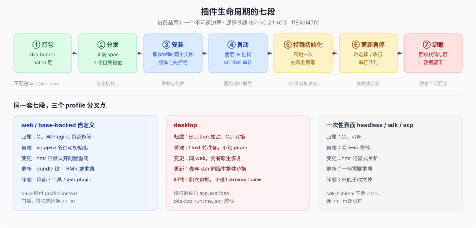

# Plugin lifecycle · 插件生命周期

## 一句话

一个插件要走完「打包 → 分发 → 安装 → 启动 → 一次性初始化 → 更新与启停 → 卸载」七段才算真正交付。语料其余专题按**运行时插件树**切分，于是每一段散落在不同专题的正文与脚注里；本专题把它们收在一处，并且只写段与段之间的接缝——谁在什么时刻写盘、哪一步不可逆、失败停在哪、什么数据会留下来。

## 为什么要单独立这一专题

`_digested/00-index.md` 自己写着「插件不是某个目录的主题，而是所有目录的底座」。这个切法对运行时机制是对的：fiber、waterfall、配置层各归各家。但它同时意味着**跨阶段流程没有家**。立题前的三个悬空问题：

| 问题 | 立题前的落点 | 现在 |
|------|--------------|------|
| 一个包凭什么成为插件？装进去时改了哪几个文件？ | 只有 `inventory/` 一行货架注脚 | [`01`](./01-打包.md) · [`03`](./03-安装.md) |
| 装坏一个插件，进程会死吗？半截的安装留下什么？ | 只有 boot 时序里的结算审计 | [`04`](./04-启动.md) 失败矩阵、[`03`](./03-安装.md) 失败表 |
| 插件卸载后，Session、workspace、设置还在不在？ | 无落点 | [`07`](./07-卸载与数据留存.md) |

## 七段与各自的不可逆边界

| # | 段 | 这一段结束后不可逆的东西 | 正文 | 深挖入口（机制在别的专题） |
|---|----|--------------------------|------|------------------------------|
| ① | **打包** | 包发布后 `name@version` 固定，作者改不了用户机器上的那一份 | [`01-打包.md`](./01-打包.md) | [`inventory/05`](../inventory/05-taxonomy-and-design.md) 的形态分类 |
| ② | **分发** | 包已在机器上，但还没有任何 profile 引用它 | [`02-分发.md`](./02-分发.md) | — |
| ③ | **安装** | profile 的 `dependencies` 与 `dsh.profile.bundles` 被改写 | [`03-安装.md`](./03-安装.md) | [`two-tree-runtime/framework/01`](../../two-tree-runtime/framework/01-五条原语对照源码.md) 的 fiber 与 inject |
| ④ | **启动** | 行被挂进活树，`ctx` 服务开始对外提供 | [`04-启动.md`](./04-启动.md) | [`composition/05`](../composition/05-启动窗口与首屏交接.md) 的启动窗口与首屏交接 |
| ⑤ | **特殊初始化** | 只跑一次的导入或版本戳写入完成，旧状态被改名、被接受或被拒绝 | [`05-特殊初始化.md`](./05-特殊初始化.md) | [`session-and-loop/04`](../../session-and-loop/04-格式世代与迁移.md) 的格式世代 |
| ⑥ | **更新与启停** | 选择列表顺序改变，配置优先级随之改变 | [`06-更新与启停.md`](./06-更新与启停.md) | [`composition/03`](../composition/03-user-patch-hmr.md) 的 HMR 事务 |
| ⑦ | **卸载** | 代码与 patch 层消失，数据留下 | [`07-卸载与数据留存.md`](./07-卸载与数据留存.md) | — |

这张表是**时间轴**；「深挖入口」一列是**结构轴**上的专题。两者不合并：时间轴回答「什么时候做什么」，结构轴回答「它到底怎么实现」。当某一段的机制正文超过三页时，那一段才值得在 `lifecycle/` 下开子目录；在那之前，深挖留在原专题，避免把两种轴混成一个目录。

08 与 09 是交叉章：08 讲「没有钩子时怎么自己造一次性动作」，09 讲「配置该落在哪一层」。两者不属于任何单独一段，但每段都会用到。

⑤ 是唯一与 ④ 交织的一段：profile 首建发生在 boot 之前，`settings.yaml` 导入在 Loader 结算之后，desktop 的运行树校验在 Host 起来之前。表里的顺序是**逻辑顺序**，不是时间顺序——每一段在自己的时点触发，只是它们共享同一条「只跑一次」的判据。

这条切法与仓库自己的两条纪律同源：把正确性写进结构（显式生命周期、显式条件）而不是事后补偿，以及一个事实只有一个家（[`docs/defensive-patterns/README.md`](../../../docs/defensive-patterns/README.md) 的五条习惯）。前一条解释了为什么每一段都有可判定的边界，后一条解释了本专题为什么要存在。

一条贯穿全部七段的判据（本专题的归纳，不是某份文档的原话）：**DSH 只在它拥有所有权的边界上做准入与撤销**。版本门在写依赖之前拒绝（③），行不合法就在挂树前拒绝（④），运行中的替代靠 effect 撤销（④），代码移除不动数据（⑦）。越过这些边界的后果由插件自己承担。

## 卡在哪一段：定位表

七段的价值不只是分类，还在于把一个模糊的「插件没生效」拆成可判定的位置。

| 症状 | 先查 | 依据 |
|------|------|------|
| 装了，但 Plugins 页里没有 | 包没有 `dsh.bundle` 声明，被当成普通依赖 | [`02`](./02-分发.md) 的 `not-a-bundle` |
| 在列表里，但行没有激活 | 版本门拒绝了它；看 `incompatible-version` 与 `compatibility.json` | [`03`](./03-安装.md) · [`04`](./04-启动.md) |
| 行挂上了，服务不可用 | fiber 停在 `PENDING`，缺一个 provider | [`04`](./04-启动.md) |
| 改了配置不生效 | `hmr` 行被关断、`appReady` 缺失，或这是 startup-only 的 profile | [`05`](./05-特殊初始化.md) · [`06`](./06-更新与启停.md) |
| 卸载了，数据还在 | 没有数据卸载契约，这是默认行为 | [`07`](./07-卸载与数据留存.md) |

## 三个 profile 分叉点

生命周期不是 profile 无关的。同一套七段，三个面各有分叉：

| 维度 | web 与 base-backed 自定义 profile | desktop | 一次性表面（headless / sdk / acp） |
|------|-----------------------------------|---------|-------------------------------------|
| profile 归属 | CLI 与 Plugins 页都能管 | Electron 独占，CLI 双向拒绝 | CLI 可管 |
| 首次创建 | shipped 名自动初始化；自定义名走 `--from-default-profile` 或 `dsh plugin` | 壳在 Host 启动前准备，不改已装包、不跑 pnpm | 同左列 |
| 运行期变更 | base 的 `hmr` 行默认开配置重载，写盘即时生效 | 同左列，另有原生恢复 | `hmr` 行显式关断，改了要重启 |
| 更新 | bundle 级更新 + HMR 或重启 | 应用整体替换：壳与 dsh 恒为同一精确版本 | 一律重启 |
| 卸载 | Plugins 页 / `plugin_manager` / `dsh plugin remove <pkg>` | 应用卸载删 Electron 数据，**永不碰 Harness home** | `dsh plugin remove <pkg>`；无进程内管理面 |

`sdk-minimal` 是第四种：它不叠 `dsh-base`，于是连 `hmr` 行都没有。

## 与其他专题的分工

| 问题 | 去哪 |
|------|------|
| fiber 状态机、effect 撤销顺序、waterfall 合同 | [`two-tree-runtime/framework/`](../../two-tree-runtime/framework/00-map.md) |
| 配置层顺序、dump 保真、patch 算法 | [`composition/`](../composition/00-map.md) |
| 每个 profile 出厂带哪些插件 | [`runtime-profiles/`](../../runtime-profiles/00-map.md) |
| 现成插件有什么、能不能直接复用 | [`inventory/`](../inventory/00-map.md) |
| 一个能力怎么换实现而不改调用方 | [`capability-seams/`](../../capability-seams/00-map.md) |
| 插件作者要交什么测试证据 | [`test-strategy/08`](../../test-strategy/08-plugin-testing.md) · [`09`](../../test-strategy/09-plugin-testing-playbook.md) · [`10`](../../test-strategy/10-plugin-testing-checklist.md) |
| **装 / 更 / 卸 / 首启的机制与失败语义** | **本专题** |

本专题不重写配置层顺序与 dump 保真，只链接 [`composition/`](../composition/00-map.md)；不重写 fiber 状态机，只链接 [`two-tree-runtime/framework/01`](../../two-tree-runtime/framework/01-五条原语对照源码.md)。

## 阅读路径

- 想知道「我写的包怎么变成用户机器上的一行插件」→ [`01`](./01-打包.md) → [`02`](./02-分发.md) → [`03`](./03-安装.md)
- 想知道「装坏了会怎样、会不会把进程打死」→ [`04`](./04-启动.md) 的失败矩阵，再看 [`03`](./03-安装.md) 的失败表
- 想知道「升级 DSH 之后插件的旧数据还认不认」→ [`05`](./05-特殊初始化.md) → [`07`](./07-卸载与数据留存.md)
- 想知道「为什么在 Plugins 页点一下，配置就变了」→ [`03`](./03-安装.md) → [`06`](./06-更新与启停.md)
- 想知道「没有 first-run 钩子时，首启该怎么做」→ [`08`](./08-首启与产品初始化.md)
- 想知道「这个配置值该写在哪一层」→ [`09`](./09-配置与设置面.md)
- 想知道「从零到跑起来最短要几步」→ [`12`](./12-从零到一个能跑的插件.md)
- 想知道「插件没生效到底卡在哪」→ [`10`](./10-诊断地图.md)
- 想知道「谁能在哪执行代码、sandbox 到底管不管插件」→ [`11`](./11-信任与执行边界.md)

## 源码入口

| 路径 | 角色 |
|------|------|
| `packages/util/package-manifest/src/types.ts` | `DshBundleManifest` / `DshProfileManifest`：两个 manifest 的类型真源 |
| `packages/boot/app-boot/src/profile.ts` | `bundlePatchFiles`、`initProfile`、`PROFILE_TEMPLATES`、`OPTIONAL_BUNDLES`、`loadProfile`、`loadProfileDirectory` |
| `packages/boot/app-boot/src/official-bundle-packages.ts` | `ON_DEMAND_BUNDLES` 与官方按需目录 |
| `packages/boot/app-boot/src/plugin-compatibility.ts` | `engines.dsh` / peer 准入判定，不导入插件代码 |
| `packages/boot/app-boot/src/profile-compatibility.ts` | `compatibility.json` 的读取与豁免写入 |
| `packages/boot/app-boot/src/compatibility-preflight.ts` | 组合期逐行准入，拒绝的行变成 detached `disabled: true` |
| `packages/boot/app-boot/src/index.ts` | `boot`（`:1200`）、`recomposeProfile`（`:307`）、`reconcileProfilePatches`（`:322`）、`auditStartupEntries`（`:1153`） |
| `packages/boot/plugin-manager/src/index.ts` | `listBundles` / `installBundle` / `removeBundle` / `setBundleEnabled` |
| `apps/cli/src/plugin.ts` | `dsh plugin`：初始化 profile、跑 pnpm、按已安装状态对账 bundles |
| `apps/desktop/src/project-manager.ts` | desktop profile 准备与原生恢复（`sanitizeProfile`） |
| [`packages/boot/app-boot/README.md`](../../../packages/boot/app-boot/README.md) | profile 机器合同与启动/重载失败表 |
| [`packages/boot/plugin-manager/README.md`](../../../packages/boot/plugin-manager/README.md) | 安装、更新、移除的操作语义与失败表 |

> 承重词按 [`canon/GLOSSARY.md`](../../canon/GLOSSARY.md) 的 DSH 原文用；本页自己的分类与指标不是 DSH 的词。
