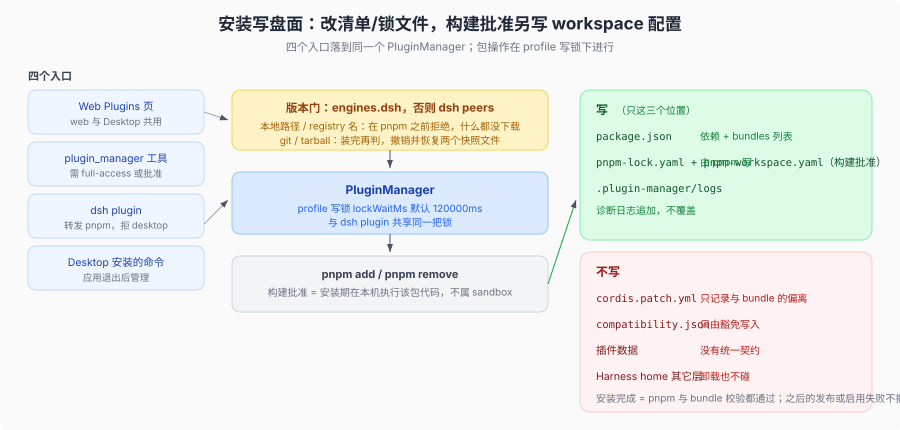

# 安装：写盘的那一步

## 一句话

安装只改 profile 的两个文件：`package.json`（依赖 + `dsh.profile.bundles`）和 `pnpm-lock.yaml`。它**不写**用户的 `cordis.patch.yml`，不碰任何插件数据，也不碰 Harness home 的其它层。所以「装上」与「启用」是两件事，「装上」与「配置」也是两件事。

## 四个入口，同一套操作

| 入口 | 谁在用 | 边界 |
|------|--------|------|
| Web **Plugins** 页 | 所有人（web 与 Desktop 共用同一个页面） | 只能管当前 profile |
| `plugin_manager` 工具 | Creator 预设；其它预设默认关 | 每次调用需要 `danger-full-access` 或单次批准 |
| `dsh plugin --profile <name> <pnpm args>` | 终端、脚本、CI | 直接转发给 pnpm，`desktop` 被拒 |
| Desktop 安装的命令 | 应用退出后管理 desktop profile | npm 装的 `dsh` 命令不能改这个 profile |

页与工具落到同一个服务：`PluginManager`（`packages/boot/plugin-manager/src/index.ts:207`）。工具面只是它的薄包装：一个 `plugin_manager` 工具、八个 action（`packages/boot/plugin-manager/src/tools.ts:89` 的枚举 `list_plugins` / `list_bundles` / `set_plugin` / `set_bundle` / `install_bundle` / `remove_bundle` / `list_version_exemptions` / `set_version_exemption`），分派在 `:112`–`:153`；Desktop 的命令走同一批 HTTP 路由。

`dsh plugin` 是另一条实现路径：它在**另一个进程**里调用同一套包操作模块（`src/operations.ts`），不经过服务。两条路径不共享内存，只共享 profile 写锁，所以并发保护靠锁而不是靠服务状态。

## 写什么，不写什么

| 文件 | 安装时 | 启停时 | 卸载时 |
|------|--------|--------|--------|
| `<profile>/package.json` | 加 `dependencies` 条目；把 bundle 追加到 `dsh.profile.bundles` 末尾 | 改 `dsh.profile.bundles` 的有序列表 | 删依赖、移出列表 |
| `<profile>/pnpm-lock.yaml` | pnpm 写 | 不动 | pnpm 写 |
| `<profile>/cordis.patch.yml` | **不动** | 行级开关写这里 | **不动** |
| `<profile>/compatibility.json` | **不动** | **不动** | **不动** |
| `<profile>/.plugin-manager/logs/` | 追加诊断日志 | 同上 | 同上 |

`cordis.patch.yml` 不动的理由与配置优先级有关：bundle 层是出厂组合，用户 patch 只记录「与 bundle 的偏离」。行级开关确实会写这个文件，但那属于启停，见 [`06-更新与启停.md`](./06-更新与启停.md)。

## 版本门在哪一步拒绝

同一个准入门在两条路径上的位置不同（`packages/boot/plugin-manager/README.md` 的版本兼容节）：

| 通道 | 判定时机 | 拒绝的后果 |
|------|----------|------------|
| 本地路径、registry 名字 | **pnpm 之前** | 什么都没下载、没跑构建脚本 |
| git、tarball | **安装之后**（要先取到 `package.json`） | 恢复 manifest 与 lockfile，并用恢复后的 lockfile 重装 |

也就是说 registry 通道的拒绝是干净的，git 通道的拒绝是「撤销式」的，而已允许过的构建脚本副作用可能留下。请求里带的 `enabled: false` 同样要过这道门。

被拒绝的行在启动时另有处理：启动期准入独立执行一次（[`04-启动.md`](./04-启动.md)）。一次安装里**没有改动**的坏依赖不会阻塞无关操作——那次安装只记一条点名它的 warning，把它拒之门外的是**启动**，不是安装。

## 精确豁免

`compatibility.json` 是 profile 自己的文件，与 `package.json`、`cordis.patch.yml` 并列（`packages/boot/app-boot/src/profile-compatibility.ts:10` 的 `PROFILE_COMPATIBILITY_FILENAME`）。它把**精确**的 `name@version` 映射到一组**精确**的运行时版本（`:99` 的 `readProfileVersionExemptions`）。

三条设计后果：

1. **豁免不随升级继承**。插件升级或 DSH 升级都换掉 key 或值，旧授权自动失效。
2. **写豁免不改依赖、不改选择、不改 patch 层**。它只影响准入门。
3. **文件坏了不阻塞启动**。读取端接受的记录照常生效，被拒的记录报到 stderr，文件随即被当作只读——此时授权与撤销都会拒绝，并提示用户手工修，而不是覆盖用户内容（`:125`–`:129`）。

授予需要显式确认风险，`plugin_manager` 的 `set_version_exemption` 要求 `acceptRisk: true`；CLI 对应 `dsh plugin --profile 
 allow-version`。授权生效时机跟着组合走：活 profile 会重组合并当场挂载，startup-only 的 profile 要重启。

## 失败表

失败处理的原则是「保留已完成的步骤，报告真实剩余状态」：

| 失败的操作 | 处理 |
|------------|------|
| Install：pnpm 或 bundle 校验失败 | 把 `package.json` 与 `pnpm-lock.yaml` 恢复到 pnpm 运行前的快照；**pnpm 已下载的文件可能留下** |
| Enable：保存选择或加载失败 | 保留已装依赖与已保存的选择；报告启用失败，允许修复、禁用或移除 |
| 包操作成功但 resolution 发布失败 | 保留磁盘改动与上一版运行时表，报告 `application: 'failed'`；pnpm 退出码 0 不等于发布成功 |
| Remove：任一步失败 | 停在失败步，保留已完成改动，保留剩余依赖供重试，**不重新启用该 bundle** |

安装的完成条件是 pnpm 与 bundle 校验都通过；**之后的发布或启用失败不会撤销安装**。这条不对称是刻意的：撤销一个已经落盘的安装比报告一次半完成更危险。

## 写锁

profile 是共享资源：Plugins 页、`plugin_manager`、`dsh plugin`、HMR 的文件监视可能同时想改它。包操作统一走 profile 写锁，等待上限 `lockWaitMs` 默认 120000ms（`packages/boot/plugin-manager/src/index.ts:212`）。Desktop 侧还有一层自己的锁，原生恢复也要在它之下进行（`apps/desktop/src/project-manager.ts:77`）。

管理面的可调项都是 Config 字段而不是常量（`registry`、`fallbackRegistries`、`inspectTimeoutMs`、`githubConnectionTimeoutMs`、`outputBytes`、`lockWaitMs`、`idleTimeoutMs`），符合仓库「部署可变的取值必须是可校验的配置字段」这条规则。

配置写入不在这把锁里走，而是与 HMR 共用同一条串行队列，见 [`06-更新与启停.md`](./06-更新与启停.md)。

## 安装是授权执行代码

有三个互不相同、不能互换的授权：

1. **依赖构建脚本**（pnpm 的 `allowBuilds`）：安装期在本机执行该包代码。
2. **`plugin_manager` 工具调用**：需要 `danger-full-access` 或单次批准，批准不改变会话的权限模式。
3. **版本豁免**：只解除准入，不授权任何脚本。

装进来的 Host 代码在进程内执行，位于 workspace sandbox 之外。这三条边界各自独立，混用其中任何一条都是安全漏洞。

## 本页的边界

页面只写安装、启停、卸载各自的写盘面。profile 目录怎么被创建、`--from-default-profile` 的复制语义见 [`composition/04`](../composition/04-profile-创建与保留名.md)。装完之后怎么变成活树见 [`04-启动.md`](./04-启动.md)。

下一段：[`04-启动.md`](./04-启动.md)。
