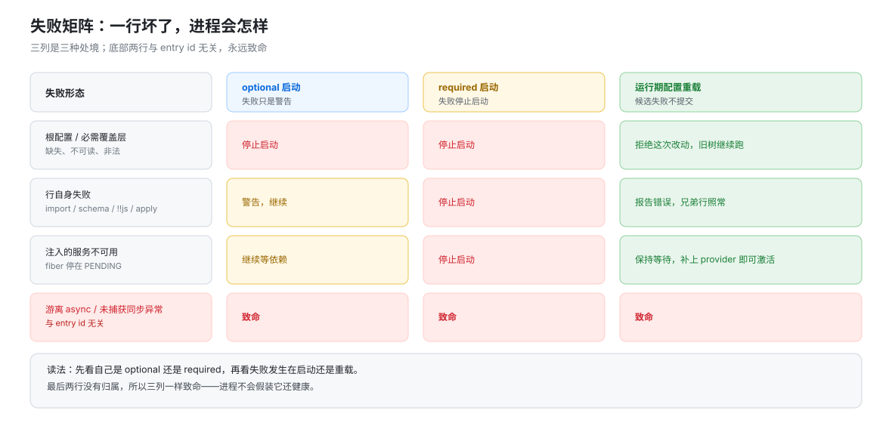

# 启动：从层列表到 ACTIVE 审计

## 一句话

启动做四件事：把 bundle 层叠成一个 entry 列表，对每个 bundle 与每一行做准入，把留下的行挂成 fiber，最后**审计每一行的最终状态**。第一件与挂树的机制归 [`composition/`](../composition/00-map.md)；本页写准入、审计，以及「一行坏了，进程会怎样」——这是安装与运行之间最容易被忽略的一段。

## 两道准入，粒度不同

| 粒度 | 机制 | 判据 | 拒绝后果 |
|------|------|------|----------|
| bundle | `loadProfile` 读层时逐包判定 | 解析失败、清单非法、patch 读不出、DSH 要求不满足 | 整个 bundle 跳过，选择不变，记入 `skippedBundles` 并在启动时打印一次 |
| 行 | `prepareProfilePatches` 组合期逐行判定 | `engines.dsh` / peer 不满足且无豁免 | 该行变成 detached `disabled: true`；原生 group 仍挂载但被拒的 child 不加载 |

两处实现分别在 `packages/boot/app-boot/src/profile.ts:750`–`:760` 与 `packages/boot/app-boot/src/compatibility-preflight.ts:180`。行级准入的关键性质是：**只有兼容性冲突才拒绝行**，其它失败保留 Loader 自己的诊断（`compatibility-preflight.ts:100`）——准入不替 Loader 做错误分类。

bundle 被跳过不等于剩下的组合还能工作。层里少一个 provider，后面的顶层行会停在 `PENDING`，这不被视为 bundle 跳过的一部分。

## 挂树

profile 行有两种名字形态：裸包名与文件 URL。patch 加载把 `insert` 行里的绝对路径与补丁相对的 `./`、`../` 转成 file URL，而已有行的名字断言与替换 `config` 保持字面（`packages/boot/app-boot/README.md` 的 profile 节）。

解析不靠往 profile 里写 fallback 链接：launcher 先算出一份不可变的运行时解析表，再把它装到 Node 的 ESM 与 CJS 解析器上。解析顺序是 profile 本地 `node_modules` 优先，其次安装锚，再按声明者位置找 linked root。boot 时序见 [`composition/01`](../composition/01-boot-时序.md)。

## 结算审计

`boot()` 在 `loader.await()` 之后调用 `auditStartupEntries` 逐条扫 fiber 状态（`packages/boot/app-boot/src/index.ts:1153`）：

| 状态 | 处理 |
|------|------|
| `ACTIVE` | 通过 |
| 无 fiber / `disabled` | 跳过 |
| `FAILED` | `await fiber.await()` 取回原 rejection，保留原因与栈 |
| `PENDING` | 在该 fiber 自己的 `ctx` 上点名还缺哪个服务 |
| 其它 | 原样写进诊断 |

fiber 的六态（`PENDING` / `LOADING` / `ACTIVE` / `FAILED` / `UNLOADING` / `DISPOSED`）由 Cordis 定义，见 [`two-tree-runtime/framework/01`](../../two-tree-runtime/framework/01-五条原语对照源码.md)。审计只看落在树上的那一瞬间，不看中间态。

## 失败矩阵

这张表是「装坏一个插件会不会把应用打死」的完整答案。三列分别是：optional 行启动、required 行启动、运行期配置重载。

| 失败形态 | optional 启动 | required 启动 | 运行期重载 |
|----------|---------------|---------------|------------|
| 根配置或必需覆盖层缺失、不可读、非法 | 停止启动 | 停止启动 | 拒绝这次改动，保留运行中的配置 |
| 模块导入失败或模块求值抛错 | 警告，继续 | 停止启动 | 报告错误，兄弟行照常；修好后可以激活 |
| 插件 config schema 校验失败 | 警告，继续 | 停止启动 | 新行保持失活；已有行保留原实例与配置；改对后下一次可以生效 |
| `config` 里的 `!!js` 求值抛错 | 警告，继续 | 停止启动 | 报告错误，兄弟行照常 |
| `disabled: !!js` 求值抛错 | 警告，继续 | 停止启动 | 报告求值错误，**不要当成 disabled** |
| 同步 `apply()` 抛错 | 警告，继续 | 停止启动 | 报告错误，兄弟行照常 |
| 异步 `apply()` 抛错 | 结算后警告，继续 | 结算后停止启动 | 结算后报告错误 |
| 注入的服务不可用 | 警告，继续等依赖 | 停止启动 | 保持等待；补上 provider 即可激活 |
| HTTP 端口绑定失败 | 警告，不带该端点继续 | 停止启动 | 进程继续，端点缺失；改对配置可恢复 |
| `apply()` 返回的 Promise 之外的游离异步产生 unhandled rejection | **致命**：卸载并退出 | **致命** | **致命**，与 entry id 无关 |
| 任意时刻的同步回调（stream 的 `data`、定时器）抛出未捕获异常 | **致命**：卸载并退出 | **致命** | **致命** |
| 行缺失或显式 `disabled` | 忽略 | 忽略 | 不激活；不做必需性审计 |

要读的点有两个。**根配置类失败对 optional 与 required 一视同仁**——那时还没有「可选」可言，整棵树都起不来。除此之外，optional 行的失败只是警告，required 行的失败会停止启动。而最后两行与 entry id 无关：游离的异步错误没有归属，进程不会假装它还健康。

对应的两段失败标签：`host preparation failed`（`prepare` 之前）与 `plugin tree failed to load`（`prepare` 之后、挂载之前）。catch 里 `await ctx.fiber.dispose()`，根 fiber 的清理按观察者隔离。

启动窗口之后出现的 rejection 走 `installFailLoud`：stderr 一行、释放与 2000ms 赛跑、`exit(1)`。第一条 rejection 是被报告的那条。

## 重组合的失败边界

运行期的配置重载不是重新 boot，而是 `recomposeProfile`（`packages/boot/app-boot/src/index.ts:307`）：

1. 移除新一代不再列出的行，并在包还处于映射状态时等它们释放完。
2. 发布新一版解析表，跑兼容性预检，再应用。
3. 启动 `running` 里的行，以及因导入失败而失去 fiber、本次更新又补救了的行。
4. 判定激活。

失败回滚只覆盖一件事：**在应用合并之前失败，就把刚移除的行放回原位并重新启动**。应用之后失败不回滚整次更新，也不重复必需性审计。

## 本页的边界

配置层顺序、`insert` 与 id 命中的替换规则、`--dump-config` 的保真性都在 [`composition/`](../composition/00-map.md)。本页只管「一行能不能活、活不了会怎样」。

下一段：[`05-特殊初始化.md`](./05-特殊初始化.md)。
