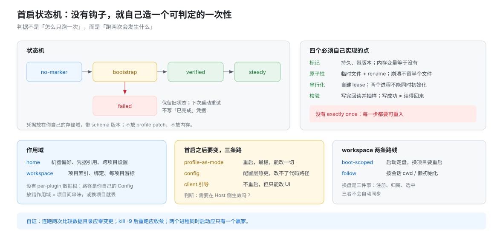

# 首启与产品初始化：没有钩子时该怎么自己造

## 一句话

DSH **没有**插件级的 first-run 或 migration 钩子。所以「首次运行时做点事」不是找一个回调，而是**自己造一个状态机**：可判定的凭据 + 每一步幂等 + 失败保留旧状态 + 单写者串行化。做完之后还想改变行为，只有三条路——profile-as-mode（重启）、config（配置层热更）、client 引导（只改 UI）。

## 为什么没有钩子（这不是遗漏）

宿主的生命周期只有 **fiber**：挂上、卸下、因为依赖变化重新加载。这三件事在一次运行里会反复发生——服务被替换、配置更新、HMR 重进。把「首次运行」绑在 fiber 上，语义立刻崩塌：到底算第一次加载，还是第一次成功加载，还是第一次在这个 profile 里加载？

所以 DSH 把「一次性」交给**数据**，不交给**生命周期**。看现有四个实例就明白：它们的一次性都由一个**可判定的持久事实**担保，而不是由某个回调被调用过担保。

## 四个既有实例的启示

| 实例 | 凭据 | 幂等靠什么 | 失败处置 |
|---|---|---|---|
| profile 首建 | 文件是否存在（`packages/boot/app-boot/src/profile.ts:262`） | 已有文件一律不写 | 保留旧文件 |
| `settings.yaml` 导入 | 文件是否已被改名（`packages/settings/settings/src/index.ts:238`） | **先改名再写**，中途崩溃也不会重来 | 被拒段落留在改名后的文件里 |
| 存储版本戳 | `PRAGMA user_version`（`packages/storage/storage-sqlite/src/schema.ts:20`）、域版本（`packages/storage/storage-domain/src/spec.ts:39`、`:56`） | 版本匹配才继续 | 拒绝打开，不猜 |
| desktop 运行树 | `desktop-runtime.json` 校验（`apps/desktop/src/runtime-tree.ts:12`） | 校验通过才用这份运行时 | 进原生恢复 |

三条提炼，直接决定你怎么写：

1. **凭据必须可判定**——「跑过了」不能是一个内存变量，也不能是一句日志。
2. **动作必须幂等**——因为没有 exactly once，同一个动作可能被执行两次（崩溃、重装、双进程）。
3. **失败必须保留旧状态**——宁可停在「没做」，也不要停在「做了一半」。

## 实测（T，2026-11-02，隔离 `DSH_HOME`）

宿主侧的一次性动作已实测：「文件存在即不写」这个凭据是有效的。

```sh
H=$(mktemp -d)
DSH_HOME=$H pnpm dsh --profile web --dump-config > /dev/null
find "$H" -type f | sort > /tmp/tree1
DSH_HOME=$H pnpm dsh --profile web --dump-config > /dev/null
find "$H" -type f | sort > /tmp/tree2
diff /tmp/tree1 /tmp/tree2        # 零差异
```

结果：首次初始化产出 4 个文件（`package.json`、`cordis.patch.yml`、`cordis.yml`、`pnpm-workspace.yaml`），第二次运行**文件树与输出都零差异**；`cordis.yml` 的内容始终是注释加 `[]`。

这条实测说明的是**判据**，不是实现细节：宿主的「一次性」由「文件在不在」担保，而不是由「有没有跑过」的记录担保——所以它天然可重入。

## 作者首启状态机



```text
no-marker ──► bootstrap(running) ──► verified ──► steady
                    │
                    └─► failed（保留旧状态，下次重试）
```

四个必须自己实现的点：

| 点 | 做法 | 不做的后果 |
|---|---|---|
| 标记 | 写进自己的存储域，带上 schema 版本 | 放 profile patch 会被用户覆盖；放内存等于没有 |
| 原子性 | 先写临时文件，再 `rename` | 崩溃留下半个文件，下次读不出来 |
| 串行化 | 自己实现一个 lease（文件锁 / 带过期的标记） | 两个进程同时初始化，互相覆盖 |
| 校验 | 写完回读并抽样 | 「写成功」不等于「读得回来」 |

**没有 exactly once**。所以设计判据不是「怎么保证只跑一次」，而是「**跑两次会发生什么**」。跑两次必须收敛到同一个状态，否则这个一次性动作就是错的。

## 作用域：home 级还是 workspace 级

| 放哪 | 适合 | 放错的代价 |
|---|---|---|
| home（跨 profile） | 机器偏好、凭据引用、跨项目的用户设置 | 项目级数据放这里 → 项目之间串味 |
| workspace（跟随项目） | 项目索引、绑定、每项目游标 | 机器级偏好放这里 → 换个项目就丢 |

DSH **没有 per-plugin 的数据根**：路径是你自己的 `Config` 字段，部署可以改。所以「我的数据放哪」要在文档里写死一个**相对可配置根的路径**，而不是假设宿主会给一个目录。

## 首启之后要变，只有三条路

| 手段 | 生效方式 | 能改什么 | 代价 |
|---|---|---|---|
| **profile-as-mode** | 改 profile 组合，重启 | 一切：工具面、服务、模型、权限 | 要重启；但最稳、最好解释 |
| **config** | 写当前 profile 的 patch，配置层热更 | 只改配置能表达的行为；`.volatile()` 的字段才能进设置页 | 改不了代码路径 |
| **client 引导** | 不重启，改 UI / client 状态 | 面板、向导、选中与可见性 | **改不了 Host 行为** |

判断顺序：**这个变化需要在 Host 侧生效吗？** 需要 → 重启（profile-as-mode）；不需要 → client 引导；介于两者 → 用 config 把行为参数化。

## workspace 两条路线

| 路线 | 什么时候定 | 适合 | 代价 |
|---|---|---|---|
| **boot-scoped** | 启动时读 config 的 root，一次定盘 | 单项目部署、桌面产品 | 换项目要重启 |
| **follow** | 按会话 cwd / 每个 workspace 懒初始化 | 多项目、跨目录使用 | 每个 workspace 都要跑一次初始化，且要自己处理并发 |

Host 与 Client 的分工是固定的：`workspaceController.create`（`packages/workspace/workspace/src/index.ts:238`）与 `sessionController.create`（`packages/api/session-controller/src/index.ts:301`）负责建；**选中**由 client 的 `uiWorkspace.openSession` 负责（用法见 `packages/client/ui-chat/src/client/apply.ts:291`）。

**换盘其实是三件事**：workspace 注册、session 归属、client 选中。三者不会自动同步——建了不等于归属，归属了不等于选中。

## 首屏与配置呈现

首屏链路与失败信号由 [`../composition/05-启动窗口与首屏交接.md`](../composition/05-启动窗口与首屏交接.md) 单点拥有（五步：打印入口 → 303 + cookie → 发 HTML → 注入 `__DSH_BOOT__` → client 两段式启动）；本节只讲首启状态，不重复那五步。

配置呈现有四种**合法**手段，选一个，别叠加：

1. **volatile 设置页**：字段标 `.volatile()`，用户改的写当前 profile patch。
2. **bundle config slot**：你自己渲染一块面板，数据仍来自 `Config`。
3. **自定义面板**：完全自绘，但读的必须还是同一份 `Config`。
4. **命令或只读路由**：只展示，不给写入口。

一条禁令：**不要自建第二套真值**。设置页、你的面板、你自己的文件三处同时存同一个开关，第一次冲突就会产生"设置页改了但没生效"的经典故障。

## 决策表：我想做 X

| 我想做 | 用哪个机制 | 落在哪 | 硬限制 |
|---|---|---|---|
| 首次运行初始化数据 | 自己的状态机 + 存储域标记 | workspace 或 home | 没有钩子；必须幂等 |
| 首次运行弹一个向导 | client 引导 | 窗口 D | 不能改 Host 行为 |
| 每次启动检查环境 | `apply` 里的只读检查 | 窗口 C | 别在这里改状态，会拖慢就绪 |
| 支持多个项目 | follow 路线 | workspace 级 | 三件事要自己串起来 |
| 切换运行模式 | profile-as-mode | 新 profile | 要重启 |
| 用户可改的开关 | `Config` + `.volatile()` | 设置页 → profile patch | 只有 volatile 才进表单 |
| 部署级参数 | `Config` 非 volatile | bundle patch | 用户改要用 patch 覆盖 |
| 密钥 / 授权 | `ctx.credentials` | home | 不进 profile patch |
| 每个项目独立索引 | 存储域按 workspace 键 | workspace 级 | 键必须路径安全 |
| 跨项目偏好 | home 级存储或 home patch | home | 产品不要静默写 home patch |
| 数据格式变更 | 自己写迁移：版本化 + 幂等 + 回读校验 | 你的存储域 | 宿主不会替你迁移 |
| 首屏欢迎 | client 面板 | 窗口 D | 不依赖 `welcome-notice` |

## 反例：这样写会坏

| 写法 | 会看到什么 | 属于 |
|---|---|---|
| 用内存变量当「已初始化」 | 每次重启重跑；数据被写两遍（文件时间戳变化、条数翻倍） | C（fiber 会重进，见 09 行「为什么没有钩子」） |
| 先写正式文件、后做校验 | 崩溃留下半文件；下次启动解析失败或 schema 校验不过 | C（原子写语义） |
| 不做 lease，允许多进程同时初始化 | 两个进程各写一遍，后写覆盖先写；「看起来成功了」但状态随机 | C（无跨进程锁） |
| 把「已完成」标记写进 profile patch | 用户改 patch 或重置 profile 后标记消失，首启重新跑一遍 | C（patch 是用户层） |
| 在 `apply` 里同步做完整初始化 | 就绪被推迟；HMR 拿不到 `appReady`，直接抛错 | T/C（`hmr/src/index.ts:369`） |

## 硬限制（附失败信号）

| 想做的事 | 为什么不行 | 你会看到什么 |
|---|---|---|
| 找 first-run 回调 | 宿主没有这个 API | 全仓搜不到；只有 client 侧文案 |
| 保证只执行一次 | 没有 exactly once | 崩溃/重装后会再跑一次 |
| 让 Host 替你在首次运行时改 UI | 选中与呈现归 Client | 数据写进去了，界面没变 |
| 用 config 改代码路径 | 配置层只能表达配置 | 改了没反应，或需要重启才生效 |
| 让宿主清理你的旧数据 | 没有数据卸载契约 | 卸载后数据仍在，用户以为删了 |

## 自证配方

```sh
# 1. 二次启动零变更：连跑两次，比较你的数据目录
DSH_HOME=$(mktemp -d) dsh --profile <name> --no-open --port 0 &
sleep 5; ls -la "$DSH_HOME"/<your-data-subpath>
# 再跑一次，文件数与内容应完全相同

# 2. 中断后恢复：第一次启动 kill -9，再启动，检查是否收敛
# 3. 并发：两个进程同时启动，检查 lease 是否只有一个赢家
# 4. 作用域：换一个 profile 跑，确认 home 级数据可见、workspace 级不可见
```

失败先看哪里：**先看你的凭据文件在不在**（决定走没走 bootstrap），**再看数据目录的时间戳**（决定有没有被重写）。

## 本页的边界

宿主侧的一次性机制（profile 首建、`settings.yaml` 导入、存储版本、desktop 运行树）在 [`05-特殊初始化.md`](./05-特殊初始化.md)；启动窗口与本页的「窗口 C/D」定义在 [`../composition/05-启动窗口与首屏交接.md`](../composition/05-启动窗口与首屏交接.md)；配置层与 patch 语义在 [`../composition/00-map.md`](../composition/00-map.md)。
