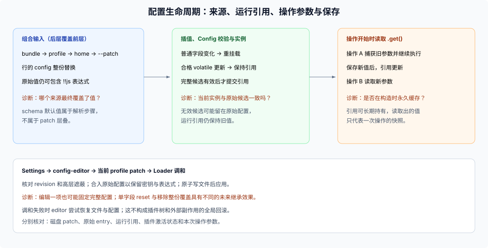
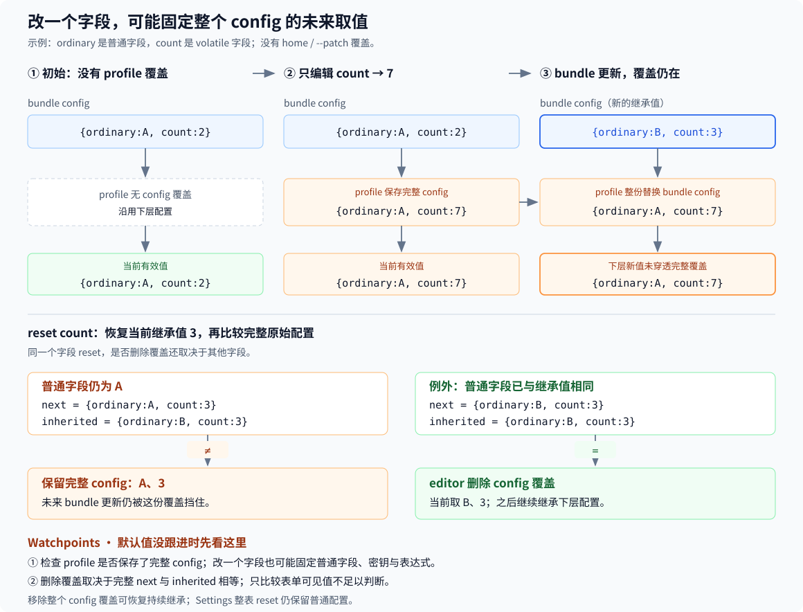

# 配置与设置：从声明、运行读取到 profile 保存

一个配置值有三个不同的时点：插件加载时解析、一次业务操作开始时读取、用户保存后写入下一次启动的输入。本页串起这条生命周期；先了解 [patch 层叠](../composition/00-map.md)，字段的解析规则见 [Config 与 Schemastery](../../runtime-integrity/00-index.md)。

## 来源与解析各做什么

| 输入 | 所有者 | 生效方式 |
|---|---|---|
| bundle patch | 插件作者 / 部署方 | 按 profile 清单顺序提供插件行与产品默认配置 |
| profile patch | 当前 profile 的用户 | 覆盖该 profile 的组合；Settings 的保存目标 |
| home patch | 用户 / 机器 | 位于 profile 之后，跨 profile 覆盖 |
| `--patch` | 本次调用方 | 位于最后，提供本次启动的覆盖 |
| 插件 `Config` 默认值 | 插件作者 | 对组合后的输入解析时补值；不参与 patch 层叠 |

行的 `config` 是整份替换，没有深合并。默认值属于解析，不能当成最底下一层 patch。app args、环境变量和 credentials 也有各自的消费者，不会自动变成同名 Config 字段。

Loader 的 `internal/config` 处理插值等运行输入，插件 Config 随后校验。依赖尚未满足的插件可以停在 pending，等依赖可用才解析并激活；dump 成功因此不等于每个插件配置已经验证。命令与运行态的区别见 [dump 与 boot](../composition/02-dump-and-boot-fidelity.md)。

例如 `--port` 只有在对应行保留读取 app 参数的 `!!js` 表达式时才影响结果；更高层把它替换成字面量后，参数不会自动覆盖该字面量。

## 先分清四种状态

| 状态 | 例子 | 谁使用 |
|---|---|---|
| 原始配置 | entry 的 `options.config`，可能仍含表达式 | Loader 比较、编辑器保存 |
| 解析后的配置 | 普通值与 volatile 引用 | 当前插件实例 |
| 本次操作参数 | 命令开始时读取的超时快照 | 该次命令，不随以后保存自动变化 |
| 持久化 patch | profile 的 `cordis.patch.yml` | 重载和下次启动 |

设置页的脱敏值只是显示投影，不能用来覆盖完整原始配置，否则未返回给客户端的密钥会丢失。引用更新、原始配置更新和文件写入也不是同一次全局事务，失败后应分别核对，见 [重载失败矩阵](../composition/03-user-patch-hmr.md)。

## volatile 是生命周期选择

`.volatile()` 声明允许字段在保留插件实例的条件下更新；Settings 才据此提取可编辑字段。是否把字段标成 volatile，先由资源与读取方式决定。

| 字段用途 | 消费方式 | 更新要求 |
|---|---|---|
| 决定连接、监听器或其他实例资源 | 构造时建立资源 | 普通 Config 字段；修改走重挂载 |
| 决定每次操作的超时、模型选择等 | 保留引用，在每次操作开始时 `.get()` | 可声明 volatile，并核实消费者确实按操作读取 |
| 动态数组 / 字典中的整组参数 | 整个容器作为一个快照读取 | 整个容器可 volatile；动态成员不能各自带独立 volatile 引用 |

Loader 先比较普通字段的原始变化；仅可能是 volatile 变化时，再解析完整候选并比较普通字段的有效值。只有条件满足才提交新引用值并保留实例与引用身份。普通字段或依赖变化仍遵循重挂载生命周期；这项能力由 Loader 更新路径提供，不依赖文件 watcher。

以超时为例：命令 A 开始时读取旧值并形成执行参数；用户修改超时，合格的更新保持当前实例并更新引用；命令 B 开始时读取新值。A 可以继续使用原来捕获的超时。若消费者在构造时 `.get()` 并永久缓存，设置保存成功也不能使它自动读取新值。

候选解析失败不会提交运行引用；直接 Loader 更新可能留下无效的原始候选，之后重挂载还会遇到它。不能只查看当前服务仍可用，就认定磁盘和下次启动都安全。

## Settings 保存与继承

Settings 从活跃 Loader entry 的原生 Config 投影 volatile 表单，以 entry id 区分实例；它不提供另一份业务配置。自定义页面和自动页面的展示由产品 UI 决定，schema 元数据本身不保证某个控件已经实现，见 [Config 消费者与限制](../../runtime-integrity/03-runtime-integrity-and-quality-assurance.md)。

一次保存经 Settings 与 config-editor 完成：

1. 在串行编辑与 profile 文件锁内重读当前配置；带 `expectedRevision` 的请求拒绝覆盖已经变化的版本。
2. 将路径编辑合入原始配置，保留普通字段、未编辑的密钥与表达式；校验可写字段和完整候选。
3. 重新计算所有层，若 home 或命令行覆盖会使这次编辑失效，则在写盘前拒绝。
4. 原子替换 profile patch 文件，再调和 Loader。调和失败时，编辑器尝试恢复旧文件并重新调和；该恢复范围不覆盖任意外部副作用。

**改一个字段仍可能保存完整 entry 的 `config` 对象。** 这是整份替换语义的结果：保留的普通字段和其他已写入值也成为 profile 覆盖，未来 bundle 对这些字段的默认配置更新不会自动穿透。

下图用两个字段展示保存、bundle 更新与 reset 的结果；是否清除覆盖取决于完整原始配置是否等于 inherited（[保存实现](../../../packages/boot/config-editor/src/index.ts)、[配置测试](../../../packages/settings/settings/tests/configuration.spec.ts)）。

| 操作 | 当前结果 | 后续继承 |
|---|---|---|
| 编辑一个字段 | 保存完整配置覆盖并应用更新 | 已保存的其他字段也可能固定在当前值 |
| reset 一个字段 | 恢复该字段当前的继承值 | 仍有完整覆盖时，不等于恢复未来的动态继承 |
| 移除整个 entry 的配置覆盖 | 使用下层组合与 schema 默认值 | 之后随下层配置变化；编辑结果等于完整 inherited 配置时，editor 也会清除该覆盖 |

Settings 的整表 reset 保留普通配置；普通字段本身仍偏离 inherited 时，不应把整表 reset 等同于删除 entry 覆盖。构建自定义设置页时，要把“恢复当前默认值”和“移除覆盖、以后继续继承”表达清楚。

## 症状与核对

| 症状 | 先核对 | 深入 |
|---|---|---|
| 保存后新操作仍读旧值 | 消费者是否缓存了 `.get()` 的结果；实例是否已替换 | 本页 volatile 表与操作时点 |
| 改 profile 没生效 | 更高层遮蔽、没有 watcher、或该字段需要重挂载 | [重载机制](../composition/03-user-patch-hmr.md) |
| bundle 升级后默认值没跟进 | entry 是否留有完整 config 覆盖 | 本页保存与 reset 表 |
| 保存被拒绝或值又变了 | revision 冲突、高层遮蔽、完整候选是否有效 | [Config 消费者](../../runtime-integrity/03-runtime-integrity-and-quality-assurance.md) |
| 运行正常，重启却失败 | 原始候选、profile 文件与运行引用是否一致 | [重载失败矩阵](../composition/03-user-patch-hmr.md) |

## 源码核验入口

| 文件与符号 | 核对内容 |
|---|---|
| [profile 配置与组合](../../../packages/boot/app-boot/src/profile.ts) · `loadProfileDirectory` | 各 patch 输入与顺序 |
| [SettingsForms](../../../packages/settings/settings/src/index.ts) · `describe` / `write` / `mutate` / `replace` | 活跃实例投影、revision、原始值合并、字段 reset |
| [ConfigEditor](../../../packages/boot/config-editor/src/index.ts) · `edit` | 完整配置替换、遮蔽拒绝、文件原子写与局部恢复 |
| [真实配置测试](../../../packages/settings/settings/tests/configuration.spec.ts) | 消费者身份、磁盘与重启、冲突、密钥和表达式保留 |
| [Loader 更新测试](../../../scripts/loader-volatile-update.spec.ts) | 实例与引用、无效候选、普通字段变化和 Group/Include 更新 |
| [volatile 比较测试](../../../scripts/loader-config-diff.spec.ts) | schema 默认值、原始表达式与普通字段比较 |
| [配置归属决策](../../../.agents/notes/implemented/architecture/2026-09-19-profile-owned-live-configuration.md) | profile 保存、默认值固定和重置的设计取舍 |
