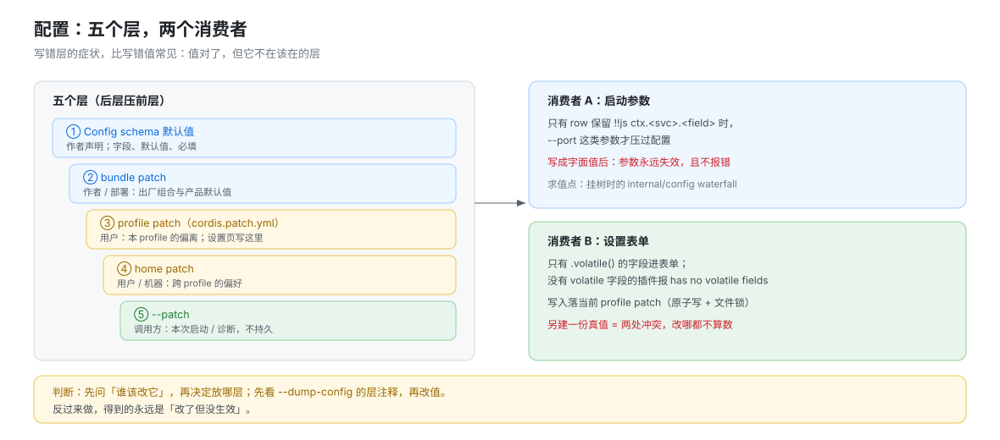

# 配置与设置面：五个层，两个消费者

## 一句话

配置不是「一个开关」，是**五个层 + 两个消费者**。写错层的症状比写错值更常见：值是对的，但它不在该在的那一层，于是改了没反应、或下一次启动被覆盖。



## 五个层，各归各的写者

| 层 | 谁写 | 典型内容 | 什么时候读到 |
|---|---|---|---|
| Config schema 默认值 | 插件作者 | 字段声明、默认值、必填 | 每次挂树 |
| bundle patch | 作者 / 部署 | 出厂组合、产品默认值 | 每次启动，按 `dsh.profile.bundles` 顺序 |
| profile patch（`cordis.patch.yml`，`packages/boot/app-boot/src/profile.ts:40`） | 用户 | 本 profile 的偏离 | profile 层 |
| home patch | 用户 / 机器 | 跨 profile 的偏好 | 所有 profile |
| `--patch` | 调用方 | 本次启动 / 诊断 | 只此一次 |

**不是配置层的东西**：app args、env、`.env`、credentials、客户端 localStorage。它们也是启动输入，但语义与生效方式都不同，混进 patch 是常见错误。

配置在这一刻被求值：Loader 挂树时的 `internal/config` waterfall（`vendor/cordis/src/fiber.ts:642`）。所以它不是「启动脚本里读一次」，而是**每棵树各自解析**。

## 两个消费者

### 1. 启动参数（`--port` 这类）

只有当 row 的 `config` 保留 `!!js ctx.<service>.<field>` 表达式时，app 参数才压过配置；一旦某层把它写成字面值，参数就**永远失效**。

这条规则的后果很具体：你替用户写好 `port: 4133`，他再传 `--port 0` 也没用——而且不会报错。

### 2. 设置表单（`Config.volatile()`）

- 只有标了 `.volatile()` 的字段进表单（`vendor/schemastery/src/index.ts:165`、`packages/settings/settings/src/index.ts:385`）。没有 volatile 字段的插件，表单直接报 `has no volatile fields`（`:386`）。
- 表单写入落在**当前 profile 的 patch**，由 config-editor 以原子写 + 文件锁提交（`packages/boot/config-editor/src/index.ts:34` 的 `documentPath`、`:11` 的 `withFileLock` / `writeFileAtomic`）。
- 所以 `.volatile()` 不是「这个字段特殊」，而是**「允许用户改，并接受它写进 profile 的 patch」**这句承诺。

## 三个坑（附失败信号）

| 坑 | 你会看到什么 | 属于 |
|---|---|---|
| 整份替换只写想改的字段 | required 行失败：`$.host missing required value`（patch 对 `config` 是整份替换，不是字段合并） | T（隔离实测） |
| 把 `!!js` 写成字面值 | `--port 0` 不生效，仍监听旧端口；不报错 | T（隔离实测） |
| 设置页与自建文件各存一份 | 改了设置页不生效，或重启后被另一份覆盖 | C（两份真值互相覆盖） |

## 决策表：这个值该放哪一层

| 我想让谁改 / 什么时候生效 | 放哪层 | 怎么声明 |
|---|---|---|
| 部署方（一次决定，全 profile 生效） | bundle patch | row 的 `config` |
| 用户，且希望在设置页里改 | Config + `.volatile()` | schema 字段 |
| 用户，但只给他改文件 | Config（非 volatile） | schema 字段 |
| 跨 profile 共享的机器偏好 | home patch | 直接给用户文档 |
| 本次调试 / 临时覆盖 | `--patch` | 命令行 |
| 密钥、token | `.env` / credentials | 不进配置层 |

## 自证配方

```sh
# 1. 看这份组合到底由哪些层叠出来
dsh --profile <name> --dump-config | sed -n '/^# == /p'

# 2. 改一行 profile patch，观察生效方式
$EDITOR "$DSH_HOME/profiles/<name>/cordis.patch.yml"
# 有 HMR：日志出现 config-reload；无 HMR：重启

# 3. 验证 app 参数是否还有效（表达式被换成字面值后会失效）
dsh --profile <name> --no-open --port 0    # 看实际监听端口
```

判据：**层对了，值才对**。先看 `--dump-config` 的层注释，再去改值；反过来做，得到的是「改了但没生效」。

## 边界

层序与 dump 保真归 [`../composition/02-dump-与boot-保真.md`](../composition/02-dump-与boot-保真.md)；patch 的 `insert` / override 语义归 [`../composition/00-map.md`](../composition/00-map.md)；首启与一次性初始化归 [`08-首启与产品初始化.md`](./08-首启与产品初始化.md)。本篇只回答「这个值该写在哪一层」。
