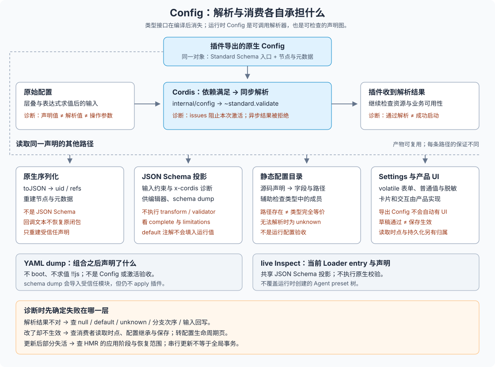

# 插件配置：运行时声明、解析与消费

本专题回答插件的原始配置怎样成为运行值，以及同一份配置声明还能被哪些工具读取。Schemastery 把可调用的解析器与可检查的元数据放在同一对象上；Cordis 通过同步 Standard Schema 协议消费解析器，DSH 的设置与检查工具再按各自用途读取声明。

配置声明只约束它实际解析的输入。工具参数、远程消息和持久化记录各有自己的校验机制；配置通过解析，也不等于依赖可用、资源创建成功或任务成果正确。

## 按问题阅读

| 问题或症状 | 页面 | 本页承担的说明 |
|---|---|---|
| 类型里有字段，为什么运行时仍未校验？依赖未到时何时解析？ | [Config 与同步 Standard Schema](./01-schemastery-configuration-and-usage.md) | 同名类型和值、插件导出、激活时点 |
| 字符串数字为什么被拒绝？默认值、null 或拼错的字段怎样处理？ | [精确解析语义](./02-coercion-and-fail-fast-mechanisms.md) | 原始输入到解析结果的规则 |
| 有 schema 为什么没有设置卡片？dump 或目录能证明什么？ | [消费方与保证范围](./03-runtime-integrity-and-quality-assurance.md) | 原生序列化、JSON Schema、静态目录与产品 UI |
| 怎样组合字段和分支？转换为什么重复执行或改了输入？ | [复合声明与纯转换](./04-advanced-algebraic-patterns.md) | intersect、union、transform 的组合约束 |

## 与运行时和测试的衔接

在线读取、普通字段与 volatile 字段的生命周期、设置保存和默认值继承，由[配置与设置面](../plugin-system/lifecycle/09-configuration-and-settings.md)说明。更新失败后哪些状态保留，由[用户 patch 的 HMR](../plugin-system/composition/03-user-patch-hmr.md)说明。这里不把解析成功延伸为整棵树的事务或自动恢复保证。

配置正确性需要沿实际消费者取证：解析结果、Loader 激活、资源或工具执行、保存后的重启行为，各自回答不同问题；证据选择见[插件测试实践](../test-strategy/plugin-testing/14-dsh-plugin-testing-playbook.md)。

## 源码核验入口

- [Schemastery 声明与解析](https://github.com/deepseek-ai/deepseek-harness/blob/master/vendor/schemastery/src/index.ts)：可调用 schema、元数据、Standard Schema 适配与解析规则。
- [Cordis Fiber](https://github.com/deepseek-ai/deepseek-harness/blob/master/vendor/cordis/src/fiber.ts)：依赖状态、配置校验与插件执行的次序。
- [Config 输入投影测试](https://github.com/deepseek-ai/deepseek-harness/blob/master/packages/boot/app-boot/tests/schemastery-json-schema.spec.ts)：原生语义与 JSON Schema 表达能力的对照。
