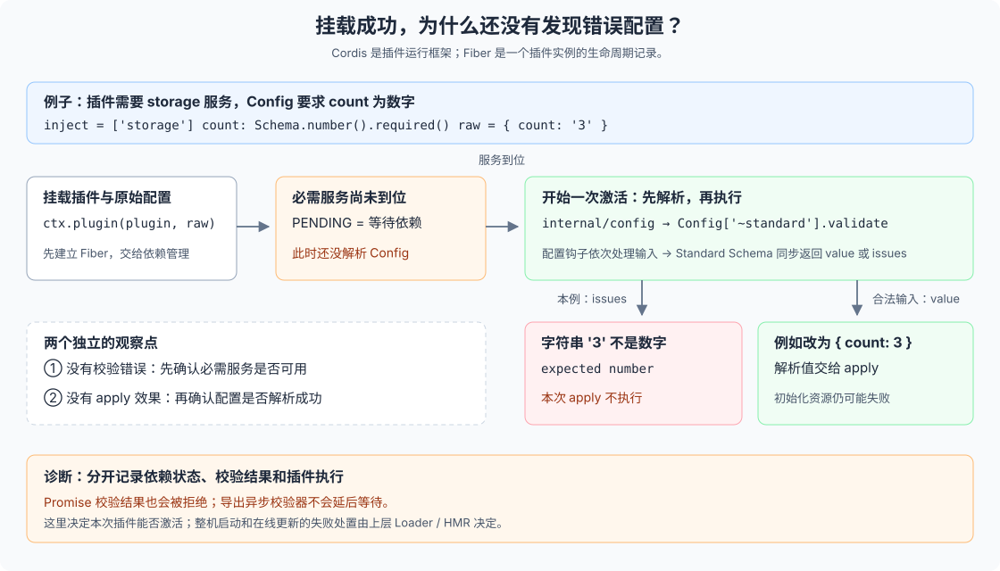

# Config 与同步 Standard Schema

插件常用两个同名声明表达配置：TypeScript 的 `interface Config` 描述代码可使用的字段，运行时的 `const Config` 负责解析实际输入。接口编译后消失，不能替代运行时校验；`Schema<输入, 输出>` 标注帮助类型检查，也不证明类型与解析规则完全等价。

## 可调用的配置声明

Schemastery 使用默认导入。下面的模块可以直接解析配置；函数插件导出这个运行时 `Config`，Cordis 才能在激活时使用它。服务插件则将声明放在服务类的静态 `Config` 上。

```typescript
import assert from 'node:assert/strict'
import Schema from '@deepseek-ai/schemastery'

export interface Config {
  endpoint: string
  timeoutMs: number
}

export const Config: Schema<Partial<Config>, Config> = Schema.object({
  endpoint: Schema.string().required().description('远端服务地址'),
  timeoutMs: Schema.number().min(1).default(5000).description('请求超时毫秒数'),
})

const input = { endpoint: 'https://example.test' }
assert.deepEqual(Config(input), { endpoint: 'https://example.test', timeoutMs: 5000 })
assert.deepEqual(Config['~standard'].validate(input), {
  value: { endpoint: 'https://example.test', timeoutMs: 5000 },
})
```

`Config(input)` 是原生解析调用；`Config['~standard'].validate(input)` 是同一声明提供的 Standard Schema 入口，成功返回 `value`，原生校验错误转为 `issues`，非校验异常继续抛出。`.description()`、`.role()` 等附着在运行时对象上，供认识这些元数据的消费者解释；能否生成界面取决于[具体消费方](./03-runtime-integrity-and-quality-assurance.md)。

## 校验发生在激活前

沿图检查“插件已挂载，错误配置却还未报错”：先确认它是否已进入激活，再观察解析结果与插件执行。



Cordis 挂载的是插件或服务类，例如 `ctx.plugin(plugin, rawConfig)`，不是配置 schema。Fiber 的依赖满足、准备激活时，先经过 `internal/config` waterfall，再通过运行时 `Config` 的 Standard Schema 入口解析，成功后才执行插件。依赖尚未满足的插件可以停在等待状态；声明被读取，不代表它已经运行过配置校验。

这个入口只接受同步结果，Promise 形式的校验结果会被拒绝。没有运行时 `Config` 的插件得到原配置；有校验问题时，该次插件激活失败。整个启动是否失败、在线更新留下哪些状态，由上层加载与诊断策略决定，见[HMR 的失败范围](../plugin-system/composition/03-user-patch-hmr.md)。

Cordis 的接入协议是 Standard Schema；DSH 的原生图投影另需 Schemastery 的节点和元数据。满足前者不自动满足后者。原始配置、解析结果与操作捕获参数也不是同一个值，在线更新与设置保存见[配置生命周期](../plugin-system/lifecycle/09-configuration-and-settings.md)。

## 问题导航

- 缺省、null、数字字符串或未知字段的结果不符合预期：看[精确解析语义](./02-coercion-and-fail-fast-mechanisms.md)。
- 标了描述或角色却没有 UI，或另一种 Standard Schema 不能被检查工具投影：看[消费方与保证范围](./03-runtime-integrity-and-quality-assurance.md)。
- 配置已通过，但外部服务、文件或跨字段条件仍不可用：由资源消费者在最早可判断处检查，不能从类型通过推出业务可用。

## 源码核验入口

- [Schemastery 实现](https://github.com/deepseek-ai/deepseek-harness/blob/master/vendor/schemastery/src/index.ts)：默认导出、可调用对象与 `~standard` 适配。
- [Cordis 插件声明](https://github.com/deepseek-ai/deepseek-harness/blob/master/vendor/cordis/src/registry.ts)：函数插件、服务类与运行时 `Config` 的归属。
- [Cordis Fiber](https://github.com/deepseek-ai/deepseek-harness/blob/master/vendor/cordis/src/fiber.ts)：`resolveConfig`、依赖等待和激活次序。
- [真实函数插件的 Config](https://github.com/deepseek-ai/deepseek-harness/blob/master/packages/skill/tool-skill/src/index.ts)：同名接口、运行时声明与插件消费。
