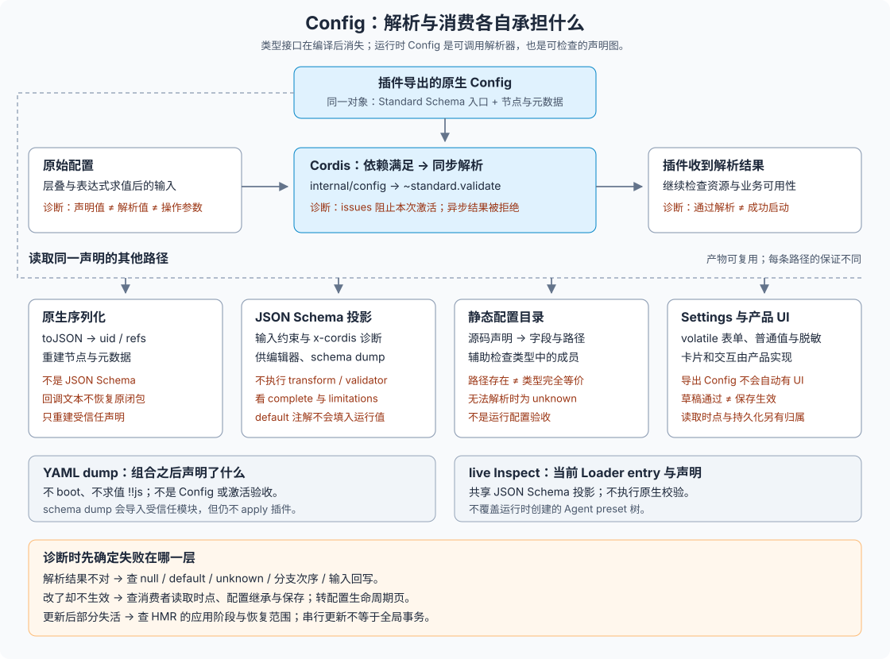

# 02-coercion-and-fail-fast-mechanisms.md: 深入运行时修整与 Fail-Fast 机制

## 概念 (Concept)
Schema 的核心价值在于：它把**防御性代码 (Defensive Code)** 从业务逻辑里剥离，转嫁给了运行时解析引擎。这不仅减少了样板代码，更消除了“隐式类型转换”导致的逻辑 Bug。



## 背后思考 (Insight)
*   **强制转换 (Coercion) 的魔法**：Schemastery 具备强大的多态性，自动将环境输入归一化为内部类型，消除了 `parseInt()` 等冗余代码。
*   **Fail-Fast 的生产价值**：在插件加载的“第一时刻”检查配置。如果配置不合规，直接打断系统启动。这种“将故障提前到加载期”的工程哲学，是生产环境鲁棒性的基石。
*   **契约式编程**：这是 DSH 插件编写的标准契约。假设数据一定是 Schema 定义的那样，从而彻底消除了业务逻辑中的冗余防御性判断。

## 工程实践推荐 (Practice)

```typescript
// ❌ 反例：在逻辑里防御
function handle(config) {
  if (typeof config.port !== 'number') {
     throw new Error("Port must be number")
  }
}

// ✅ DSH 推荐：契约优先
function handle(config: Config) {
  // 假设 config 已经通过了 Schema 校验，直接使用
  startServer(config.port)
}
```

## 参考 (Reference)
*   插件边界校验：[Capability Seams](../capability-seams/00-map.md)
*   防御性模式：[Defensive Patterns](../system-overview/03-门禁与性能基准.md)
