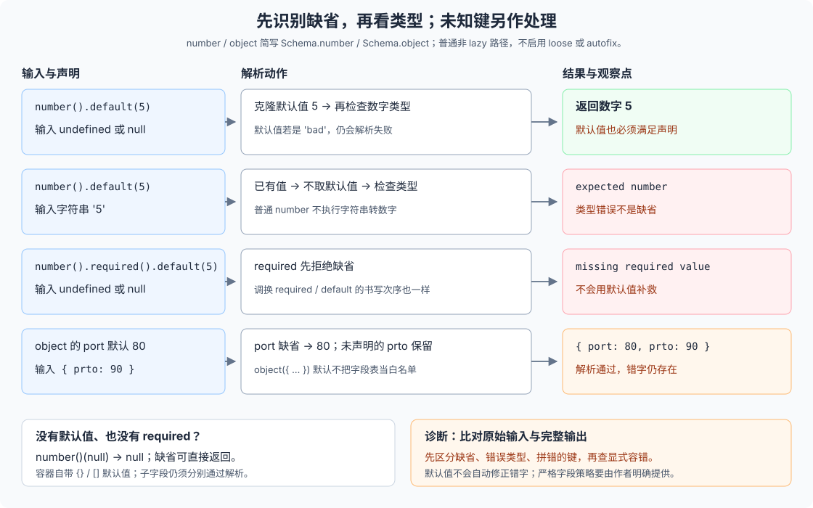

# 精确解析：缺省、类型与未知字段

Schemastery 按声明解析输入，返回默认值、转换值或校验错误。普通标量声明不会把环境字符串自动变成数字或布尔值；需要转换时，由作者显式定义，规则见[复合声明与纯转换](./04-advanced-algebraic-patterns.md)。

## 普通解析的规则

先用四条输入路径区分缺省、错误类型和错字字段，再查表中的容错选项。



下表描述直接调用 schema 的普通路径；`loose` 和 `autofix` 是显式容错选项，不能据此推断所有调用都会修复输入。

| 输入或声明 | 当前行为 | 使用后果 |
|---|---|---|
| `undefined` 或 `null` | 在普通非 lazy 节点上都先走缺省分支；没有默认值时保留原值 | `Schema.string()` 本身不表示必填 |
| `.required()` 与 `.default(value)` 同时存在 | 先因缺省报错，追加顺序不改变这一点 | 默认值不能挽救 required 的缺省输入 |
| 只有 `.default(value)` | 克隆默认值后继续解析；默认值自身也可能校验失败 | 默认值是解析输入，不是跳过校验的结果 |
| object、dict、array、tuple | 分别隐含 `{}` 或 `[]` 默认值，内部字段仍须校验 | 父对象可省略，不代表其必填子字段可省略 |
| number、boolean、string | 检查实际类型及已声明约束 | 字符串 `'5'` 不能直接通过 number |
| 普通 object 的额外字段 | 合并进结果，不默认拒绝或删除 | 拼错字段不一定报错，也不能把 object 当字段白名单 |
| `.loose()` | 捕获该节点解析器的错误并返回声明默认值 | 会主动放宽输入；前置 required 缺省错误不在此捕获范围 |
| `{ autofix: true }` | 属性解析失败时删除该输入属性并返回字段默认值 | 会修改输入且可能掩盖错误，不是普通校验的保证 |

构造器或常量简写也有区别：`Schema.array(String)` 的 `String` 通过 `Schema.from` 成为必填 string，而显式 `Schema.string()` 保留可缺省语义。

## 可执行的最小例子

示例中的 `as never` 仅用于向运行时传入故意构造的非法值；它不参与解析，也不是业务代码的输入转换。

```typescript
import assert from 'node:assert/strict'
import Schema from '@deepseek-ai/schemastery'

assert.equal(Schema.string()(), undefined)
assert.equal(Schema.string()(null), null)
assert.equal(Schema.number().default(5)(null), 5)
assert.throws(() => Schema.number().required().default(5)(), /missing required value/)
assert.throws(() => Schema.number().default(5).required()(null), /missing required value/)
assert.throws(() => Schema.number().default('invalid' as never)(), /expected number/)
assert.throws(() => Schema.number()('5' as never), /expected number/)
assert.deepEqual(Schema.object({})(), {})
assert.deepEqual(Schema.array(String)(), [])
assert.throws(() => Schema.object({ token: Schema.string().required() })(), /missing required value/)
assert.deepEqual(Schema.object({ port: Schema.number().default(80) })({ typo: true }), {
  port: 80, typo: true,
})
assert.equal(Schema.string().loose().default('fallback')(3 as never), 'fallback')
assert.throws(() => Schema.string().required().loose().default('fallback')(), /missing required value/)

const raw = { port: 'bad' }
assert.deepEqual(Schema.object({ port: Schema.number().default(80) })(raw as never, { autofix: true }), { port: 80 })
assert.deepEqual(raw, {})
```

## 解析成功以后的检查

Schema 只执行作者写出的约束。可服务的数值范围、跨字段关系、路径权限、远端可达性或依赖引用，需要由能判断这些条件的消费者继续检查。例如 bash 执行器在解析后仍检查预算为正且有限、定时器能承受的上限；这不是重复进行普通类型检查。

校验失败的插件不会继续该次激活，但“立即打断整个系统启动”不是解析器的统一承诺。校验时点见[Config 与激活](./01-schemastery-configuration-and-usage.md)，更新的状态与失败保证见[HMR](../plugin-system/composition/03-user-patch-hmr.md)。

## 问题导航

- 默认值没有生效：先区分缺省与类型错误，再检查 required、父对象默认值和显式容错选项。
- 错字字段仍然通过：普通 object 保留额外字段；需要更严格的输入策略时必须明确实现。
- 多分支或转换结果出乎预期：看[union 次序、intersect 与输入回写](./04-advanced-algebraic-patterns.md)。

## 源码核验入口

- [Schemastery 解析器](https://github.com/deepseek-ai/deepseek-harness/blob/master/vendor/schemastery/src/index.ts)：`resolve`、`property`、各类型解析器和容器默认值。
- [Config 投影对照测试](https://github.com/deepseek-ai/deepseek-harness/blob/master/packages/boot/app-boot/tests/schemastery-json-schema.spec.ts)：缺省、null、required/default、未知字段及原生输入变化。
- [volatile 配置测试](https://github.com/deepseek-ai/deepseek-harness/blob/master/scripts/volatile-config.spec.ts)：显式 autofix 与解析后的值。
- [bash 配置可服务性检查](https://github.com/deepseek-ai/deepseek-harness/blob/master/packages/shell/bash-local/src/index.ts)：Schema 有效之后的业务约束。
