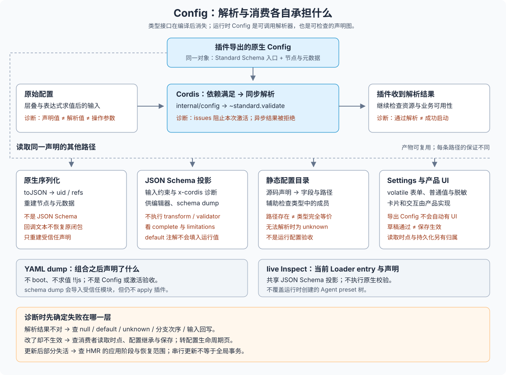

# 03-runtime-integrity-and-quality-assurance.md: 运行时完整性与质量保障闭环

## 概念 (Concept)
在 DeepSeek Harness (DSH) 中，`schemastery` 不仅仅是一个校验工具，它是整个插件系统实现**运行时质量保障 (Runtime Quality Assurance)** 的关键基础设施。DSH 通过该机制，确保了插件行为在复杂、动态的配置环境下依然保持高度确定性。

## 背后思考 (Insight)
*   **启动期“Fail-Fast”**：将配置校验前置到插件装载瞬间，从根本上杜绝“配置污染导致的运行后隐患”。
*   **Seam 守护**：当插件交互穿越 Seam 时，Schema 作为“守门员”拦截非法数据。
*   **测试联动**：Schema 定义与自动化测试夹具生成的深度联动，使得针对特定 Schema 的压力测试变得极其廉价且高效。

## 工程实践推荐 (Practice)

| 实践准则 | 推荐理由 |
| :--- | :--- |
| **拒绝 `Schema.any()`** | 强制明确类型是 DSH 自动生成 UI 设置表单的前提。 |
| **默认值先行 (`.default()`)** | 降低用户配置门槛，实现系统“开箱即用”。 |
| **敏感信息标注** | 使用 `.role('secret')`，让 UI 自动切换为密码框。 |
| **复用 Schema 对象** | 导出共享的 Schema，确保跨插件配置项的一致性。 |

> [!TIP]
> **开发习惯**：在提交代码前，养成运行 `pnpm dsh --dump-config` 的习惯。这能帮您在启动 Agent 前，即时发现 Schema 定义与配置文件之间的冲突。

## 参考 (Reference)
*   插件质量门禁：[CI Gates](../test-strategy/07-ci-gates.md)
*   配置叠层机制：[Config Catalog](../system-overview/03-门禁与性能基准.md)
