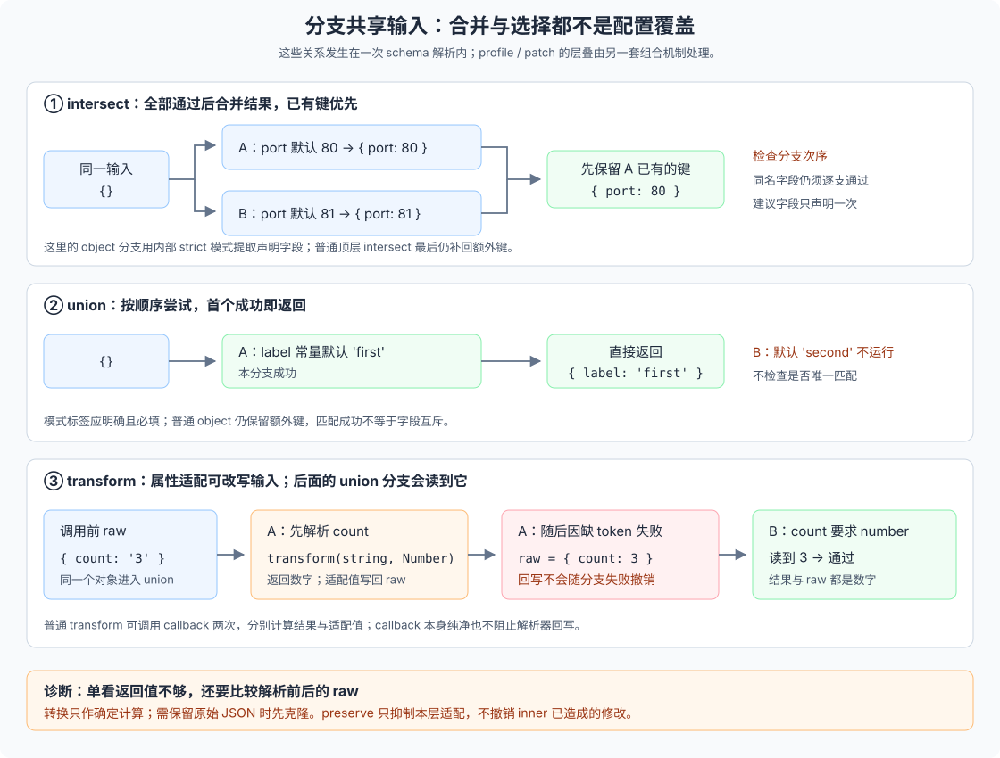

# 复合声明与纯转换

复合 schema 在一次配置解析中组合字段、输入分支与归一化函数。它不处理 profile 的层序、entry 定位或 patch 替换；这些由[组合机制](../plugin-system/composition/00-map.md)承担。缺省和未知字段的共同规则见[精确解析](./02-coercion-and-fail-fast-mechanisms.md)。

先区分三种关系：intersect 合并解析结果，union 选择成功分支，transform 可能适配原始输入。图中的失败分支例子适合排查“各分支单独运行与组合后结果不同”。



## intersect：同一输入上的组合

使用静态方法 `Schema.intersect([...])`。各分支针对同一输入，以内部 strict 模式解析；结果合并时已有键优先保留，普通顶层对象的额外字段最后补回。标量结果必须相等；同名对象字段仍须分别通过各分支，结果合并不是后者覆盖前者。

```typescript
import assert from 'node:assert/strict'
import Schema from '@deepseek-ai/schemastery'

const Base = Schema.object({ enabled: Schema.boolean().default(true) })
const Advanced = Schema.intersect([
  Base,
  Schema.object({ retries: Schema.number().min(0).step(1).default(3) }),
])

assert.deepEqual(Advanced({ trace: true }), { enabled: true, retries: 3, trace: true })
assert.throws(() => Advanced({ retries: -1 }), /expected number/)
```

这个组合描述单个配置值应怎样解析，不会替插件找到 bundle 或合并用户 patch。重复字段若有不同默认值，结果依赖分支次序；需要单一含义的字段应只声明一次。intersect 自身缺省且没有默认值时，还会沿首分支寻找可用默认值，所以分支顺序也可能影响父节点是否可省略。

## union：首个成功分支

`Schema.union([...])` 按声明次序尝试，遇到首个成功分支即返回，不检查是否恰好只有一个分支成立。普通 object 又保留未知字段，因此输入可以同时携带另一分支的字段。需要区分模式时，用必填的常量标签让分支选择明确；若还要求拒绝额外字段，必须另行实现该检查。

```typescript
import assert from 'node:assert/strict'
import Schema from '@deepseek-ai/schemastery'

const First = Schema.union([
  Schema.object({ label: Schema.const('first').default('first') }),
  Schema.object({ label: Schema.const('second').default('second') }),
])
assert.deepEqual(First({}), { label: 'first' })

const Storage = Schema.union([
  Schema.object({ type: Schema.const('local').required(), path: Schema.string().required() }),
  Schema.object({ type: Schema.const('cloud').required(), bucket: Schema.string().required() }),
])
assert.deepEqual(Storage({ type: 'local', path: '/tmp/data', bucket: 'extra' }), {
  type: 'local', path: '/tmp/data', bucket: 'extra',
})
assert.throws(() => Storage({ path: '/tmp/data' }), /expected/)
```

union 外层也先经过缺省处理：没有 required 或默认值时，`undefined` / `null` 直接返回，不会进入分支；分支里的必填字段不能代替外层必填。需要缺省时仍解析对象分支，可给 union 显式的 `{}` 默认值。

## transform：确定计算与输入回写

`Schema.transform(inner, callback)` 先以内部 strict 模式解析 inner，再调用转换函数；若 inner 是普通 object，callback 的解析结果参数只含声明字段。普通模式同时计算结果与适配值，所以一次解析可能调用 callback 两次；作为对象属性解析时，适配值还可能回写原始对象。失败的 union 分支已经造成的回写也可能留给后续分支，不能假设每个分支都读取未修改的输入。

转换函数应当只根据参数计算结果，避免 I/O、时钟、随机数、外部计数或资源注册；即使 callback 本身纯净，解析器仍可能改写传入对象。需要保留原始 JSON 配置时，在解析前克隆。下面的数字转换是显式定义的，普通 number schema 不提供此转换。

```typescript
import assert from 'node:assert/strict'
import Schema from '@deepseek-ai/schemastery'

const NumericText = Schema.transform(Schema.string().pattern(/^\d+$/), value => Number(value))
const Config = Schema.object({ count: NumericText })
const raw = { count: '3' }

assert.deepEqual(Config(structuredClone(raw)), { count: 3 })
assert.deepEqual(raw, { count: '3' })

const adapted = structuredClone(raw)
assert.deepEqual(Config(adapted), { count: 3 })
assert.deepEqual(adapted, { count: 3 })
```

第三参数 `preserve` 传 `true` 时不返回适配值，因而避免这一层 transform 的属性回写，并减少该层的 callback 调用；它不撤销 inner 自己的修改。转换回调的行为也不能由通用 JSON Schema 代为执行，见[投影限制](./03-runtime-integrity-and-quality-assurance.md)。

## 问题导航

- 把 intersect 当作配置覆盖，或期待“后写覆盖前写”：看[组合层的 patch 语义](../plugin-system/composition/00-map.md)。
- union 同时接受多种模式字段：检查必填标签、分支次序与未知字段策略。
- 转换重复产生副作用或失败后原始值变化：检查 callback 的纯度、inner 的回写以及是否保留了输入副本。
- 复合节点内声明 volatile 报错：其放置和引用生命周期见[配置与设置面](../plugin-system/lifecycle/09-configuration-and-settings.md)。

## 源码核验入口

- [Schemastery 组合解析器](https://github.com/deepseek-ai/deepseek-harness/blob/master/vendor/schemastery/src/index.ts)：intersect、union、transform、strict 路径与属性适配。
- [原生语义与投影测试](https://github.com/deepseek-ai/deepseek-harness/blob/master/packages/boot/app-boot/tests/schemastery-json-schema.spec.ts)：重叠 union、失败分支改写输入和投影限制。
- [volatile 配置测试](https://github.com/deepseek-ai/deepseek-harness/blob/master/scripts/volatile-config.spec.ts)：复合节点内的 volatile 放置限制。
