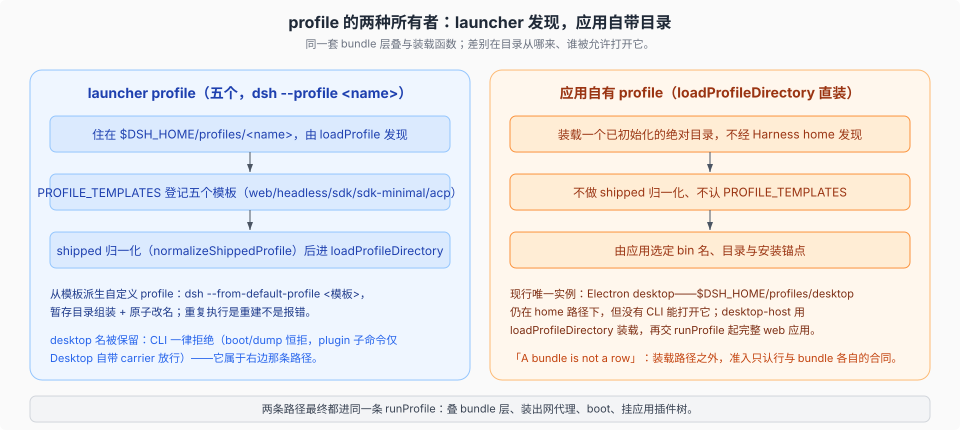

# Runtime Profiles · 运行时配置

## 一句话

Runtime Profile 决定一个 `dsh` 进程**启动时装入什么**：浏览器应用、一次性无界面任务、JSON-RPC 服务、极简 SDK 还是自动化 ACP 服务。会话存在哪里、用哪个模型、是否接沙箱和审批，也在这里定下来。

先立一对最容易混的区分：**Profile 是进程级的宿主形态，Preset 是会话级的工具组合**。同一个 Web 进程可以承载多个 Session，每个 Session 自己选 Agent Preset；Profile 只管这棵进程插件树最初长什么样（preset 的机制归 [`../plugin-system/composition/`](../plugin-system/composition/00-map.md)）。

## 两种所有者，一条装载终点



- **launcher profile**（五个，`dsh --profile <name>`）：住在 `$DSH_HOME/profiles/<name>`，由 `loadProfile` 发现；模板登记在 `PROFILE_TEMPLATES`（`packages/boot/app-boot/src/profile.ts`），本专题是模板清单与各 profile 差异的唯一家。
- **应用自有 profile**：`loadProfileDirectory(binName, dir, installAnchor, options)` 直装一个已初始化的绝对目录——不经 home 发现、不做 shipped 归一化、不认模板。现行唯一实例是 Electron 的 `desktop`（`desktop` 名被保留，CLI 一律拒绝），见 [`06-desktop.md`](./06-desktop.md)。

两组数数法别混，都是五但成员不同：**launcher profile** 是 web / headless / sdk / sdk-minimal / acp；**base-backed 组合**是 web / headless / sdk / acp / desktop。差异在两端：sdk-minimal 是独立树不叠 base（所以在 launcher 里、不在 base-backed 里），desktop 由 Electron 直装（所以在 base-backed 里、不在 launcher 里）。

```text
web:          ['@deepseek-ai/dsh-base', '@deepseek-ai/dsh-web-app']
headless:     ['@deepseek-ai/dsh-base', '@deepseek-ai/dsh-headless']
sdk:          ['@deepseek-ai/dsh-base', '@deepseek-ai/dsh-sdk-app']
sdk-minimal:  ['@deepseek-ai/dsh-sdk-minimal']   // 独立树，不叠 base
acp:          ['@deepseek-ai/dsh-base', '@deepseek-ai/dsh-acp-app']
```

（按阅读顺序列；源码声明顺序无语义。层叠算法本身——空 entry list 起、bundle 层、profile patch、home patch、`--patch` overlay——的家在 [`../plugin-system/composition/`](../plugin-system/composition/00-map.md)。）

从模板派生自定义 profile 用 `dsh --from-default-profile <模板>`；创建路径与保留名的机制见 [`../plugin-system/composition/04-profile-创建与保留名.md`](../plugin-system/composition/04-profile-创建与保留名.md)。

## 决定 Profile 差异的三条轴

| 名称 | 是什么 | 命令 | stdout | 常驻？ |
|------|--------|------|--------|--------|
| **web** | 浏览器 GUI + HTTP 服务 | `dsh --profile web` | 用户终端 | 常驻 |
| **headless** | 一次性 CLI 任务 | `dsh --profile headless "task"` | 最终 assistant 文本（`--json` 转 NDJSON 事件） | 回答完退出 |
| **sdk** | JSON-RPC SDK 服务 | `dsh --profile sdk` | JSON-RPC 帧 | 常驻 |
| **sdk-minimal** | JSON-RPC · 独立树收窄 | `dsh --profile sdk-minimal` | JSON-RPC 帧 | 常驻 |
| **acp** | Agent Client Protocol 服务 | `dsh --profile acp` | ACP 帧 | 常驻 |

三条轴解释这五个形态为什么不同：

1. **进程生命周期**：web 常驻等浏览器；headless 回答一条任务即退出；sdk / sdk-minimal / acp 是常驻 stdio 协议服务，`shutdown` 请求或 stdin end 才退出。
2. **stdout 的归属**：headless / sdk / sdk-minimal / acp 的 stdout 是**纯数据管道**（最终回复或协议帧），不能装 stdout logger，否则污染输出；web 的 stdout 给用户，可以装。
3. **运行时 patch 重载（HMR）**：web 支持（自定义 launcher profile 默认同样开启）；headless / sdk / sdk-minimal / acp 显式禁用——一次性任务与已开始的协议不支持中途重组。机制（三份被监视文件、原子换入、appReady 前提）归 [`../plugin-system/composition/03-user-patch-hmr.md`](../plugin-system/composition/03-user-patch-hmr.md)。

## 共同基底与独有层

web / headless / sdk / acp 与桌面这五个 base-backed 组合共享 `dsh-base`：LLM 运行时、出网检索、session 与持久化、agent 核心、工作目录、工具管线、沙箱与审批、subagent、goal、文件系统。`sdk-minimal` 是唯一不叠 base 的独立树（工具面收窄到一个持久 shell 加两个工具），见 [`04-sdk-minimal.md`](./04-sdk-minimal.md)。

各 profile 在 base 之上叠什么、独有哪些行，一页一个：

| 文件 | 内容 |
|------|------|
| [`01-web.md`](./01-web.md) | web：浏览器 GUI、host/client 两半的分层组合 |
| [`02-headless.md`](./02-headless.md) | headless：一次性任务的执行机制 |
| [`03-sdk.md`](./03-sdk.md) | sdk：JSON-RPC 协议层 |
| [`04-sdk-minimal.md`](./04-sdk-minimal.md) | sdk-minimal：独立树的完整组合事实 |
| [`05-acp.md`](./05-acp.md) | acp：自动化协议层 |
| [`06-desktop.md`](./06-desktop.md) | desktop：Electron 应用自有 profile（组合同 web，启动方式不同） |

web 与 desktop 的「两棵树」形状（host 半边 + 浏览器半边）归 [`../two-tree-runtime/`](../two-tree-runtime/00-map.md)；桌面三进程拓扑的图在 [`../two-tree-runtime/figures/desktop-shape.svg`](../two-tree-runtime/figures/desktop-shape.svg)。

## 按问题找

| 你的问题 | 去哪 |
|---|---|
| 这个进程怎么启动、装了什么 | 本页 + 对应 profile 页 |
| 层叠算法 / patch 语义 / HMR 机制 | [`../plugin-system/composition/`](../plugin-system/composition/00-map.md) |
| 人从哪个入口进来、入口对调用方保证什么 | [`../surfaces-entrypoints/`](../surfaces-entrypoints/00-map.md)（两专题双向单点委托） |
| 改了 patch 为什么没生效 | [`../plugin-system/composition/03-user-patch-hmr.md`](../plugin-system/composition/03-user-patch-hmr.md) + 本页第三轴 |
| 装了为什么没启用 | [`../plugin-system/lifecycle/`](../plugin-system/lifecycle/00-map.md) 的症状定位表 |

## 源码入口

| 路径 | 角色 |
|------|------|
| `packages/boot/app-boot/src/profile.ts` | `PROFILE_TEMPLATES`、`initProfile`、`loadProfile`、`loadProfileDirectory` |
| `packages/bundle/base/cordis.patch.yml` | base-backed 组合共享的核心插件清单 |
| `packages/bundle/{web-app,headless,sdk-app,sdk-minimal,acp-app}/cordis.patch.yml` | 各 profile 特有层 |
| `packages/util/http-proxy/` | launcher 在任何行 mount 之前装的进程级出网代理（机制见 [`../capability-seams/06-外发代理策略.md`](../capability-seams/06-外发代理策略.md)） |

> 承重词按 [`canon/GLOSSARY.md`](../canon/GLOSSARY.md) 的 DSH 原文用；本页自己的分类与指标不是 DSH 的词。
