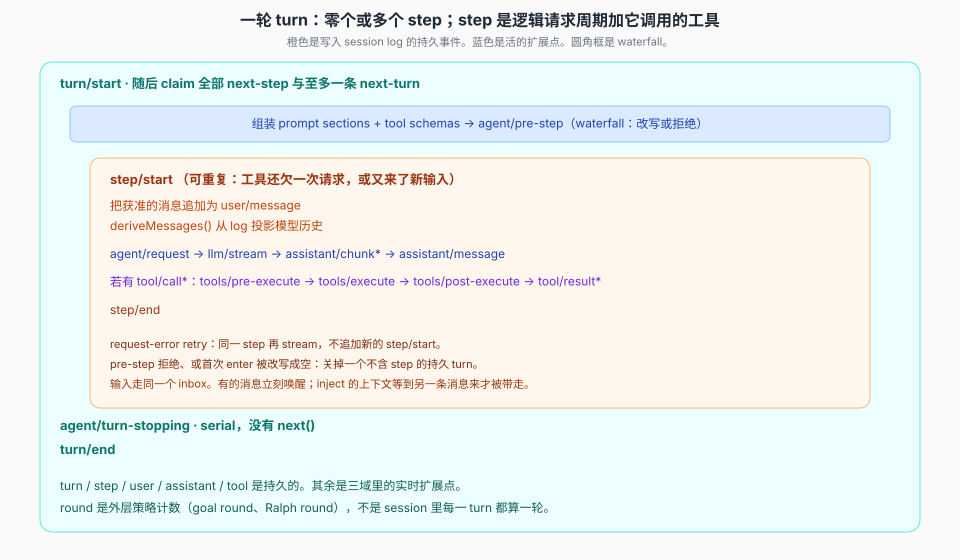

# Session and loop · 会话与驱动

## 一句话

**Session log 是模型请求的可重建来源。** `agent-loop` 是执行驱动，实现 `Agent` 接口。模型可见面由 `session log` 中的特定事件投影而成（模型可见 ⟺ 已记录）。

## 心智模型

核心状态流转机制，详见 [`CONCEPT_INDEX.md`](../CONCEPT_INDEX.md) 对 `turn`、`step`、`surface` 的定义。

### 三条不变量
1. **模型可见 ⟺ 已记录**: `deriveMessages()` 从有序 `surface` 投影，所有 `request/header` 决策必须持久化。
2. **拒绝即事实**: `pre-step` 的拒绝、或 `turn` 被截断，皆作为持久事件记入 log，确保回放一致。
3. **只读的 Projection 机制**: 状态由宿主通过 `Projection` 注册表从日志 fold 而出，`Client` 树的 `store` 严禁存放任何非投影业务事实。

## 架构职责分层

| 层级 | 职责 | 核心组件 |
|---|---|---|
| **会话记录 (Persistence)** | 仅追加事件流，JSONL 格式，世代迁移 | `packages/session/` |
| **驱动器 (Driver)** | `Agent` 运行时，turn/step 逻辑 | `packages/core/agent-loop/` |
| **投影 (Projection)** | 日志折叠、状态快照、视图更新 | `packages/core/session/projection/` |

## 阅读路径

按你的关注维度，从以下专题深入：

| 关注维度 | 阅读入口 |
|---|---|
| 会话日志结构与重建 | [`01-session-event-map.md`](./01-session-event-map.md) |
| 运行时推进机制 (Turn/Step) | [`02-inbox-与turn-时序.md`](./02-inbox-与turn-时序.md) |
| loop 的扩展与定制 | [`03-换loop的半径.md`](./03-换loop的半径.md) |
| 持久化与世代迁移 | [`04-格式世代与迁移.md`](./04-格式世代与迁移.md) |

---
> 承重词按 `canon/GLOSSARY.md` 的 DSH 原文用；本页自己的分类与指标不是 DSH 的词。

## 按问题找

| 你的问题 | 去哪 |
|---|---|
| 事件有哪些、哪些进模型历史、未知类型怎么拒 | [`01`](./01-session-event-map.md) |
| followup / steer / inject 差在哪、turn 内部时序 | [`02`](./02-inbox-与turn-时序.md) |
| 换一个 loop 要满足什么 | [`03`](./03-换loop的半径.md) |
| 旧 session 文件打不开 / 格式世代怎么迁移 | [`04`](./04-格式世代与迁移.md) 的读方向四语义 |
| idle 之后谁在推进、goal 为什么自动续轮 | [`../agent-loop/00-map.md`](../agent-loop/00-map.md) |
| scope / preset 祖先层怎么过滤工具 | 本页 scope chain 节 + [`../plugin-system/composition/`](../plugin-system/composition/00-map.md) |

## 源码入口

| 路径 | `ctx` key | 角色 |
|------|-----------|------|
| `packages/core/session/` | `ctx.sessions` | 仅追加的 log + 内存 store |
| `packages/core/agent/` | `ctx.agents` | `Agent` 接口、活注册表、`agent/*` |
| `packages/core/agent-loop/` | `ctx.agentLoop` | 默认驱动 |
| `packages/core/scope/` | （库） | per-agent 注册原语 |
| `packages/preset/` | | 从 preset `cordis.yml` 组合 |
| `packages/session/` | 持久化 seam | JSONL、projection、title、格式包组与世代迁移 |
| `packages/session/working-directory/` | `ctx.workingDirectory` | 每个 Session 的持久工作目录：`workingDirectory` projection 状态 + session 事件落盘，模型侧入口是 `packages/session/tool-working-directory`（声明见 [`docs/persistence-changes/2026-09-13-working-directory.md`](../../docs/persistence-changes/2026-09-13-working-directory.md)） |
| [`docs/agent-lifecycle.md`](../../docs/agent-lifecycle.md) | | 官方时序图 |
| [`docs/subsystems/session.md`](../../docs/subsystems/session.md) | | session 语义 |
| [`docs/subsystems/scope.md`](../../docs/subsystems/scope.md) | | scope 语义 |
| [`docs/subsystems/core.md`](../../docs/subsystems/core.md) | | Agent handle、取消与恢复 |

## 机制级正文

| 文件 | 内容 |
|------|------|
| [`01-session-event-map.md`](./01-session-event-map.md) | 信封、surface 五类、required-on-read 与 ignorable |
| [`02-inbox-与turn-时序.md`](./02-inbox-与turn-时序.md) | followup / steer / inject；claim；拒绝仍关 turn；settlement 与 `system/message` |
| [`03-换loop的半径.md`](./03-换loop的半径.md) | `AgentFactory`、日志与事件义务、默认组合替换点 |
| [`04-格式世代与迁移.md`](./04-格式世代与迁移.md) | 世代、相邻迁移链、权威与门禁、读方向与读准备/写发布 |

下一专题：[`../agent-loop/00-map.md`](../agent-loop/00-map.md)（idle 之后谁在推进）、[`../capability-seams/00-map.md`](../capability-seams/00-map.md) 或 [`../tools-prompt-llm/00-map.md`](../tools-prompt-llm/00-map.md)。

> 承重词按 [`canon/GLOSSARY.md`](../canon/GLOSSARY.md) 的 DSH 原文用；本页自己的分类与指标不是 DSH 的词。
