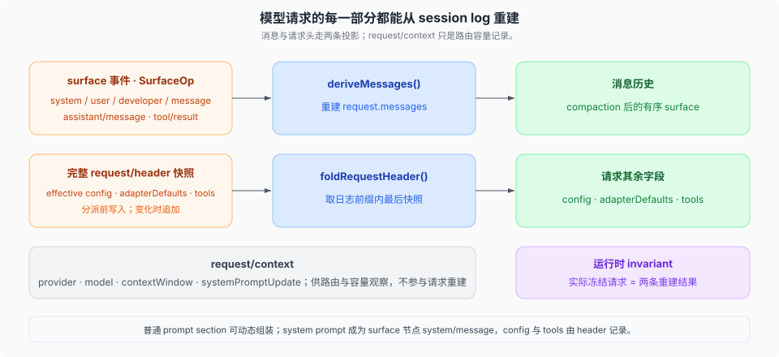
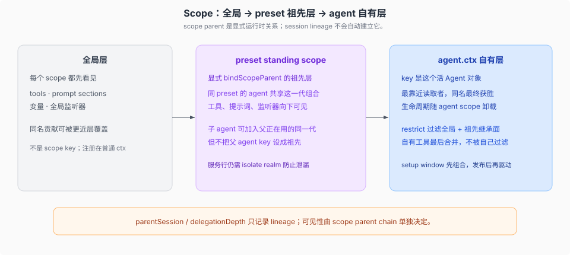

# Session and loop · 会话与驱动

## 一句话

**session log 是模型请求的可重建来源。** `agent-loop` 只是默认驱动，实现 `Agent` 接口。UI、hook、工具插件依赖 `dsh-agent`，不依赖具体 loop。

**模型可见 ⟺ 已记录。** 消息从 surface 事件投影；生效的模型配置与 tools 在分派前写入 `request/header` 快照；system prompt 不在这里，它是 surface 节点 0 的 `system/message`。

## 一轮对话长什么样

词汇先分开（正式定义在 [`docs/glossary.md`](../../docs/glossary.md)）：

| 词 | 含义 |
|----|------|
| **turn** | 一次把获准输入抽干。模型与工具都停了，或策略终止，这一轮结束。 |
| **step** | 一次逻辑模型请求周期，加上它调用的工具。`agent/request-error` 重试可在同一 step 内再次流式请求。一个 turn 里可以有 0 个或多个 step。 |
| **round** | 外层策略计数，例如 goal round、Ralph round。不是 session 里每一 turn 都算。 |

读这张图时抓住三件事：

1. **橙色是持久的。** `turn/*`、`step/*`、`system/message`、`user/message`、`assistant/*`、`tool/*` 写入 log，reload / fork / 回放都靠它们。
2. **蓝色是活的扩展点。** `agent/pre-step`、`agent/request`、`llm/stream` 与四条 `tools/*` waterfall（`pre-execute` / `execute` / `post-execute` 在调用管道上，`ptc-dispatch-log` 观察 PTC 子调度；`tools/result` 是同步通知，不是 waterfall）是 waterfall；`next()` 委托下游，拥有最终决定的监听器可以直接返回并短路。`agent/turn-stopping` 是 serial，没有 `next()`；需要继续时由监听器 `agent.steer()`。
3. **拒绝也记一笔。** `pre-step` 拒绝、或首次 enter 被改写成空，仍关掉一个不含 step 的持久 turn。日志记录这次尝试。

输入走**同一个 inbox**。有的消息立刻唤醒驱动器；`agent.inject()` 放进去的上下文会等，直到另一条消息把它带走。

**surface 是本专题第一承重词**：能进入模型消息投影的事件只有五类——`system/message`、`user/message`、`assistant/message`、`tool/result`、`developer/message`——它们构成有序 surface，`deriveMessages()` 从它投影历史；其余事件是 log-only 的持久事实（事件全表见 [`01`](./01-session-event-map.md)）。

## 模型可见即已记录

这条不变量决定了模型请求各部分如何落日志：

- 对话内容用 `agent.inject()` 或其它消息入口；获准后写成 surface `user/message`。
- prompt section、tool schema 和模型配置可以在请求前动态组装；loop 把 system prompt 写成 `system/message` 节点，把 config、adapterDefaults 与 tools 写入 `request/header`，然后才分派。
- 只有现有 surface 与 `request/header` 都无法表达的新语义，才需要扩展 `SessionEventMap` 并补上对应的重建规则。

这条不变量落地为三件事：`deriveMessages()` 只从有序 surface 投影历史；`request/header` 单独重建 config、adapterDefaults 与 tools（system prompt 是 surface 节点 `system/message`，`request/context` 不参与重建）；**完整记录不等于完整发送**——compaction 只让 replacement 在后续投影中遮蔽旧 surface，raw log 从不删事件。逐 chunk 时序内嵌在结算事件的 `stream` 里。精确折叠规则见 [`01-session-event-map.md`](./01-session-event-map.md#完整记录不等于完整发送)。

fork、resume、transcript、遥测、持久化都从这一条流派生。持久化是 **JSONL-only**（zstd 拼接多帧容器支持追加与批量恢复），按格式世代寻址：**更新**版本拒收并指出「升级 harness」，**更旧**版本经 build-static 相邻链迁移到当前写者版本。世代、权威与读准备/写发布时序见 [`04-格式世代与迁移.md`](./04-格式世代与迁移.md)。所以 loop 可以换：只要新驱动仍往同一条 log 写、仍发同一类 `session/event`，渲染面可以不动。

## Projection 注册表

projection 是「由日志折叠出的当前值」的机制面：host 侧插件把 projection unit 注册进 `session-projection`，读方用 `stateOf()` 取类型化状态。三条合同：

- 定义带 `init(header, inheritedEventCount)`：fork/resume 时从哪条 seq 起算自有事件由此决定；
- 视图发布按 `Object.is` 比较，两次 fold 引用相同则跳过，避免无效 UI 更新；
- 它是**可选注册表**，与 `session-persistence` 之间没有依赖边——强制点在消费者一侧：读方必须自己拒绝缺失的注册表或键，否则「读投影状态却不激活该状态」会静默发生（[`2026-08-19-session-projection-mandatory-seam`](../../.agents/notes/implemented/architecture/2026-08-19-session-projection-mandatory-seam.md)）。

## 每个 agent 的 scope chain

- 注册表先读**全局层**，再按 scope parent chain 从最远祖先读到当前 agent；离 agent 最近的同名注册获胜。
- Agent preset 是显式祖先层：standing composition 的工具、提示词和监听器对加入它的 agent 可见。子 agent 可以加入父 agent 正在使用的同一 preset generation，但不会因此继承父 agent 自有层的注册。
- `parentSession` / `delegationDepth` 是持久 lineage 数据，不会自动建立 scope parent；可见性只由 `bindScopeParent` 的运行时关系决定。
- **restrict**：沿 chain 的 restriction 取交集，过滤全局与祖先贡献；当前 agent 自有层的注册最后合并，不受自己的继承面过滤。被过滤的工具在提示词和执行中都表现为不存在。
- **setup window**：agent 对象已经有了、但还没发布、还没走 session-start 边。这里只注册，不驱动。preset 给**一个 session** 另一套能力，其中的服务行需要 `isolate` realm。

## 按问题找

| 你的问题 | 去哪 |
|---|---|
| 事件有哪些、哪些进模型历史、未知类型怎么拒 | [`01`](./01-session-event-map.md) |
| followup / steer / inject 差在哪、turn 内部时序 | [`02`](./02-inbox-与turn-时序.md) |
| 换一个 loop 要满足什么 | [`03`](./03-换loop的半径.md) |
| 旧 session 文件打不开 / 格式世代怎么迁移 | [`04`](./04-格式世代与迁移.md) 的读方向四语义 |
| idle 之后谁在推进、goal 为什么自动续轮 | [`../agent-loop/00-map.md`](../agent-loop/00-map.md) |
| scope / preset 祖先层怎么过滤工具 | 本页 scope chain 节 + [`../plugin-system/composition/`](../plugin-system/composition/00-map.md) |

## 源码入口

| 路径 | `ctx` key | 角色 |
|------|-----------|------|
| `packages/core/session/` | `ctx.sessions` | 仅追加的 log + 内存 store |
| `packages/core/agent/` | `ctx.agents` | `Agent` 接口、活注册表、`agent/*` |
| `packages/core/agent-loop/` | `ctx.agentLoop` | 默认驱动 |
| `packages/core/scope/` | （库） | per-agent 注册原语 |
| `packages/preset/` | | 从 preset `cordis.yml` 组合 |
| `packages/session/` | 持久化 seam | JSONL、projection、title、格式包组与世代迁移 |
| `packages/session/working-directory/` | `ctx.workingDirectory` | 每个 Session 的持久工作目录：`workingDirectory` projection 状态 + session 事件落盘，模型侧入口是 `packages/session/tool-working-directory`（声明见 [`docs/persistence-changes/2026-09-13-working-directory.md`](../../docs/persistence-changes/2026-09-13-working-directory.md)） |
| [`docs/agent-lifecycle.md`](../../docs/agent-lifecycle.md) | | 官方时序图 |
| [`docs/subsystems/session.md`](../../docs/subsystems/session.md) | | session 语义 |
| [`docs/subsystems/scope.md`](../../docs/subsystems/scope.md) | | scope 语义 |
| [`docs/subsystems/core.md`](../../docs/subsystems/core.md) | | Agent handle、取消与恢复 |

## 机制级正文

| 文件 | 内容 |
|------|------|
| [`01-session-event-map.md`](./01-session-event-map.md) | 信封、surface 五类、required-on-read 与 ignorable |
| [`02-inbox-与turn-时序.md`](./02-inbox-与turn-时序.md) | followup / steer / inject；claim；拒绝仍关 turn；settlement 与 `system/message` |
| [`03-换loop的半径.md`](./03-换loop的半径.md) | `AgentFactory`、日志与事件义务、默认组合替换点 |
| [`04-格式世代与迁移.md`](./04-格式世代与迁移.md) | 世代、相邻迁移链、权威与门禁、读方向与读准备/写发布 |

下一专题：[`../agent-loop/00-map.md`](../agent-loop/00-map.md)（idle 之后谁在推进）、[`../capability-seams/00-map.md`](../capability-seams/00-map.md) 或 [`../tools-prompt-llm/00-map.md`](../tools-prompt-llm/00-map.md)。

> 承重词按 [`canon/GLOSSARY.md`](../canon/GLOSSARY.md) 的 DSH 原文用；本页自己的分类与指标不是 DSH 的词。
