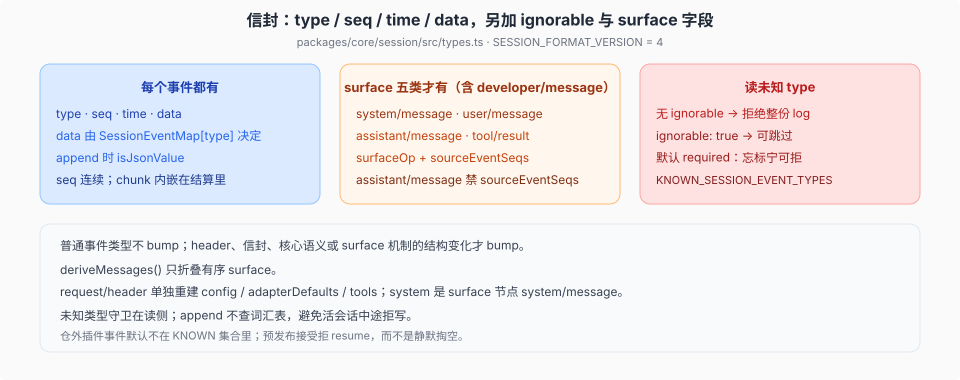

# SessionEventMap 与 required-on-read

> **为什么单独有这一页**：多数 agent 系统在内存里维护一份可读可写的 `messages[]`，需要存盘时再整体序列化；DSH 相反，把**只追加的事件日志**当成唯一真实来源，下一次请求发给模型的历史、UI 展示的对话树、以及跨版本兼容性判断全部从同一份 log 投影出来。想在不损坏持久化历史、也不漏掉模型可见上下文的前提下新增事件或读懂日志，必须先把「log 里存了什么、哪些进模型请求、遇到不认识的事件何时该报错」立成一张清晰地图。
>
> **读法与分工**：先读「一份 log 是什么」区分“记录事实”和“投影消息”，再按需检索核心事件表；跨版本格式升级与迁移规则不在本页展开，见 [`04-格式世代与迁移.md`](./04-格式世代与迁移.md)。
>
> 源码核验入口：`packages/core/session/src/types.ts`、`packages/core/session/src/known-event-types.ts`、[`2026-08-10-session-log-version-mechanism`](../../.agents/notes/implemented/architecture/2026-08-10-session-log-version-mechanism.md)、[`2026-08-31-released-session-format-migrations`](../../.agents/notes/implemented/architecture/2026-08-31-released-session-format-migrations.md)、[`docs/session-format-status.md`](../../docs/session-format-status.md)、[`2026-08-31-session-sequence-and-log-offset-brands`](../../.agents/notes/archived/architecture/2026-08-31-session-sequence-and-log-offset-brands.md)。

## 一份 log 是什么

`SessionEventMap` 是可合并的、仅追加的交互源。消息历史从它投影，不另存一份 `messages[]`。每个事件是无损 JSON；`seq` 连续（当前格式里一次模型尝试只结算一条事件，逐 chunk 时序内嵌在它的 `stream` 里），持久化才能原样存 canonical log。

**seq 与日志 offset 是两个品牌类型**：`SessionSeq` 命名一条已存在的事件，`SessionLogOffset` 命名空隙/前缀长/读切。信封 `seq`、surface 替换端点与来源事件引用用 `SessionSeq`；`Session.seq`、`firstLiveSeq` 与正文读偏移用 `SessionLogOffset`；线上数值不变，header 用 `isSeeded` + 正文侧 `inheritedEventCount` 表达种子边界（决定记录：[`2026-08-31-session-sequence-and-log-offset-brands`](../../.agents/notes/archived/architecture/2026-08-31-session-sequence-and-log-offset-brands.md)）。本专题说「seq 连续」指事件身份，与日志物理偏移无关。

核心地图（插件用 `declare module '@deepseek-ai/dsh-session/types'` 往里加键）里，loop 自己写的是（标注了写者的两行除外）：

| type | 进 `deriveMessages`？ |
|------|------------------------|
| `turn/start` · `turn/end` | 否（边界） |
| `step/start` · `step/end` | 否 |
| `system/message` | 是（surface；system prompt 的落点，第一条成为 surface 节点 0） |
| `user/message` | 是（surface） |
| `assistant/message` | 是（surface；空 content 派生为 null；内嵌 `stream`；可带 `interrupted: true`） |
| `assistant/attempt` | 否（log-only；保存失败、重试、取消或流错误的尝试的内嵌 `stream`） |
| `tool/call` | 否 |
| `tool/result` | 是（surface；一等 tool-role message：role `'tool'`、`toolCallId` 在 message 层、扁平 content，error 可带 `reason`） |
| `request/header` | 否（单独重建 config、adapterDefaults 与 tools） |
| `request/context` | 否（只记录 provider、model、context window 与 `systemPromptUpdate` 能力） |
| `todo/write` | 否（log-only UI；非 loop 写——`packages/todo/tool-todo/src/index.ts:199`） |
| `workspace/changes` | 否（log-only；非 loop 写——turn 结束时的 git 快照对比：每文件行数摘要 + per-file 对比，payload `{ turn }`；写者 `packages/deliverables/workspace-changes/src/recorder.ts:351`，投影经 `registerMessageProjection` 挂 summary；无 git 或工作目录在仓库外时退化为文件工具改动清单） |
| `image/offload` | 否（log-only 的表面修复决策；非 loop 写——路由以 `IMAGE_OFFLOAD_REQUIRED` 拒绝请求时选中最旧的保留图片出现并重试，不占重试预算，payload `{ targets }`；写者 `packages/compaction/compaction-image-offload/src/image-offload.ts:44`，后续请求对这些出现发占位文本） |
| `developer/message` | 是（surface；第五类：于指定 turn/step 准入的增量会话变化消息，如工具增删，空节点保留位置不产生模型消息） |
| `session/end-seed` | 否（种子与 live 的分界；非 loop 写——合法写者 = Session 构造器 + `buildForkSeed`（fork seed 可自带 tagged end-seed marker 与 child-owned synthetic closers，marker 不必在 `firstLiveSeq`，`packages/core/session/src/types.ts:403-428`）；appender `packages/core/session/src/index.ts:695-697`） |

`SurfaceEventType` 有五类：`system/message`、`user/message`、`assistant/message`、`tool/result`、`developer/message`（闭集，`packages/core/session/src/types.ts`）。只有它们可以带 `surfaceOp`；`assistant/message` **独占禁止** `sourceEventSeqs`，其余四类可引用非空、唯一、严格更早的 seq 集合。编译器在 `Session.append` 调用点强制：log-only 事件不许带 surface 字段。

`surfaceOp`：`'append'` 接到尾巴；`{ op: 'replace', startSeq, endSeq }` 换掉一段有序 surface（compaction 与 system 节点改写用）。端点按**当前 surface 顺序**、含端点解释，不是数值 seq 顺序；replace 节点的 `sourceEventSeqs` 必须覆盖被挡住的每一个 surface 节点。

## required-on-read

信封上的 `ignorable?: true`。缺省 = **required**。读者碰到不认识的 `type`：

- 没有标记 → 拒绝重建整份会话。未识别的 required 事件可能改变其余 log 怎么读（`session/end-seed` 是现成例子）。
- `ignorable: true` → 可以跳过。写者只给「丢了也不影响重建」的信息性记录打这个标。

默认 required：忘了标记会**过度拒绝**（不方便）；默认 ignorable 会**静默掏空**再 resume（安全事故）。模型请求的消息由 surface 类型投影：`developer/message` 以 `developer` role 进入 `deriveMessages()`，未声明 `toolUpdate` 支持的 route 通过 `withoutDeveloperMessages()` 从请求中省略该类消息（`packages/llm/llm/src/content.ts:430-436`），而 `llm-deepseek` 与 `llm-pi-ai` 将其折进 `{ role: 'system', ... }` 消息且仅拒绝不支持的内容块类型（`packages/llm/llm-deepseek/src/serialize.ts:91-101`、`packages/llm/llm-pi-ai/src/context.ts:171-200`）；config、adapterDefaults 与 tools 由 `request/header` 折叠，system prompt 取当前有效的 `system/message` 节点；`request/context` 不参与请求重建。真正危险的未知量是那些改变怎么读其余 log 的非 surface 事件。

required 与否**只由信封的 `ignorable` 决定**，不按事件「注册时间」区分：`known-event-types.ts` 只是一个扁平的名字集合（文件头部 JSDoc 自述），读侧按 `event.ignorable !== true` 判定必知，种子事件的信封校验同样只接受 `true`。**跨历史格式边时规则更严**：未知事件即使带 `ignorable: true` 也拒迁，因为基数保持型迁移必须证明每个被保留的 payload 在目标世代仍语义有效（[`2026-08-31-alpha-historical-unknown-event-refusal`](../../.agents/notes/implemented/architecture/2026-08-31-alpha-historical-unknown-event-refusal.md)）。

已知集合是生成的 `KNOWN_SESSION_EVENT_TYPES`（`gen-persistence-catalog` 扫本仓库每一次 `SessionEventMap` 合并）。同一版本、不同插件组合，读规则仍一致。仓外插件事件按构造不在表里；预发布接受「第一方读者拒 resume」，且拒绝是大声的。

守卫在**读**侧。`append` 不查词汇表：活会话中途拒写，比下次加载时大声拒绝代价更大。

## 持久化与版本权威

当前持久化 **JSONL-only**：`session-persistence-jsonl` 用 zstd 拼接多帧容器压缩，支持追加与批量恢复。写者版本（`SESSION_FORMAT_VERSION`，钉在每个 `SessionHeader` 上）、bump 规则（写者决定、加普通事件不 bump）、读方向（更新拒、更旧迁）、世代不可变承诺与读准备/写发布时序的唯一家是 [`04-格式世代与迁移.md`](./04-格式世代与迁移.md)。

## 完整记录不等于完整发送

原始 session log 仅追加，记录完整的耐久事实；下一次模型请求使用的消息则是当前有序 surface 的投影。compaction 会追加 summary 和 replacement 事件，`surfaceOp: replace` 只让被覆盖的 surface 节点退出后续 `deriveMessages()` 结果，不会从 raw log 删除旧事件。持久化、审计和精确回放因而仍能读取完整历史，模型则只接收当前投影。

`Session.deriveMessages()` 只折叠有序 surface 节点。返回的数组每次是新的；里面的 `Message` 对象共享且深冻结。`assistant/message` **独占禁止** `sourceEventSeqs`，投影本身不用内嵌 `stream`；逐 chunk 的时序证据留在 `stream` 里，需要时用 `expandAssistantStream()` 展开（`packages/llm/llm/src/assistant-stream.ts:202`）。

人看的 transcript 不是同一份投影：UI 常用 **append-origin** 的 surface 事件；`deriveMessages()` 走 compaction `replace` 之后的有序 surface。像素级回放展开 settlement 的内嵌 `stream`（`expandAssistantStream()`，`packages/llm/llm/src/assistant-stream.ts:202`）；模型下一请求读 assembled message。

两套「source」不要混：`sourceEventSeqs` 是 log 里更早事件的 seq；`UserMessage.source` 是语义来源（字段为 `kind`：`user` / `model` / `tool` / `system-prompt` 及各生产者合并的 kind，`packages/llm/llm/src/message.ts` 的 `MessageSourceMap`），不参与 surface fold。

生产者合并 kind 的现成例子：迟到的问题回答以 `source.kind: 'user-question-reply'`（`{ callId, outcome: 'answered' }`，`packages/interaction/user-questions/src/types.ts:108-117`）写在普通 `user/message` 上——answer RPC 是唯一生产者（`packages/interaction/user-questions/src/index.ts:186-195`），`userQuestions` projection 读它关题并记录答案；加生产者 kind 不加事件类型，不 bump `SESSION_FORMAT_VERSION`（声明见 `docs/persistence-changes/2026-09-21-user-question-reply.md`）。

对话内容必须成为 surface；system prompt 最终写成 `system/message` 节点，`inject` 和 runtime-context 快照最终都写成 `user/message`。动态 prompt section、tool schema 与模型配置走另一条现成路径：实际结果在分派前写入 `request/header`（system 除外），无需为每个 section 新增事件类型。只有现有 surface 与 header 都无法表达的新语义，才扩展 `SessionEventMap` 和相应的重建规则。
