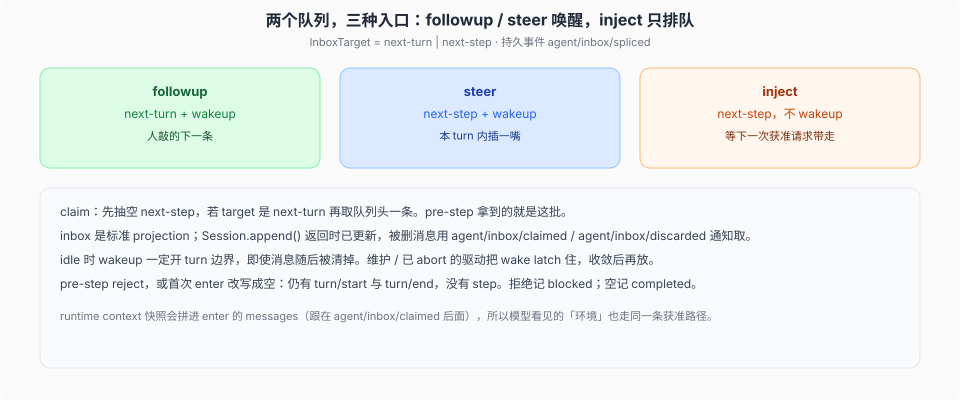

# Inbox、唤醒与 turn 时序

> **为什么单独有这一页**：表面上看，给 agent 发消息无非是「塞进队列等下一轮跑」；但在真实运行里，用户输入、后台子代理回传、`inject` 注入和 `RuntimeContext` 快照可能在任意时刻到达——如果把「唤醒下一轮」「插话当前轮」「静默注入材料」混成一条内存队列，或把 `pre-step` 拒绝与崩溃中止写混，就会丢消息、错 turn 边界，甚至把内存队列漏掉的输入带不进 fork/resume。本页单独拆解**默认驱动从入队认领到单次流式结算的完整时序**，帮你在写 hook、发 steer/inject 或追查“为什么这条消息没进本步/进了下一步”时有一张精确的状态钟。
>
> 源码核验入口：`packages/core/agent-loop/src/inbox.ts`（`Inbox` 契约由 `dsh-agent` 的 `runtime-types.ts` 导出）、`packages/core/agent/src/types.ts`（`InboxTarget` 与 `inbox` projection 键）、`packages/core/agent-loop/src/agent.ts` 的 `ReactLoopAgent`、`packages/core/agent-loop/src/assistant-stream.ts`；测试用 `dsh-agent-loop-testkit` 的结构化 stub。



## 两个队列，三种入口

`InboxTarget` 只有两个：`'next-turn'` 与 `'next-step'`。**队列是持久事实**——它是标准 `inbox` projection 对整份日志的折叠状态，不是内存里的临时列表；入队只是 append 一条 `agent/inbox/spliced` 事件，出队（claim）append `agent/inbox/claimed`。三件由此而来的事：

- **pre-splice 的 `session/event` 视图不存在**：要拿被删消息请监听 `agent/inbox/claimed` / `discarded`，不要依赖同步观察者里的旧列表。
- **种子（fork 继承前缀）里的 splice 会进子会话队列**：fork 出的 child inbox 含继承项，父项与自有项按序共存（`packages/core/agent-loop/tests/inbox.spec.ts` 的 "projects inherited inbox events in a forked session" 断言）。
- `claim(target, turn)`（**认领**：把消息从持久队列取出、准备进本次请求）：抽空 `next-step`；若 `target === 'next-turn'` 再取 `next-turn` 的头一条，逐条发 `agent/inbox/claimed`。loop 的 step 边界操作，不是插件扩展点。

`ReactLoopAgent.send(message, target, wakeup)` 三个公开入口：

| 方法 | target | wakeup | 典型用途 |
|------|--------|--------|----------|
| `followup` | `next-turn` | true | 人的下一条，开新 turn |
| `steer` | `next-step` | true | 本 turn 内插话，下一步带走 |
| `inject` | `next-step` | false | 文件变更、AGENTS.md、skill……等下一次获准请求 |

唤醒输入不能加入已经 abort 的活动：若 `wakeup &&` 当前非 idle 且 abort 已触发，target 改成 `next-turn`。这个分类在插入**之前**拍板，以免 splice 观察者里的可重入 cancel 把它改类。

idle 时 wakeup **一定**开 turn 边界，即使消息随后被清掉。只有 latch 住的重放会在队列不再持有 wake 时被抑制。维护中或已 abort 的驱动把 `wakeRequested` latch 住，收敛后再 `wakeDriver`。`runMaintenance` 期间 `status` 仍是 `idle`。`disposed` 原因不 latch，teardown 不等模型 turn。

runtime context **不是** `inject`。`RuntimeContextProjection.project()` 造一条 `UserMessage`（source 写 `kind: 'runtime-context'` 并携带 `form: 'snapshot', sections`，`packages/core/agent-loop/src/runtime-context.ts:13-16,152-163`），只在文本相对上次保留快照有变化时给出候选。它与 pre-step 的 enter 批次解耦：pre-step 下游只求值候选（`packages/core/agent-loop/src/agent.ts:274-284`），真正落盘由 `step()` 在每次 attempt 的 dispatch 前完成（`:411-414`、`:438-440`）。`inject` 是插件往 `next-step` 塞材料、不唤醒；两者都会在获准后变成 `user/message`，入队路径不同。

`cancel({ keepInbox })`：默认 `inbox.clear()`（先 next-step 再 next-turn）。`keepInbox` 只 abort 活动，不记 canceled splice。

## 折叠细节与同队特例

projection 建 cell 时折的是 `session.snapshotEvents()` 的整段内存日志（`packages/session/session-projection/src/index.ts` 的 `buildCell`；**cell** = 一个 agent 的 inbox 折叠单元），不是 `ownEvents()`——后者只是给普通消费者提供「本条会话自有后缀」的视图。live 通知（`agent/inbox/inserted` / `discarded`）在 `Session.append()` 返回、projection 已更新之后发出。

迟到的问题回答也走同一条队列：timed `ask_user_question` 在前台等待超时先结算 `pending`（问题保持可答），用户随后的提交由 `dsh-user-questions` 的 answer RPC 构造一条 `user-question-reply` 消息 `steer` 进 `next-step`，claim 与获准后落 `user/message` 的路径和其它输入完全相同。

## `turn()` 里实际发生的事

1. `session.append('turn/start', { turn })` —— 在 claim 和 pre-step **之前**。所以拒绝也有打开的 turn。
2. `preStep`：**先 `claim`**（消息已从 inbox 耐久删掉并 `agent/inbox/claimed`），再 `systemPrompt.assemble`，最后 `waterfall('agent/pre-step')`。runtime context 快照只在下游的 default 分支求值（`packages/core/agent-loop/src/agent.ts:274-284`），inner 默认 `{ kind: 'enter', messages: claimed + context? }`；真正写进日志推迟到 `step()` 的 attempt。
3. `reject` → `turnEnds = { kind: 'blocked' }`，没有 step，也**没有** `user/message`。claimed 的条目不会回到 inbox。
4. 首次 step 且 `messages.length === 0`（唤醒消息被拿掉，或 enter 被改写成空）→ `completed`，仍无 step。
5. 否则先 append `step/start`，再进 `step()`；获准的消息不在 step 边界落盘，而是在 `step()` 的**首次 attempt 内**逐条 append `user/message`（`surfaceOp: 'append'`，`packages/core/agent-loop/src/agent.ts:426-437`），runtime context 快照在同一批次里按序落位（`:438-440`）。
6. 工具还欠一次请求，或 `next-step` 又有货 → 下一 step 的 target 是 `next-step`。
7. 有结束原因且 `next-step` 为空时，`serial('agent/turn-stopping')`（没有 `next()`）；监听器可 `agent.steer()`，驱动随后重读 inbox，有新工作就继续下一 step。
8. `finally` 里 `turn/end`。loop **不等** turn 边界上的 flush；checkpoint 策略另挂。

`turn/end` 的 `interrupted` 只用于补写崩溃孤儿 turn，补写者是 **agent-loop 的 resume** 与 **session-query 的冷读**两个消费点（`packages/core/session/src/types.ts:216-222`），不是持久化后端；loop 在正常路径从不发这个标记。别和 `assistant/message.interrupted` 混：那是 loop 在取消时主动写的前缀定稿（见 `step()` 一节），不是 `turn/end` 的字段。v1→v2 迁移会在 bounded legacy 重启模式下**补写**一条 interrupted 的 `turn/end`（`.agents/notes/implemented/architecture/2026-08-31-released-session-format-migrations.md:90-92`），那是历史修复，不是 loop 行为。

## `step()` 与历史

`buildRequest(..., this.session.deriveMessages(), ...)` 之后，一次 attempt 的流是：

```text
llm.stream / preparedCall.stream（整个 for-await 包在 try/catch）
  每个 chunk → live.push(chunk)：进内存 accumulator / assembler + process-local 帧，不落盘
  signal.aborted 且 assembler 有已送达前缀 → live.settle + append assistant/message
    （interrupted: true，带内嵌 stream；未派发的 tool-call 不在），再 rethrow
  无可见前缀的取消 / 失败 / 流错误 → append log-only assistant/attempt（带内嵌 stream）
  assembler.finish
  error/aborted → waterfall agent/request-error；retry 则同一 step 再来，不新开 step
  否则 createAssistantMessage → assistant/message
    （surfaceOp append，带内嵌 stream；无 sourceEventSeqs）
  max-tokens → 该 step 结束，turn 上 sticky
  无 tool-call → completed
  有 → executeToolCalls；可往 next-step splice 上下文
```

每次 attempt 在 `live.push` 之前先刷新 runtime context、再结算 system prompt：`SystemPromptProjection.project()` 决定这一轮提交哪些 `system/message` 节点，然后才发请求（`packages/core/agent-loop/src/agent.ts:411-424`）。attempt 内内存累积与 process-local 帧见 `packages/core/agent-loop/src/assistant-stream.ts`；结算点见 `packages/core/agent-loop/src/agent.ts` 的 attempt 结算段。

请求头：`request/header` 在 dispatch 前写入，只承载 config、adapterDefaults 与 tools。对截至某次请求的日志前缀取最后一份，即可重建当时的 config 与 tools；system prompt 从当前有效的 `system/message` 节点取。`request/context` 只在路由、容量或 `systemPromptUpdate` 能力变时写，不参与 header 相等。

## `system/message` 与请求上下文

system prompt 承载在 surface 事件 `system/message { turn, step, message }`（`packages/core/session/src/types.ts:331`）中。每个会话的第一条 `system/message` 成为受保护的 surface 节点 0；`request/header` 不含 `system`，`headerEquals` 只比 config、adapterDefaults 与 tools（`packages/core/session/src/request-header.ts:21-30,43-52`）。

`SystemPromptProjection.project()` 有三条路由（`packages/core/agent-loop/src/runtime-context.ts:88-110`）：没有任何 system 节点 → append 一条；route 不具备 in-history 能力、开了新 series、或渲染为空 → 归一化（清空后续非空节点，必要时改写头部）；具备 in-history 能力的 route → 内容变化时 append 一条新节点。`request/context.systemPromptUpdate`（`packages/core/session/src/types.ts:263`）记录 route 能力：`'in-history'` 表示该 route 把任意位置的最后一条 `system` 消息当作有效 system prompt。

`turn()` 第一步先从 `next-turn` claim 一条排队消息并同步抽空 `next-step`（inject 的材料若此前已入 `next-step`，会和该条 `followup` 在**同一 step** 进入模型）；后续 step 只 claim `next-step`。
