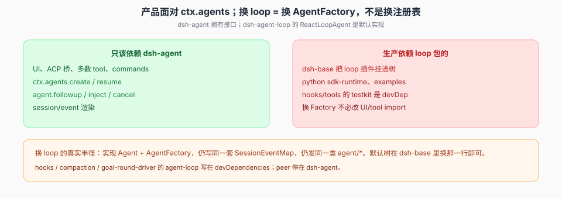

# `dsh-agent` 与 `dsh-agent-loop`：换 loop 的半径

> **为什么单独有这一页**：总览里常说「`agent-loop` 也是一个可替换的插件」，但真要动手换驱动或写一个面向 `Agent` 接口的消费者时，立刻会面临一个实际问题：**到底哪些东西属于“驱动无关的稳定合同”（谁都可以依赖）、哪些只是默认 `ReactLoopAgent` 的私有实现（换了 loop 就不再成立）？** 如果划不清这条界线，要么消费者偷偷绑死默认 loop 导致不可替换，要么自定义驱动漏维护投影和信封把前端和持久化一起弄坏。本页专门划出**可替换性的精确半径**与兼容义务清单。
>
> 源码核验入口：`packages/core/agent/src/index.ts` `AgentRegistry` / `AgentFactory`、`packages/core/agent/src/types.ts` / `runtime-types.ts` `Agent`、`packages/core/agent-loop/src/agent.ts` `ReactLoopAgent`、`packages/core/agent-loop/src/index.ts` `AgentLoop`。

运行时消费者面向 `dsh-agent` 的 `Agent` 与 `AgentFactory` 编程；composition、demo 和测试包可以显式选择默认 `dsh-agent-loop`。

## 接口在 agent，驱动在 loop

`ctx.agents` 是 `AgentRegistry`（`dsh-agent`）。它跟踪活着的 agent，提供 process-local initiator（`AsyncLocalStorage`），但不实现 turn。创建委托给 `AgentFactory`：

- `createAgent(ownerCtx, options)` — 调用方提供 `sessionId`；setup 窗口 → commit → 登记 session 与 agent → `AgentRegistry.announce()` 发出串行 `agent/created { agent, source: SessionStartSource, signal? }`（`packages/core/agent/src/index.ts:539-561`；`SessionStartSource = 'startup' | 'resume' | 'clear' | 'compact'`，`packages/core/agent/src/runtime-types.ts:125`）。这条 session-start 边是第一个允许提交启动输入的扩展点，且逐 agent 只发一次（重复 announce 抛错）；真正的 turn 由 waking input 驱动。
- `resume(ownerCtx, options)` — 先 `persistence.open(id, 'write')` 取得写所有权（`packages/core/agent-loop/src/index.ts:879`，注释写明 "Taking write ownership FIRST"），再读回日志，最后 `ctx.sessions.prepare(id, ...)` 构造 Session（`:893`）；seam 本身没有 `prepare`，它只有 `create` / `open` / `flush` / `stat` / `list`（`packages/session/session-persistence/src/index.ts:152,167,180,196,203`）。

默认 loop 插件在构造时调用 `ctx.agents.setFactory(this)`。没有 factory 时，`create` / `resume` 抛出 `no agent factory registered (load an agent-loop plugin)`。ACP 等消费者对着 `ctx.agents` 编程，不需要导入 `ReactLoopAgent`。

`Agent` 句柄的字段、驱动方法和生命周期语义由 `dsh-agent` 的公开接口定义。`agent.ctx` 是该 agent 的注册 scope；工具、提示词和监听器在这里登记即可获得 agent-local 生命周期，不应依赖 `ReactLoopAgent` 的私有 `kick` / `turn` / `step`。

## setup 窗口

`CreateAgentOptions.setup` 在 agent 和 session 都未发布时运行。这里只组合 preset 的 isolate 服务行、scoped 工具等贡献，不驱动 agent。setup 或同步 publication commit 失败会撤销 scope，且不会发布任何 id；若后续创建通知或 `agent/created`（session-start 边）监听器失败，已经开始的 `session/created` / `agent/created` 通知会由配对的 disposed 通知收束。

`ownerCtx` 是 `create()` 调用方的 fiber，不是 factory 自己的注册 ctx。所有权跟调用方走。

## 兼容现有 surface 的义务

替换驱动必须：

1. 实现 `AgentFactory` 和公开 `Agent` 接口，并用 `ctx.agents.setFactory()` 注册唯一 factory。
2. 保持 session 生命周期和日志语义：turn / step、模型可见输入、tool call / result 与 `request/header` 仍可从同一日志重建。
3. 按 Cordis `Events` 的声明合并（`packages/core/agent/src/runtime-types.ts`）与 `AgentEventDispatch` / `AgentSubjectEvent`（`packages/core/agent/src/dispatch.ts:54`）声明的 mode 和 agent scope 派发实时事件；尤其不能把 waterfall 与 serial 互换。
4. 从 `session.deriveMessages()` 取得请求历史；「实际 LLM 请求可对回日志」由 `request/header` 与 surface 事件的记录机制承担。
5. **维护 session projection**：projection 定义带 `init(header, inheritedEventCount)` 签名（inheritedEventCount 决定 fork/resume 从哪条 seq 起算自有事件）。替换 loop 必须确保投影在 session 生命周期内正确运行，否则毁坏客户端状态。
6. **按成本定价的 session 读意图**：`session.events` 数组读取不存在；`packages/core/session/src/index.ts` 暴露三个读操作——`seq`（O(1) 长度）、`eventAt(seq)`（O(1) 单事件）、`snapshotEvents(fromSeq?, toSeqExclusive?)`（显式物化冻结数组；全量快照缓存到下次 append，区间快照不缓存）。三者与 `ownEvents()` 均带 `@deprecated`（现存逻辑可不迁移，新调用被禁止；见 [`2026-09-09-deprecate-synchronous-session-event-reads`](../../.agents/notes/implemented/architecture/2026-09-09-deprecate-synchronous-session-event-reads.md)）——替换 loop 的消费者与驱动不得假设 `session.events` 存在，新代码也不应新增这三个同步读（依据：[`session-log-read-intent`](../../.agents/notes/archived/architecture/2026-08-21-session-log-read-intent.md)，已归档）。
7. **满足当前世代的规范信封**：写入的事件必须遵守当前格式的信封规则——五类 surface（`system/message`、`user/message`、`assistant/message`、`tool/result`、`developer/message`）必需 `surfaceOp`，log-only 事件不得带 surface 字段，`assistant/message` 禁带 `sourceEventSeqs`；system prompt 必须作为 `system/message` surface 节点（首条为节点 0），不写进 `request/header`（规则与权威见 [`04-session-format-generations-and-migrations.md`](./04-session-format-generations-and-migrations.md) 与 [`01-session-event-map.md`](./01-session-event-map.md)）。

满足这些接口后，渲染面、按 `agent.ctx` 登记的插件与人类 command 无需知道私有驱动结构。

## 组合与包依赖

默认 profile 由 [`packages/bundle/base/cordis.patch.yml`](../../packages/bundle/base/cordis.patch.yml) 的 `agent-loop` 行挂载 `@deepseek-ai/dsh-agent-loop`，相应安装依赖在 [`packages/bundle/base/package.json`](../../packages/bundle/base/package.json)。替换默认驱动必须一起替换组合行并确保新包可由 profile 解析。

其它包是否直接依赖默认 loop，以各自 `package.json` 和 import 为准；生成的 [`docs/module-graph.md`](../../docs/module-graph.md) 提供源码依赖索引。测试为了组装真实驱动而声明的 devDependency 不会扩大运行时 `Agent` 接口。

替换半径因此由三部分组成：公开 factory / agent 接口、日志与 `agent/*` 语义、默认 profile 的组合行。私有 loop 方法和测试装配不属于兼容接口。
