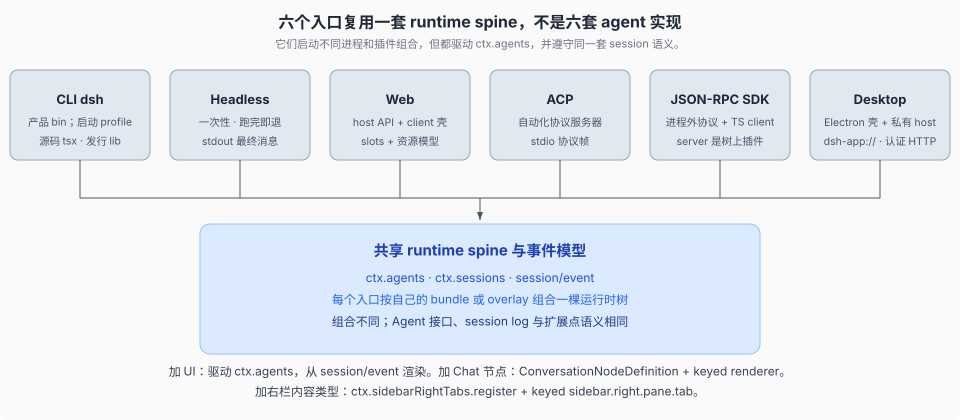
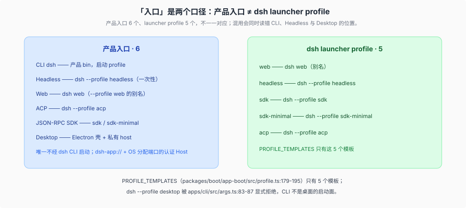
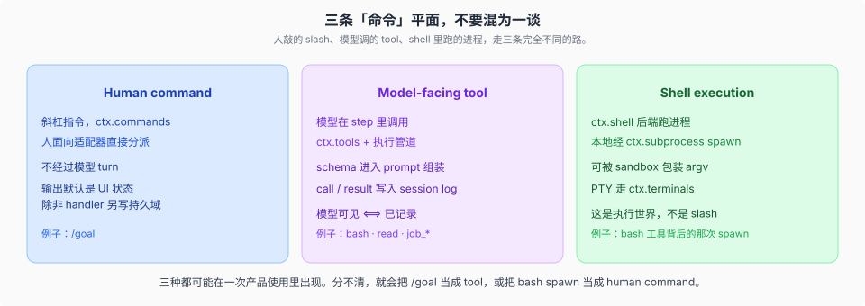

# Surfaces · 人对机器的入口

## 一句话

CLI、headless、Web、ACP、JSON-RPC 与桌面复用同一套 runtime spine、`Agent` 接口和 session 事件模型，不是六套 agent 实现。不同入口可以启动不同进程和不同插件组合；每棵组合后的树都通过 `ctx.agents` 驱动 agent，并从 `session/event` 渲染或投影。

本卷回答的是**入口契约**：人/程序从哪里进、每个入口对调用方保证什么、它们如何复用同一套 spine。**进程里装了什么**——`PROFILE_TEMPLATES`、bundle 层叠、行级差异、profile 装载与 HMR——在 [`../runtime-profiles/`](../runtime-profiles/00-map.md)。两卷按事实单点归属：profile 组合归 profiles，入口清单、CLI/SDK/ACP 契约、输出与退出、认证载体归本卷。

## 六个入口，一套运行时模型

| 入口 | 它是什么 | 典型组合 |
|------|----------|----------|
| **CLI `dsh`** | 产品 bin。源码启动走 tsx 的 ESM hook；发行物跑 built `lib/`。 | `--profile web` 或 `headless` |
| **Headless** | `dsh --profile headless [task...]` 的一次性入口：跑完即退出；stdout 只给最终 assistant 文本（`--json` 改为 NDJSON 事件），stderr 给诊断与 reasoning | `dsh-base` + `dsh-headless`（不 mount Host / HTTP / browser） |
| **Web** | host 半边（API / HTTP）+ browser 半边（壳、wire、slots、`ui-*`） | `dsh-base` + `dsh-web-app` |
| **ACP** | 自动化用的 Agent Client Protocol 服务器 | `dsh --profile acp`（launcher profile） |
| **JSON-RPC SDK** | 进程外协议、TS client、树上的 server 插件 | `dsh --profile sdk` 或 `sdk-minimal` |
| **Desktop** | Electron 壳 + 私有 host 子进程，复用 Web 的 client 产物与完整 web 应用（webserver 以 `--host 127.0.0.1 --port 0` 启动、端口由 OS 分配，认证 URL 交给窗口） | `dsh-base` + `dsh-web-app`（经 desktop-host 的 `runProfile`；0.1.7 线起，~~私有 `desktop.cordis.patch.yml` 覆盖层~~已退役） |

**产品入口是 6 个，`dsh` launcher profile 仍是 5 个**（`web` / `headless` / `sdk` / `sdk-minimal` / `acp`，`packages/boot/app-boot/src/profile.ts:179-195` 的 `PROFILE_TEMPLATES`），两组不一一对应：CLI 是 bin 不是 profile，Desktop 是应用不是 profile，而 Headless 同时是入口和 profile。headless 的 profile 组合与一次性语义见 [`../runtime-profiles/02-headless.md`](../runtime-profiles/02-headless.md)，桌面见 [`03-桌面入口.md`](./03-桌面入口.md)。

> **入口形状**：sdk 与 acp 不是独立 app 二进制，而是 `dsh --profile` 下的 launcher profile。所有入口统一走 bundle 层叠。详见 [`../runtime-profiles/00-map.md`](../runtime-profiles/00-map.md)。

桌面是唯一不经 `dsh` CLI 启动的产品面：`dsh --profile desktop` 被 `apps/cli/src/args.ts:83` 的 `rejectElectronProfile()` 显式拒绝（大小写变体一并拦下；boot / dump 入口恒拒，`plugin` 子命令仅 Desktop 自带 carrier 以 `manageDesktopProfile` 放行，见 [`03-桌面入口.md`](./03-桌面入口.md)），上游文档也把它从 `## Application launch`（`docs/architecture.md:41-47`）分到 `## Desktop application`（`:49-53`，其中 `:53` 明写 Desktop 默认监听 OS 分配的端口、配置可覆盖）。把桌面与前五个入口并列算作第 6 个入口是语料的口径选择，不是上游文档的原话。

加 UI 或编辑器集成：驱动 `ctx.agents`，从 `session/event` 渲染。加 Web Chat 节点：注册 `ConversationNodeDefinition` + keyed renderer。加 Web 设置卡：按 0.1.7 线的 live configuration forms 机制——Config schema 声明 live 字段、跨插件贡献走 `plugins.detail.actions`/`badge`/`section` slots、companion 包经 `ctx.configForms.whileServed` 注册（旧 `installSection`/`settings.plugin.item` 已删），见 [`docs/cookbook/adding-a-settings-card.md`](../../docs/cookbook/adding-a-settings-card.md)。加右栏内容类型：声明资源协议 + 注册 provider + keyed `sidebar.right.pane.tab`，见 [`two-tree-runtime/client/view/03`](../two-tree-runtime/client/view/03-右栏-与-document-preview.md)。不要在入口里再实现一套 loop。

源码启动（`pnpm dsh`）把 workspace 包映射到 TypeScript 源；它碰到的模块必须保持 ESM。built 路径则是普通 Node 解析。两条启动面不要混着假设。

## 三条「命令」平面

产品里有三种看起来都像「命令」的东西，路完全不同。

| 平面 | 走哪 | 过不过模型 |
|------|------|------------|
| **Human command** | `ctx.commands`，人面向适配器直接分派 | 不过模型 turn |
| **Model-facing tool** | `ctx.tools` + 执行管道 | 在 step 里，call/result 入 log |
| **Shell execution** | `ctx.shell` / `ctx.subprocess` / 可选 sandbox | 是 tool 背后的进程执行层；sandbox 可包装 argv |

`/goal` 是 human command。模型调用的 `bash` 是 tool。那次实际 spawn 是 shell execution。分不清，就会把斜杠指令当成 tool schema，或把沙箱策略塞进人命令里。

## 源码入口

| 路径 | 角色 |
|------|------|
| `apps/cli/` | 产品 bin `dsh` |
| `packages/bundle/headless/` | 一次性任务入口：`dsh-headless` bundle 的 `cordis.patch.yml`，runner / startup / JSON 事件投影（`src/index.ts`、`src/startup.ts`、`src/json-stream.ts`） |
| `apps/web/` | 浏览器 Vite entry（薄壳，装配逻辑在 `packages/client/`） |
| `apps/desktop/` | Electron 壳；私有包 `@deepseek-ai/dsh-desktop`，无 `bin` |
| `apps/desktop-host/` | 桌面私有 host：载入已安装的 dsh backend 与匹配的 client 产物，同样无 `bin` |
| `packages/boot/` | 各 profile 共用的 boot 胶水 |
| `packages/host/` | webserver / frontend-static / directory-picker / plugin-inventory / open-in-app |
| `packages/api/session-controller/` | Web host 会话流（`session/event` 转发、activity、可 opt-in 的 assistant-stream 帧） |
| `packages/client/` | 浏览器壳、wire、slots、资源模型（`ctx.resources` / `useResource`）、dockkit 布局引擎、右栏三件套、file-upload、open-in-app |
| `packages/sdk/` | JSON-RPC protocol / server / TS client |
| `packages/acp/` | ACP 自动化服务器 |
| `packages/interaction/` | 审批、permission、commands、ask-user |
| `packages/api/` | Remote BFF（`api/remotes`）、Typert RPC 网关（`api/gateway`）、非 owner Peer 的 Remote 方法级访问控制（`api/remote-access`，新 core 服务 `ctx.remoteAccess`）、工作区文件服务与 `file` 资源 provider（`api/workspace-files`） |
| `packages/api/remotes/` | Remote 控制器声明 + client stub |
| `packages/typert/` | 类型安全的 Remote 序列化 |
| [`docs/user/guide/index.md`](../../docs/user/guide/index.md) | Web UI 指南 |
| [`docs/cookbook/extension-cookbook.md`](../../docs/cookbook/extension-cookbook.md) | 扩展 cookbook（含 Chat node、settings 卡片等） |
| [`docs/cookbook/adding-a-settings-card.md`](../../docs/cookbook/adding-a-settings-card.md) | 插件自有 settings 卡片 |

## 机制级正文

| 文件 | 内容 |
|------|------|
| [`01-启动面与session流.md`](./01-启动面与session流.md) | tsx ESM vs `lib/bin.js`；三条启动面与 `bin.ts` 的分发；headless 一次性入口的输出契约；session 流与认证的正文在 `two-tree-runtime/remote` |
| [`02-acp与jsonrpc.md`](./02-acp与jsonrpc.md) | ACP 只把 committed 事实表达成标准语义更新；SDK 推 Context 内全部耐久事实 |
| [`03-桌面入口.md`](./03-桌面入口.md) | Electron 壳 + 私有 host；desktop-host 经 `runProfile` 起完整 web 应用（`127.0.0.1` 上由 OS 分配端口的认证 URL，0.1.7 线起；~~dsh-app 分帧字节管道~~已退役）；打包与更新 |

客户端的资源模型、右栏、slots 与 Typert/Remote 不在本卷：正文在 [`../two-tree-runtime/client/`](../two-tree-runtime/client/00-map.md) 与 [`../two-tree-runtime/remote/`](../two-tree-runtime/remote/00-map.md)。本卷只保留「人从哪个入口进来、进来之后怎么启动」这条线。

dump 与 boot 的层差不在入口，在 [`../plugin-system/composition/02-dump-与boot-保真.md`](../plugin-system/composition/02-dump-与boot-保真.md)。

> 承重词按 [`canon/GLOSSARY.md`](../canon/GLOSSARY.md) 的 DSH 原文用；本页自己的分类与指标不是 DSH 的词。
