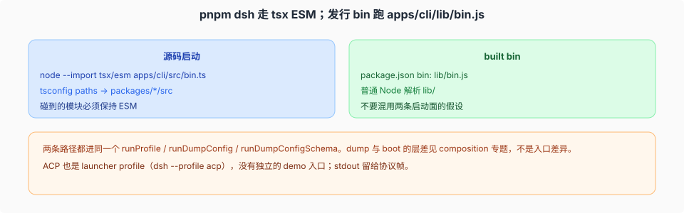

# 源码启动、built bin 与 launcher profile

源码核验入口：根 `package.json` 的 `dsh` script、`apps/cli/package.json` 的 `bin`、`apps/cli/src/bin.ts`、`apps/cli/src/args.ts`、`packages/boot/app-boot/src/profile.ts`。
五个 Launcher Profile 可以 boot 不同的 bundle 或组合，因此不一定共享同一进程或同一棵 Cordis 树；它们复用 `ctx.agents`、session log 和事件语义。桌面应用不在其中：`dsh --profile desktop` 被显式拒绝，它由 Electron 壳启动私有 host，见 [`03-桌面入口.md`](./03-桌面入口.md)。

## 三条启动面

| | 命令 | 解析 |
|--|------|------|
| 源码 | `node --import tsx/esm apps/cli/src/bin.ts`（`pnpm dsh`） | tsconfig `paths` → `packages/*/src`。碰到的模块必须是 ESM |
| 发行 | `apps/cli/lib/bin.js`（`package.json` `"bin": { "dsh": "lib/bin.js" }`） | 普通 Node 解析 built `lib/` |

第三条 Desktop：Electron 壳 `apps/desktop`（`@deepseek-ai/dsh-desktop`）包住 Web UI，私有 `apps/desktop-host`（`@deepseek-ai/dsh-desktop-host`）是 Node 子进程 host，0.1.7 线起经 `runProfile` 起 `desktop` profile 的完整 web 应用（webserver 以 `--host 127.0.0.1 --port 0` 启动、端口由 OS 分配，认证 URL 交给窗口），CLI 仍拒绝 `dsh --profile desktop`（`rejectElectronProfile`，`apps/cli/src/args.ts:83`）。完整差异见 [`03-桌面入口.md`](./03-桌面入口.md)。

不要混用：源码启动测到的「能 import 到 src」不代表发行物里裸插件名能解析。profile 的安装闭包解析现由 runtime-resolution 拦截层承担（runtime-resolution / LinkedRoot，`packages/boot/app-boot/src/profile.ts:449-482` 的 `createRuntimeResolution`），见 composition 专题。

`bin.ts` 分发：普通任务 `runProfile`、`plugin` `runPlugin`、dump 两族（`--dump-config`/`--dump-default-config` 走 `runDumpConfig`，`--dump-config-schema` 走 `runDumpConfigSchema`）。dump 与 boot 的层差（launcher 派生层、不求值 `!!js`）不是入口差异，见 [`../plugin-system/composition/02-dump-与boot-保真.md`](../plugin-system/composition/02-dump-与boot-保真.md)。

ACP：`dsh --profile acp`。launcher profile，stdout 留给协议帧。

### headless：唯一一次性入口

`dsh --profile headless [task...]` 是这 6 个入口里唯一跑完即退出的：组合是 `dsh-base` + `dsh-headless`，不 mount Host、HTTP server、Web runtime 或 browser（`packages/bundle/headless/cordis.patch.yml`）。输出契约：stdout 只放最终 assistant 文本（`--json` 时换成 newline-delimited run events，`packages/bundle/headless/src/json-stream.ts`），stderr 放诊断与非空 provider reasoning；成功 exit 0，失败 exit 1 并打 `dsh: <code>: <message>`。任务取 positional（多词按空格拼）或 stdin（缺省或 `-`；空 positional / 空 pipe 在开跑前拒绝）；`--session-id` 精确收养持久 Session，未知 id 报错；flag 面在 `packages/bundle/headless/src/startup.ts:41-51`。

runner 的最终消息从耐久日志按 seq 读，读不到即 fail loud（`packages/bundle/headless/src/index.ts:82`；读取区间 `:73-99`），推理进度另走 process-local 的 `agent/assistant-stream`（订阅 `:122`，reasoning 分支 `:134`），最后 flush Session 再退出（`:390`）。它禁用 managed credential store / authorization / account 消费者，API key 走 launch env → `<cwd>/.env` → `$DSH_HOME/.env`（`packages/bundle/headless/README.md` 的 Credentials）。profile 层叠与其他入口的差异见 [`../runtime-profiles/02-headless.md`](../runtime-profiles/02-headless.md)。

## 这一页不再讲的东西

Host 与浏览器之间的 session 流、认证与 Remote 已并入 [`../two-tree-runtime/remote/`](../two-tree-runtime/remote/00-map.md)：`session/event` 的两条出站链路在 [`streams/`](../two-tree-runtime/remote/streams/01-一条-emit-两条出站链路.md)，follow 的三类帧与 wire 校验在 [`streams/02`](../two-tree-runtime/remote/streams/02-三类帧与-wire-校验.md)，`/api/remote.mux` 与认证面在 [`connection/`](../two-tree-runtime/remote/connection/01-载体-rpcId-与逻辑流.md)，Typert 与 Gateway 在 [`typert/`](../two-tree-runtime/remote/typert/01-声明期-装饰器与-namespace.md)。客户端架构与插件纪律在 [`../two-tree-runtime/client/`](../two-tree-runtime/client/00-map.md)。

命令行 / tool / shell 三种「命令」的归属见 [`00-map.md`](./00-map.md#三条命令平面)；入口代码只负责把人或模型的动作接到 `ctx.commands`、`ctx.tools`、`ctx.shell` 上，不自己实现执行层。
