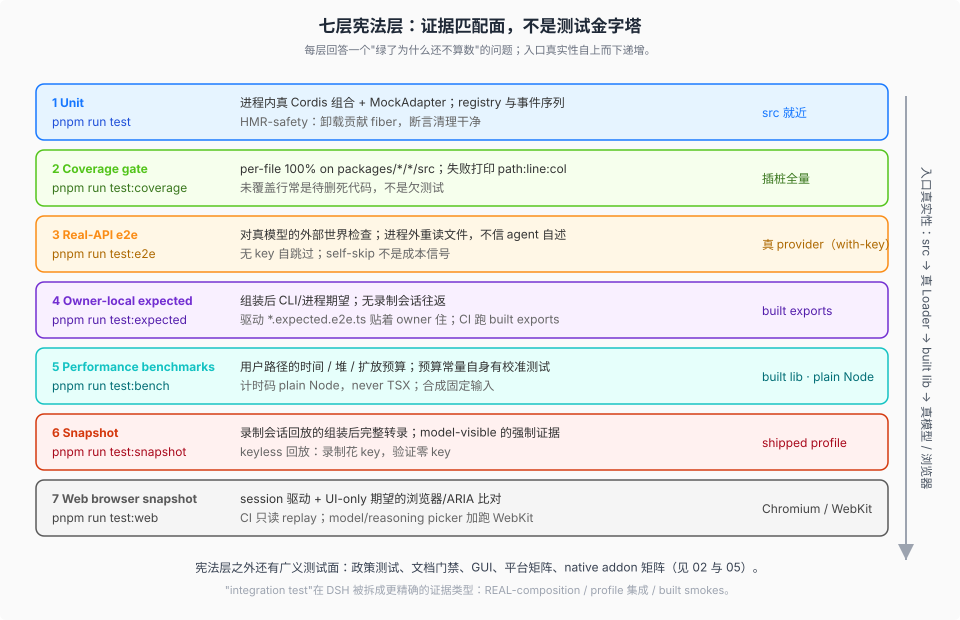

# Test Strategy · 测试思想、资产分布、防漏与决策程序

上游同步触及测试面时，按 [`_coverage/`](../_coverage/00-index.md) 的口径复核本专题；具体核验点见 [`catalog.json`](../catalog.json)。

## 一句话

DSH 的测试资产以千计（unit 用例以万计），测试政策却只有 55 行（`docs/testing.md`）——整份政策的定语是 "the rules that keep a green suite meaningful"（让绿有意义）。本专题不讲"测试金字塔"，而讲三件事：**资产怎么分布**、**怎么保证不漏**、**一个变更该配什么证据才算够**。

## 三个问题，三篇入口

| 你的问题 | 入口 | 一句话答案 |
|---|---|---|
| **测试资产怎么分布？为什么便宜层承载最多？** | [`03-asset-census.md`](./03-asset-census.md) | 绝大多数用例在最便宜的 unit 层；昂贵层只买"unit 结构上看不见"的失败类（真模型、Loader 组装、浏览器、性能） |
| **它如何保证"不漏东西"？从资产上能看出什么纪律？** | [`04-anti-omission.md`](./04-anti-omission.md) | 六个互不替代的检查面（空间、执行、类型、入口、断言、可见性）+ 复盘回路；漏被变成红灯、显式豁免或可见跳过 |
| **怎么定测试面、怎么算够了、分布准不准？** | [`05-decision-procedure.md`](./05-decision-procedure.md) | 五步程序：分类 → 选最便宜但看得见的那层 → 证明会红 → 验世界 → 判七问并记账 |

写插件的人可以直接从 [`15-plugin-testing-contract.md`](./15-plugin-testing-contract.md) 开始：五级台阶、三种采用等级、十条契约、一份 PR 账本。

## 结构（16 篇）

### 一、思想：为什么是这副形状

| 问题 | 阅读入口 |
|---|---|
| 测试思想是什么、55 行政策说了什么、指导怎么分布 | [`01-doctrine.md`](./01-doctrine.md) |
| 有哪些层、每层测什么、后缀/目录怎么选中层 | [`02-tiers.md`](./02-tiers.md) |

### 二、资产与防漏：有多少、怎么防漏、怎么决策

| 问题 | 阅读入口 |
|---|---|
| 各层有多少文件/用例、成本与 CI 必需性、为什么是"宽底窄塔尖" | [`03-asset-census.md`](./03-asset-census.md) |
| 六种防漏机制、每种漏对应哪条机制、边界在哪 | [`04-anti-omission.md`](./04-anti-omission.md) |
| 变更分类表、选层顺序、负控、七问判据、PR 证据账本 | [`05-decision-procedure.md`](./05-decision-procedure.md) |

### 三、纪律与编排：谁拥有什么、什么时候红

| 问题 | 阅读入口 |
|---|---|
| 立了哪些规矩、谁拥有什么证据（政策 / 快照树 / pre-push） | [`06-rules-ownership.md`](./06-rules-ownership.md) |
| CI 门禁怎么编排、平台矩阵怎么铺、防假绿怎么做 | [`07-ci-gates.md`](./07-ci-gates.md) |
| 测试可靠性纪律是什么、flake 怎么归因 | [`08-reliability.md`](./08-reliability.md) |
| 测试基建有哪些、各自职责与已知限制 | [`09-infrastructure.md`](./09-infrastructure.md) |

### 四、机制深潜：快照、对外面与 probe

| 问题 | 阅读入口 |
|---|---|
| 录制会话快照怎么运转（世代、四面、record/refresh） | [`10-snapshot-machinery.md`](./10-snapshot-machinery.md) |
| 快照机制对仓外暴露了什么（发布包、夹具、接线、git 卫生） | [`11-snapshot-external-face.md`](./11-snapshot-external-face.md) |
| `probe` 是什么、产出什么、该归哪个专题、与 `trace`/`span` 怎么分 | [`12-probe-作为取证动作.md`](./12-probe-作为取证动作.md) |

### 五、插件落地：政策、实战、契约

| 问题 | 阅读入口 |
|---|---|
| 写一个 DSH 插件，测试面怎么摆（政策要求与五级台阶） | [`13-plugin-testing.md`](./13-plugin-testing.md) |
| 真实插件的测试组合长什么样（五个类型解剖） | [`14-plugin-testing-playbook.md`](./14-plugin-testing-playbook.md) |
| 我的插件仓该采用哪几条（契约、等级、账本、最小编排） | [`15-plugin-testing-contract.md`](./15-plugin-testing-contract.md) |

## 规模基线

数量、口径与复测命令只在 [`03-asset-census.md`](./03-asset-census.md) 维护；核验基线（tag / commit）只登记在 [`catalog.json`](../catalog.json)。本页不复制数字，以免下一轮同步出现第二份必须同时改、又可能改得不一致的地方。

## 阅读路径

- **15 分钟，抓住三个答案**：本页 → [`03`](./03-asset-census.md) 的账本与比例 → [`04`](./04-anti-omission.md) 的六面表 → [`05`](./05-decision-procedure.md) 的七问。`docs/testing.md` 只有 55 行，值得整读。
- **30 分钟，理解为什么**：加读 [`01`](./01-doctrine.md)（九条教义）与 [`02`](./02-tiers.md)（层与选中机制）。
- **插件作者专线**：[`13`](./13-plugin-testing.md)（政策要求）→ [`14`](./14-plugin-testing-playbook.md)（真实组合）→ [`15`](./15-plugin-testing-contract.md)（契约与账本）→ [`11`](./11-snapshot-external-face.md)（快照机制的对外面）；货架与分类法在 [`plugin-inventory`](../plugin-system/inventory/00-map.md)。
- **深潜**：按问题进 [`07`](./07-ci-gates.md)（CI 与防假绿）、[`08`](./08-reliability.md)（可靠性）、[`09`](./09-infrastructure.md)（基建）、[`10`](./10-snapshot-machinery.md)（快照机制）、[`12`](./12-probe-作为取证动作.md)（probe）。

## 与其他专题的边界

| 对象 | 关系 |
|---|---|
| [`system-overview/03-门禁与性能基准.md`](../system-overview/03-门禁与性能基准.md) | 门禁聚合器与性能基准树的机制概述；本专题 [`07`](./07-ci-gates.md) 深入 CI lane 结构、必需性与防假绿，[`03`](./03-asset-census.md) 拥有资产数量 |
| [`harness-idea/`](../harness-idea/00-map.md) | 判断层（dsh 这种 harness 形态做对了什么）；本专题是机制与决策层，测试相关的价值判断在那边 |
| [`delegation-and-orchestration/completion-and-observation/07-…`](../delegation-and-orchestration/completion-and-observation/07-evidence-layers-declaration-mount-mechanism-behaviour.md) | 委派链的四层证据；仓库级测试政策与资产分布归本专题 |
| [`_coverage/`](../_coverage/00-index.md) | 本专题的核验登记（承诺回答的问题、最近核验 commit） |
| [`_change_log/`](../_change_log/00-index.md) | 上游同步记录；同步触及测试面时按影响评估复核本专题 |

## 写作定调

- 消化文档，不是搬运：每篇给"它为什么这么定"的解释；硬事实 / 解释 分开标记。
- 事实锚点：仓库相对路径 + 符号/文件名，锚定顶部基线 commit；关键规则保留英文原文短引用。
- 不复述 `docs/testing.md` 全文——读者应直接读原文；本专题的价值在于把散在 policy / skill / Agent Note / cookbook / 包 README / CI 配置 / 代码惯例里的测试体系拼成一张地图，并给出可执行的决策程序。
- 模板与判据是本专题的提炼，不冒充 DSH 的成文文件；DSH 的一手事实一律给源码入口。

> 承重词按 [`canon/GLOSSARY.md`](../canon/GLOSSARY.md) 的 DSH 原文用；本页自己的分类与指标不是 DSH 的词。
