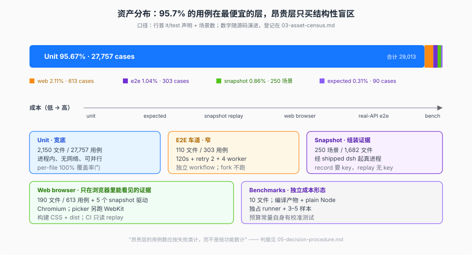

# 03 — 资产账本：自动化测试资产的分布与成本

> 本页是本专题唯一登记测试资产数量的地方：各层有多少文件、多少用例、跑起来花什么成本、在 CI 里是不是必需。分层定义见 [02](./02-tiers.md)；"这些资产为什么能防漏"见 [04](./04-anti-omission.md)；"拿到一个新变更怎么选层"见 [05](./05-decision-procedure.md)。其他页只引用本页，不复制数字。

## 一句话

DSH 的自动化资产不是经典测试金字塔，而是**宽底 + 窄塔尖**：约 **95.7%** 的用例落在最便宜的 unit 层；真实的模型调用、浏览器、录制回放和性能测量合计只占约 **4%**，而且每一条昂贵用例都能回答"unit 层为什么看不见它"。

## 账本（硬事实，按基线树实测）

| 层 | 选择器 | 规模 | 运行形态 | 边际成本 | PR CI 里的位置 |
|---|---|---|---:|---|---|
| Unit | `*.spec.{ts,tsx}`（packages / apps / scripts / website） | **2,150 文件、27,757 条 `it`/`test`** | vitest `forks` worker，进程内真依赖 | 单条毫秒级；整仓受覆盖率插桩支配 | `node 24 / coverage`（必需）：`check:ci:coverage` 同时是单测运行与覆盖率门 |
| Owner-local expected | `*.expected.e2e.ts`（apps/cli 21 个驱动；apps/web 8 个归 web 车道） | **29 文件、90 条用例** | 起子进程、跑 built exports | 秒级 | `node 24 / snapshots and artifacts`（必需） |
| E2E 车道（官方名 Real-API e2e） | `packages/*/*/tests/**/*.e2e.ts`、`apps/{cli,desktop}/tests/**/*.e2e.ts`（排除 `*.expected.e2e.ts` 与 inspector 的 browser e2e） | **110 文件、303 条用例** | 真进程：真模型与真 bash/PTY/ACP；也含 keyless 的 built/Loader 冒烟 | 120s 超时 + 30s hook + **retry 2** + 4 worker；真模型用例花 token | 独立 `e2e.yml`（trusted PR / master / 夜间 / 手动）；其中 built 冒烟另由必需 job 重跑 |
| Web browser | `apps/web/tests/**/*.{e2e,snapshot}.ts` | **190 个 web e2e 文件**（含 8 个归 expected 的驱动）、**613 条 e2e 用例**（另 14 条计入 expected 行），5 个浏览器 snapshot 驱动 | 构建 CSS + frontend dist，Chromium（picker 另跑 WebKit） | 真浏览器 + 组装后的 Host | `node 24 / snapshots and artifacts`（必需，Linux） |
| Snapshot | `snapshots/**/*.snapshot.ts`（3 个驱动）+ 场景目录 | **250 个场景**（session 150 / sdk 27 / acp 9 / web 64），树内 **1,682 个文件**（1,675 常规 + 7 符号链接：5 个跨 profile sidecar + 2 个场景内 workspace 别名） | 经 shipped `dsh` profile 起真进程，回放录制模型流 | replay 可并行；record 串行且要 key；单场景 120s 预算 | `node 24 / snapshots and artifacts`（必需） |
| Benchmarks | `benchmarks/**/*.bench.ts` / `*.bench.client.ts` | **10 个文件**（7 Host + 3 Client） | 编译产物 + plain Node；浏览器 bench 另起 Chromium | 独占 runner、逐文件串行；每文件 3 或 5 个样本，session 另跑 128MB 堆子进程 | `node 24 / benchmarks`（必需，Linux，单独 job） |
| 手动诊断 | `*.perf.ts` / `*.perf.client.ts` / `*.stress.ts` | **4 个文件**（2 + 1 + 1） | 本地手动 lane | 不进任何 CI 执行清单 | 不是门；`docs/testing.md` 明说 package-local `.perf.ts` 只做诊断 |

按用例口径（250 个快照场景各按 1 条"组装用例"计）：

| 口径 | 数量 | 占比 |
|---|---:|---:|
| unit | 27,757 | **95.67%** |
| e2e 车道（真模型 + keyless 冒烟） | 303 | 1.04% |
| web browser e2e（不含归 expected 的 14 条） | 613 | 2.11% |
| snapshot 场景 | 250 | 0.86% |
| owner-local expected | 90 | 0.31% |
| **合计** | **29,013** | 100%（分项四舍五入，和为 99.99%） |

benchmark 以"测量场景"计，不折算成 `it` 用例，因此不计入上表；它的成本按文件与运行形态单独看。



## 比例怎么读（解释）

**第一，用例占比和文件占比不是一回事。** 2,150 个 unit 文件承载 27,757 条用例（约 13 条/文件），而 110 个 e2e 文件只有 303 条用例（约 2.8 条/文件）。昂贵的 e2e 不是"更大的单测"：`e2e.yml` 的注释直说 "Profile e2e files can each own several complete dsh subprocess trees"——一个 e2e 文件可能起多棵完整 `dsh` 进程树。**用文件数或代码行数估算成本会低估一个数量级。**

**第二，昂贵层的数量应该按"失败类"计，不按"功能数"计。** 仓库有 343 个包、上百个工具，但 e2e 只有 303 条用例。差额不是漏测：绝大多数功能的失败类在进程内就能看见，只有少数失败类（真模型行为、Loader 组装、浏览器渲染、真实 OS 资源、性能）必须跨进程。DSH 把昂贵层留给这些"结构性盲区"，而不是给每个功能配一条 e2e。

**第三，snapshot 是"一次录制、永久回放"的资产，不是"每次都跑真模型"。** 250 个场景的录制成本只在 record 时支付（要 key、串行）；每个 PR 的回放是 keyless、可并行的。这让"真模型行为"的证据能以接近 unit 的边际成本进入 PR 门禁——这是分布能保持"便宜层很宽、昂贵层不失控"的关键机制。

**第四，benchmark 是一种独立的成本形态。** 它不在功能测试的预算里：需要一个空闲 runner、编译产物、逐文件串行、每个样本起新进程，还要在 128MB 堆限制下再跑一遍。所以它是独立 job，不与 unit/快照共享车道。

**为什么不让端到端承载更多？** 端到端不是"更真的测试"，而是"更贵、信息更少"的证据：一次失败只告诉你组装坏了，不告诉你是哪一层；unit 失败直接指到具体行为与代码行。DSH 的顺序是先用 unit 把行为空间压到最小，再用 e2e 证明组装与真实外部世界。**e2e 的数量因此被"失败类"约束，而不是被"功能数"约束**——这就是它只占 3% 用例的原因。

## 分布的第二维：包与目录（实测）

用例总数只是一维。按包组看，资产明显向"行为面宽"的组倾斜：

| 包组 | spec 文件 | 说明 |
|---|---:|---|
| `packages/client` | 636 | 组件行为面最宽；绝大多数是 jsdom spec，不是浏览器 e2e |
| `packages/experimental` | 236 | 实验能力不豁免测试 |
| `packages/api` | 94 | Remote / session-controller |
| `packages/session` | 92 | 持久化、投影、查询 |
| `packages/llm` | 71 | provider 与适配器 |
| `packages/core` | 68 | agent-loop、tools、session |

单包最多的是 `packages/client/ui-primitives`（67 个 spec）。**文件数最多不等于最贵**：client 组占 spec 文件近三成，但组装后的浏览器证据由 190 个 web e2e 文件承担；组件 spec 仍在廉价的 jsdom 车道里。

更值得注意的是"没有包内 spec"的包：343 个包中有 **12 个**没有自己的 `tests/**/*.spec.ts`，但没有一个等于"没测"——

- **8 个是组合/profile 层**（7 个 `*-bundle` 加 `session-search`），`src/index.ts` 只有 `export {}`，运行时条目在 `cordis.patch.yml`；它们的证据是 REAL composition / profile boot，而不是包内单测。
- **2 个服务**（`config-editor`、`tool-working-directory`）由消费方包的 spec 执行——覆盖率按**执行归属**记账，不按**目录归属**记账。
- `package-manifest` 是被消费者与脚本 spec 执行的清单/类型包。
- `ssh-helper-runtime` 用 `/* v8 ignore file -- ... */` 明示证据在可执行产物套件里。

这条分布事实给出一个读法：**"这个包没有测试"不能只看目录**。per-file 覆盖率会强迫每个可执行文件要么被某条测试执行、要么进豁免账本；所以"没有包内 spec"只说明证据住在别处，不说明缺失。

## 成本模型（硬事实 + 解释）

### Unit：便宜来自"进程内 + 无网络 + 可并行"

- 全部 suite 跑在 `pool: 'forks'`；8 个动进程级全局状态的套件单独成 `process-bound` project，避免污染其余套件（`vitest.config.ts`）。
- 覆盖率是主要成本：v8 插桩会拖慢执行，所以 CI 把重型套件（typert 编译器、webworker、若干真子进程 fixture）从插桩运行里排除、用**不插桩的并行 gate** 再跑一遍（`scripts/coverage-exempt.ts` 的成员规则：被排除的套件所执行的受测文件必须已被别的套件覆盖，删除它不改变任何阈值结果）。
- 覆盖率达到规模后，单次门禁被切成多个单 worker 分区（`scripts/coverage-partitions.ts`），按历史时长分配权重，最后合并报告统一判门。**分区只改变成本，不降低阈值。**

### e2e：贵在真进程与真实外部世界

- 车道里既有真模型调用，也有 keyless 的 built/Loader 冒烟——后者不花 token，但仍然要起进程、读产物。
- 车道参数本身就是成本声明：`testTimeout: 120_000`、`hookTimeout: 30_000`、`retry: 2`、默认 4 个文件 worker、job 上限 45 分钟。整个仓库只有这一层显式 retry——因为真实 API 有瞬态配额抖动。
- 无覆盖率（注释："the unit suites own the coverage gate"）：不在昂贵层重复计税。
- 缺 key 自跳过，所以它不阻塞 keyless CI；但为了避免"全跳过 = 假绿"，独立 workflow 的 preflight 在 secret 缺失时**硬失败**。

### Snapshot：贵在"起真进程"，省在"回放"

- 每个场景走 shipped profile，120s/30s 预算；replay 可并行，record / refresh 严格串行（record 花配额，refresh 要写回共享期望树）。
- CI 的 web 车道显式钉只读 `DSH_SNAPSHOT=replay`；snapshot 车道按 `vitest.snapshot.config.ts` 的默认走 replay——两者都让 PR 不能产生新的期望值，只能证明当前代码仍等于已提交的期望值。
- 期望树 1,682 个文件是资产体积的大头，但读取成本低；真正的成本是进程启动与回放一致性。

### Web browser：贵在"组装后的浏览器"

- `test:web` 先构建（含 plugin CSS 与 frontend dist），再在 Chromium 里比对；model/reasoning picker 额外跑 WebKit。
- CI 用 `scripts/run-web-snapshots.ts`：先串行跑会改写共享树的 HMR / client-plugin 覆盖，再并行其余——**共享可写资源决定编排，而不是测试数量。**

### Benchmarks：贵在"测量环境"

- 编译产物、`NODE_OPTIONS` 清空、plain Node、逐文件串行；Host 基准按文件取 3 或 5 个独立样本（例如 `session-open` / `agent-continuation` / `terminal-io` 为 5），session 基准另跑 128MB 堆子进程；`benchmarks/` 按用户路径分组而不是按包分组。
- 预算常量本身有校准测试（例如 `expect(REOPEN_OPEN_BUDGET_MS).toBe(63)`），所以"预算被悄悄放宽"也会红。

## 自动化边界（解释）

DSH 的规则可以压成一句：**能进门的证据必须能被 CI 自动重复；不能自动重复的，被隔离成手动诊断并不进 required。** 这不是"手动测试不重要"，而是"不可重复的证据不能作为合并判据"：

- 会进门的层全部有命令、有配置、有 CI job：unit / coverage、expected、snapshot、web、bench、built smoke。
- 不进门的层被显式命名并隔离：`*.perf.ts`（包内诊断）、`*.stress.ts`（opt-in）、`test:web:perf`（手动 lane；stress 另有 `DSH_WEB_STRESS_HEADFUL=1` 的 headful profile）。它们可以很贵、可以要人看，但不假装是门。
- 介于两者之间的"需要凭据"的层（real-API e2e）单独成 workflow：它是门，但只在可信事件上开；缺凭据时 preflight 硬失败，而不是静默跳过。

**判据**：一条资产如果不能在 CI 上自动重复，就不该出现在 required 清单里；如果它在 required 里，就必须能在无人值守下给出确定的红/绿。

结果：本页统计的自动化资产里，只有 4 个文件是手动诊断（2 个 `.perf.ts`、1 个 `.perf.client.ts`、1 个 `.stress.ts`），其余都在某个 CI job 里被自动重复。**"自动化"不是风格，而是分布的前提**——手动资产无法承担"每次变更都验一遍"的角色，所以它只能做诊断。

## 最便宜的一层不在测试里：静态门（硬事实）

仓库还有一族比 unit 更便宜的资产：**静态门**。`scripts/verify-*.ts`（不含 `.spec`）有 **46 个**，外加 workflow 级的命名门（`expected-filenames`）、`oxlint`、`typecheck`、`duplication`。它们证明的不是运行时行为，而是**关系、形态与归属**：

- 配置能否被加载、`!!js` 是否出现在允许的位置（`verify-cordis-config`）；
- 插件/包的导出形态与入口身份（`verify-application-entrypoints`、`verify-export-jsdoc`）；
- 依赖方向与客户端包边界（`verify-client-domain-graph`、`verify-client-packages`）；
- 文案归属（`verify-client-ui-i18n`）、禁用写法（`verify-no-unknown-casts`）、文件名语义（`expected-filenames`）。

**分布含义**：能用静态门证明的不变式，不应该写测试。静态门是秒级的、无需 mock、失败信息直接指到文件；把它降级成 unit 测试只会更慢、更脆。反过来，静态门也证明不了行为——所以它和测试是两条并行的资产线，不是替代关系。

## 分布是被三条规则推出来的（解释）

资产分布不是自然长成的，也不靠"70/20/10"这类比例目标。它由三条成文规则推出来：

1. **per-file 100% 覆盖率**把每一行可执行代码逼进 unit（或逼进显式豁免清单）。这条规则决定了"底"有多宽：没有测试的代码行不是"以后补"，而是当次 PR 的红灯。
2. **"模型 / 协议 / 人可见的变更必须同 PR 加强制快照"**把组装后的转录逼进 snapshot 层。这条规则决定了"塔尖"为什么存在：unit 再多也不能替代组装转录。
3. **"product-visible 插件必须有非 unit 的 REAL composition 测试"**把插件加载路径逼进 Loader/built 冒烟。这条规则决定了 e2e 虽然窄，但每个产品面插件至少有一条真实入口证据。

外加一条成本政策：**真实推理在这里是便宜的**（`docs/testing.md` "The with-key policy"）。所以 e2e 不按 token 预算削减，而是按"可信事件 + 独立 workflow + preflight"隔离——贵不是砍掉它的理由，假绿才是。

## 账本健康信号（怎么读自己的仓）

| 信号 | 健康 | 警告 |
|---|---|---|
| 昂贵层用例的理由 | 每条 e2e 都能说出"unit 看不见的失败类" | e2e 数 ≈ 功能数 → 用贵层测逻辑 |
| snapshot 变更流程 | 每个 diff 人工 review；refresh 只改期望、不改世界树 | "刷新即通过" → 把回归固化成期望（postmortem 0002） |
| 覆盖率豁免 | 逐条（文件或包）、带理由与移除条件 | 无理由、无影响面、无移除条件的豁免 → 隐性空洞 |
| 手动 lane | 不在 required 清单里，命名即诊断 | 手动 lane 混进必需门 → 慢且不稳定 |
| 跳过语义 | 跳过是可见空缺，preflight 把缺 secret 变硬失败 | 静默 skip → 假绿 |
| 覆盖率的角色 | 下限（necessary, never sufficient） | 当作"测够了"的证明 → 绿而空 |

## 口径与复测（都在仓库根执行）

```sh
# unit 文件与用例（用例=行首 it/test 声明，含 .skip/.each 等修饰符）
find packages apps scripts website -type f \( -name '*.spec.ts' -o -name '*.spec.tsx' \) | wc -l
grep -rhE '^[[:space:]]*(it|test)(\.(skip|only|each|skipIf|runIf|concurrent|fails))?[({]' \
  --include='*.spec.ts' --include='*.spec.tsx' packages apps scripts website | wc -l

# e2e 车道成员（与 vitest.e2e.config.ts 的 include/exclude 对齐）
find packages/*/*/tests apps/cli/tests apps/desktop/tests -name '*.e2e.ts' \
  -not -name '*.expected.e2e.ts' -not -name 'client-browser.e2e.ts' | wc -l

# 快照场景与树体积
find snapshots -name snapshot.yml | wc -l
find snapshots -type f | wc -l; find snapshots -type l | wc -l
```

口径边界：`it`/`test` 行计数是"声明点"而不是运行时的动态用例数（`it.each` 会展开成多条），所以本页数字是**可复现的近似规模**，不是精确执行次数；文件数、场景数、CI job 名是精确值。数字随源码演进，核验点登记在 [`catalog.json`](../catalog.json)。

## 源码锚点

- `docs/testing.md` 的 Tiers 节——七层的官方定义与命令
- 根部 9 份 `vitest*.ts`（8 份运行配置 + `vitest.shared.ts`）——每层的 include/exclude 与执行参数
- `.github/workflows/ci.yml` 的 job `needs`（`all-checks-passed` 聚合 9 个必需 job）与 `.github/workflows/e2e.yml`——必需性边界
- `scripts/run-gates.ts` 的 `ciStaticGates` / `coverageGates` / `ciConsumerGates`——静态门、单测+覆盖率、快照/产物三条内容链
- `scripts/coverage-exempt.ts`、`scripts/coverage-partitions.ts`——覆盖率的成本控制
- `benchmarks/AGENTS.md`——性能资产的落位与测量纪律

## 最小例证

1. **比例可复算**：跑上面的命令，unit 用例数应在 2.7 万量级；e2e 车道文件数应为 110。两者相差近二十倍，这就是"宽底"。
2. **贵层参数即成本**：打开 `vitest.e2e.config.ts`，`testTimeout: 120_000` / `retry: 2` / `maxWorkers: 4` 三行就是 e2e 的成本声明；unit 配置里没有这些。
3. **分布由规则推出来**：删掉一个包里的全部 spec，`test:coverage` 会因 per-file 未覆盖而红——底层的宽度不是靠自觉维持的。
