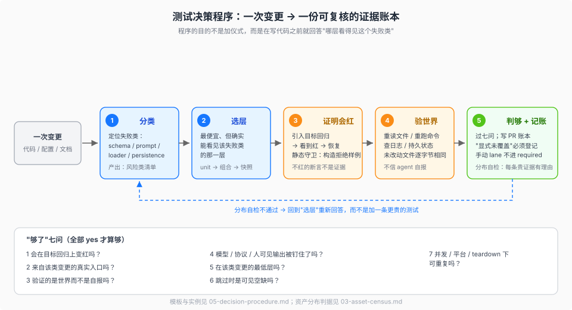

# 05 — 决策程序：怎么定测试面、怎么算够

> 本页回答本专题的第三问：把"测试资产做对了没有、做够了没有、分布准不准"从模型临场判断变成一套可执行的程序。输入是一次变更，输出是一份**证据账本**和一组 yes/no 判据。资产分布见 [03](./03-asset-census.md)，防漏机制见 [04](./04-anti-omission.md)，插件仓的缩编版见 [15](./15-plugin-testing-contract.md)。

> 说明：这套程序与账本模板是本专题对 DSH 实践的提炼，不是仓库里的成文流程；每条规则的 DSH 出处见各节与文末源码锚点。

## 为什么需要程序（解释）

全凭模型发挥时，测试策略会稳定地坏在三个地方：

1. **只写顺手的层。** 会写 spec 的人一直写 spec，会跑 e2e 的人一直跑 e2e；没有人检查"这个失败类到底哪层才看得见"。
2. **按功能数配昂贵用例。** 每加一个功能就加一条 e2e，最后用最慢的层测本该 unit 看见的逻辑，CI 变成排队。
3. **拿覆盖率当充分性。** 覆盖率证明行被执行，不证明断言有效、入口真实、组装正确——postmortem 0001 就是 100% 覆盖率下的产品级失败。

程序的作用不是增加仪式，而是让这三件事在**写代码之前**就有答案，并在 PR 里留下可复核的痕迹。

## 程序总览（五步）

1. **分类**：这次变更属于哪一类？（下表）
2. **选层**：最便宜、但**确实能看见**该失败类的层是哪层？
3. **证明会红**：引入目标回归，确认证据变红，再恢复。
4. **验证世界**：断言外部状态，而不是被测者的自报。
5. **判够 + 记账**：过七问，把证据写进 PR 账本；缺的显式登记。



## 第 1 步：给变更分类（硬事实对照表）

| 变更类 | 可能破坏什么 | 最低层证据 | 组装层证据 | 反例 |
|---|---|---|---|---|
| 纯逻辑 / 编解码 / 数据变换 | 边界、错误路径、并发下的结果 | spec：边界、畸形输入、精确上限 | 无（不要为纯逻辑写 e2e） | 用 e2e 测一个纯函数 |
| 服务 / 注册表 / 贡献与生命周期 | 贡献泄漏、dispose 后仍被引用 | spec + **HMR-safety**（dispose fiber → 断言移除） | product-visible 时加 REAL composition | 只测 register、不测 dispose |
| 插件导出形态 / 包入口 | Loader 丢弃 `inject`、default export 混用 | 导出守卫 spec（`'default' in mod === false` + `unwrapExports` round-trip） | 真 Loader boot；发布包加 built smoke | hand-mount 当作组装证据 |
| 工具定义（schema / args / result / render） | 模型看到错 schema、错误结果、渲染不一致 | spec：schema 验证、拒绝路径、边界 | 快照（模型可见 schema/结果）+ e2e 验世界 | 只断言 execute 返回值 |
| 模型可见文本（system prompt / 工具描述 / 诊断） | 转录漂移、模型看到错概念 | —（文本本身由快照钉） | **强制快照**（同 PR） | 用单测断言字符串常量 |
| Session / 持久化 / 格式迁移 | 旧日志读不回、迁移丢事件 | spec：事件映射、迁移边界 | 快照世代 + owner-local expected + SDK 双投影 | 只测新格式、不保留旧 fixture |
| Provider / adapter / 模型路由 | 真实 API 行为漂移、恢复策略错 | spec + mock server 故障注入 | with-key e2e（自跳过 + preflight） | 只跑 mock，断言"桥能过字节" |
| 子进程 / 沙箱 / 终端 / SSH | 平台语义、信号、僵尸进程 | spec：真进程 + 平台 skip | e2e：真 OS 资源 + teardown | 用假 spawn 证明 kill 语义 |
| Client UI / 浏览器 / 布局 | 用户可见行为、ARIA、响应式 | 组件 spec（jsdom，真实 props） | web snapshot（真浏览器） | 用 jsdom 断言浏览器行为 |
| 配置 / profile / 组合（`cordis.yml`） | boot 失败、插件没挂上、条件组合错 | 静态门（`verify-cordis-config`） | REAL composition / profile 测试 | 只改 YAML、不 boot |
| 性能敏感路径 | 回归无人发现 | benchmark + 预算校准测试 | 用户路径基准 | 用单测耗时当性能证据 |
| 文档 / 生成物 / 脚手架 | 文档与代码漂移 | doc gates / verify 脚本 | 无 | 为文档改动跑全量测试 |

这张表的用法不是"照抄一行"，而是**先定位失败类，再选层**。同一个 PR 往往跨多行，每行各要一条证据。

## 第 2 步：选最便宜、但看得见的那层

在问"哪层测试"之前，先问一个更便宜的问题：**这是不是一条静态不变式？** 导出形态、依赖方向、配置合法性、文案归属、禁用写法、文件名语义，能用 `verify-*` 脚本或 lint 证明的，就不要写运行时测试（[03](./03-asset-census.md) 的"静态门"一节）。静态门秒级、无 mock、失败信息直接定位；它证明不了行为，但能把你从"用 e2e 守一个 grep 能查的规则"里救出来。

选择顺序（从上往下问，第一个"是"就是最低层）：

1. 能在进程内确定复现吗？→ **unit spec**
2. 需要真实 Loader 的导出解析 / 组合语义吗？→ **REAL composition**（test-only `cordis.yml`，真 app/process）
3. 需要真实模型的输出或恢复行为吗？→ **snapshot**（录制回放，keyless）优先；问题在 provider 本身时再加 **with-key e2e**
4. 需要真实浏览器渲染 / ARIA / 响应式吗？→ **component spec + web snapshot**
5. 需要真实 OS 资源（端口、PTY、信号、文件锁）吗？→ **e2e + 平台 skip**
6. 需要数字（时间、内存、吞吐）吗？→ **benchmark**（预算 + 校准测试）
7. 以上都不是？→ 可能不需要测试资产，而需要一条**静态门**或文档。

关键区分：**"最便宜"不等于"选最低层"**。如果失败类只能在高一层出现，低一层再便宜也没用——那叫没测到。反过来，能用 unit 看见的失败类，每加一条 e2e 都是在买重复证据。

## 第 3 步：证明它会红（负控）

一条不会在目标回归上变红的断言不是证据，是装饰。DSH 的写法（来自 `dsh-ci-test-reliability` 与 `AGENTS.md`）：

- **行为回归**：先引入目标 bug，看测试红，再恢复；"observe an ordinary regression fail before the fix when practical"。
- **静态 / 语料守卫**：临时构造一个应被拒绝的样例，观察门按预期失败；"prove each changed acceptance path rejects an invalid case"。
- **并发 / 资源**：用 barrier / handshake 证明重叠，不用"多跑几次"；端口、共享路径、子进程要起**独立进程并发**验证。
- **守卫型插件**：测试对象不是"它做了什么"，而是"它什么时候不做"——透传、恢复、保留三种分支都要有负例。

负控记录写进 PR 账本（见下），评审时读的是"你见过它红"，不是"你写了一个测试"。

## 第 4 步：验证世界，而不是自报

- e2e 断言**外部事实**：重跑命令、重读文件、检查 session log / 持久状态；未改动的文件断言逐字节相同。
- 快照的 mutating 场景比对完整 `workspace.expected/` 树；record 与 refresh 永不改写这棵树——期望的"世界"与期望的"转录"分开固化。
- 关键词探测 agent 自己的输出**不算证据**："a keyword probe on the agent's own output lets a cheating agent pass."
- 资源归测试所有：测试里创建、`afterEach` 释放，失败/重试/超时也要释放；共享 fixture 放普通 `tests/harness.ts`，绝不 import 另一个 `*.e2e.ts`。

## 第 5 步：判"够了"（七问）

| # | 问题 | 判据 | 不满足时 |
|---|---|---|---|
| 1 | 这条证据会在目标回归上变红吗？ | 有负控记录 | 先补负控，再谈覆盖 |
| 2 | 它来自该类变更的真实入口吗？ | Loader / built `lib` / shipped profile / 真浏览器 | 换入口，或补一条组装证据 |
| 3 | 它验证的是世界，而不是自报吗？ | 外部文件 / 日志 / 持久状态 / 字节比对 | 改写断言 |
| 4 | 模型、协议或人可见的输出被钉住了吗？ | 同 PR 的快照 / 转录金样 | 加场景；不能只靠 rationale |
| 5 | 它在该类变更的最低层吗？ | 对应上表那一行 | 降层；更贵的层要写理由 |
| 6 | 跳过时是可见的空缺吗？ | 必需 job 的 skip 判失败；缺前置有 preflight；测试级 skip 打印原因 | 改 CI / 加守卫 |
| 7 | 并发、平台、teardown 下可重复吗？ | 资源有 owner、等待状态而非 sleep | 按 [08](./08-reliability.md) 修 |

**分布自检**（回答"分布准不准"）：

- 每一条昂贵用例都能说出"unit 为什么看不见它"；说不出就降层。
- e2e 的数量应约等于**必须跨真实进程/模型/浏览器**的失败类数量，而不是功能数量。
- 每个模型可见变更至少一条快照场景；没有就说明组装证据缺位。
- 手动 lane 不在 required 清单里；在 required 里就说明有人把诊断当门。
- 豁免清单只增不减、且没有 `TODO(...)` 移除条件，就是分布变坏的信号。

## PR 证据账本（模板）

> 这是本页从 DSH 的 PR 模板（`## Testing` + `Proof`）与 `dsh-pre-push-checks` 的选取规则提炼出的可复制模板，不是 DSH 的成文文件。

```md
## 测试账本

- 变更：<一句话；指向失败类，不是指向文件>
- 风险类：<schema / prompt / loader / persistence / browser / perf / …>

| 证据 | 层 | 覆盖的失败类 | 负控（见过红） | CI |
|---|---|---|---|---|
| `tests/foo.spec.ts` | unit | 拒绝路径 / 精确上限 | 是（临时去掉校验 → 红） | coverage |
| `tests/loader-composition.spec.ts` | REAL composition | default export 被丢弃 | 是 | coverage |
| `snapshots/.../` | snapshot | 模型可见转录漂移 | 刷新后 diff 人工过目 | snapshots |
| `tests/agent.e2e.ts` | with-key e2e | 真模型 + 真文件写入 | 文件未写 → 红 | e2e（trusted） |

- 够了判据：1 ✅ 2 ✅ 3 ✅ 4 ✅ 5 ✅ 6 ✅ 7 ✅
- 显式未覆盖：<哪一类、为什么现在不做、留下什么 TODO / issue>
```

"显式未覆盖"是账本里最重要的一行：它把"漏"变成**登记过、可追踪**的缺口，而不是藏在作者脑子里的空白。

## 反模式清单（每条都能在 DSH 政策里找到出处）

1. **hand-built `ctx.plugin(...)` 充当组装证据**——"Hand-built `ctx.plugin(...)` suites are insufficient."
2. **对 agent 自报的关键词探测**——可作弊；断言文件/日志/持久状态。
3. **用覆盖率代替行为断言**——"necessary, never sufficient"。
4. **把 refresh 当成修复**——期望值变了不等于行为正确；每个 diff 人工 review。
5. **为凑绿加 retry / 加 sleep / 弱化断言 / 改 normalizer**——`dsh-ci-test-reliability` 的"拒绝的掩盖修法"清单。
6. **用 e2e 测纯逻辑**——慢、脆、且没有增加失败类覆盖。
7. **仅 `describe.skipIf`、没有 preflight**——缺 key 时全跳过会显示绿；preflight 把缺 secret 变硬失败。
8. **手动 lane 混进 required**——诊断资产的成本不该由每个 PR 支付。

## 三个 worked example

**A. 新增一个 tool 插件（模型可见）**

1. 导出守卫 spec（named exports、无 default、`unwrapExports` round-trip）。
2. 行为 spec：从 `ctx.tools.execute` 进，断言 schema、拒绝路径、session log 事件；只 mock 模型 adapter。
3. HMR-safety：dispose 贡献 fiber → 工具从注册表消失，服务 built-in 不受影响。
4. REAL composition：test-only `cordis.yml` 走 Loader，断言工具真的出现在模型可见的工具清单里。
5. 快照：同 PR 加一个带该工具的录制场景；刷新后看 diff。
6. e2e：让模型写一个文件，测试在外层重读文件内容。
7. 负控：临时把工具从注册表移除 → 快照/组合测试红。

**B. 新增一个 client UI 插件**

1. 组件 spec（jsdom + 真实 props），断言用户可见行为，不断言 class 名或 render 次数。
2. `test:gui` 内循环；i18n 静态门确认文案归属。
3. web snapshot：真浏览器、ARIA/布局证据；键盘与焦点路径单独过。
4. 响应式/平台差异用容器查询带或显式平台 skip，不靠"看起来对"。

**C. 改 Session / 持久化格式**

1. 事件映射与迁移边界 spec；旧格式 fixture 保留。
2. 快照父子世代 + 当前 generation；跨 profile 的 sidecar 指向明确。
3. TypeScript 与 Python 两个 SDK 投影同 PR 更新。
4. 期望输出（`tests/expected/`）与 workspace oracle 分开。
5. 负控：把迁移读回路径改坏 → 旧 fixture 场景红。

## 落到 CI（谁必需、谁可选）

| 证据 | CI 形态 | 说明 |
|---|---|---|
| unit + coverage | **必需** PR job | 一次运行同时产覆盖率；不是两条命令 |
| snapshot / expected / built smoke | **必需** PR job | 与 unit 分 job，避免互相拖慢 |
| web browser snapshot | **必需** Linux PR job | 构建 CSS/dist 后跑 Chromium |
| benchmark | **必需** Linux PR job（独立 runner） | 时间预算需要空闲机器 |
| e2e 车道（真模型 + keyless 冒烟） | **独立 workflow**，trusted PR / master / 夜间 | fork 与 Dependabot 不跑；缺 secret 硬失败；built/Loader 冒烟另由必需 job 重跑 |
| perf / stress 诊断 | **不进 CI** | 本地手动；命名即诊断 |

判定"够了"时，CI 是最后一层：如果一条证据不在任何 required job 里，它就不是门，只是文档。

## 缩编到插件仓

小仓不需要 DSH 那样的多 job 矩阵，但需要同样的**形状**：互斥的车道目录、`src` 的执行下限、一条 REAL composition、一条模型可见金样、一条负控记录、以及"跳过可见"的 CI 语义。具体条款、采用阶梯与最小编排见 [15](./15-plugin-testing-contract.md)。

## 源码锚点

- `docs/testing.md`——分层、真实入口、世界验证、快照强制条件
- root `AGENTS.md` "Run relevant checks locally" 与 "Plan unit, e2e, and snapshot coverage … include missing snapshot-harness support in the same change"
- `docs/testing.md` "When a snapshot test is required"——"name every required tier at plan time" 的出处
- `.agents/skills/dsh-pre-push-checks/SKILL.md`——按变更面选证据的原始规则
- `.agents/skills/dsh-ci-test-reliability/SKILL.md`——负控、并发、资源与"拒绝的掩盖修法"
- `.agents/skills/dsh-code-review/SKILL.md`——Test strength / Negative controls / Real entry path / Transcript changes
- `.github/pull_request_template.md`——`## Testing` + `Proof` 的原始形态

## 最小例证

1. **分类可操作**：随便挑一个仓库里的 PR，先按表定位它跨了哪几行，再检查每行是否都有对应证据——缺的那行就是账本该写"显式未覆盖"的地方。
2. **负控可验证**：`grep -rn "negative control" .agents/skills docs` 能看到它被写成评审项而不是建议。
3. **分布可判**：打开 `vitest.e2e.config.ts` 与 `docs/testing.md` 的 "When a snapshot test is required"——e2e 的门槛和快照的门槛是两条独立规则，不是"重要就多测"。
