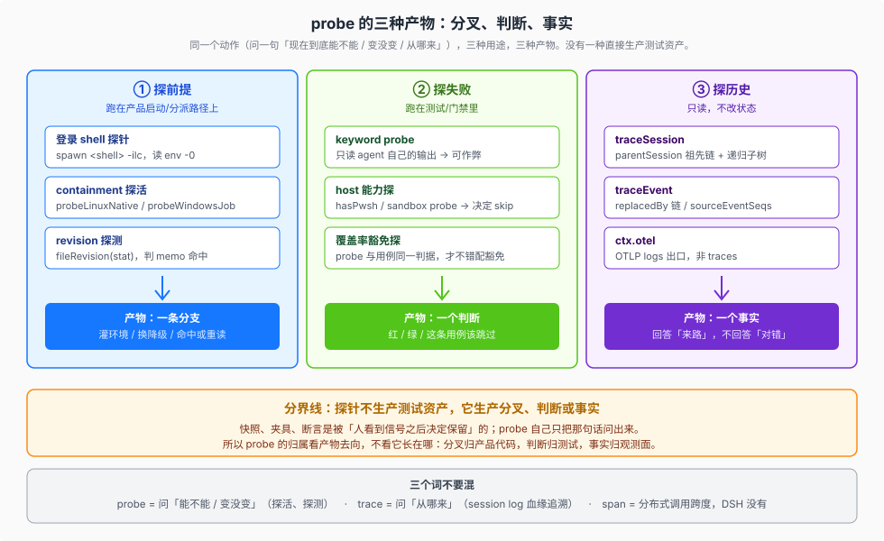

# 12 — probe：探针是一种取证动作，不是测试资产

源码核验入口：`apps/desktop/src/login-shell-environment.ts`、`packages/subprocess/subprocess-local/src/{linux-scope,windows-job,index}.ts`、`packages/session/session-persistence-jsonl/src/index.ts`、`vitest.config.ts`、`docs/testing.md`。

本页回答：**DSH 里的 `probe` 到底是什么、它产出什么、该归哪个专题。** 结论先给：probe 不是术语表里的对象，是一种**问事实的动作**；它的产物是**分叉**、**判断**或**事实**，从来不是测试资产。它在防漏体系里的位置是**证据选择器**——决定一条用例跑不跑、一个文件豁免不豁免、一个平台 skip 不 skip；选择器与它守护的判断必须同源（[04](./04-anti-omission.md) 的 M6）。所以它不属于 `canon/GLOSSARY`（那收 DSH 承认的对象与机制），而是测试策略这一卷缺的那一维——**取证动作**。

## 读完你能回答

- repo 里几十处 `probe` 分别在探什么、产物去哪了？
- 为什么「探一个前提」不算测试，却和测试共用同一条判据？
- 一个 probe 该写在产品代码里还是测试里，判据是什么？
- `probe` / `trace` / `span` 三个词各自指什么，为什么不能互换？

## 心智模型

**一个动作，三种产物，三条归属线。** 判据只有一句：

> probe 不生产测试资产，它生产分叉、判断或事实。快照、夹具、断言是被「人看到信号之后决定保留」的；probe 自己只把那句话问出来。

这句话有两个推论，本页余下全部内容都由它推出来：

1. **归属看产物去向，不看代码长在哪。** 探出来的东西决定"接下来走哪条路"→ 归产品代码；决定"这条用例红还是绿还是跳过"→ 归测试；只回答"来路"→ 归观测面。三种都可能出现在测试文件里，但只有第二种是测试行为。
2. **"探出问题"是三种产物里最小的一种。** 大多数 probe 连"问题"都不探——它探的是**前提**，即"这个能力现在在不在"。探通了继续，探不通降级。没有对错可判。

## 一、探前提：产物是分支

这是 DSH 里 probe 的主要用法，且**完全不发生在测试里**。它们跑在启动和分派路径上，产物是一条 `if` 分支。

| probe | 问的那句话 | 探通 / 探不通 |
|---|---|---|
| 登录 shell 探针（`login-shell-environment.ts:114`，`spawn(shell, ['-ilc', DUMP])`） | 这个账号的 shell 启动文件能不能跑、输出能不能解析 | 通 → 把 `env -0` 的值灌给 Host、agent shell、终端与 profile 配置；不通 → 依次试 `/bin/zsh`、`/bin/bash`、`/bin/sh`，全失败则用继承环境 |
| `probeLinuxNative`（`linux-scope.ts:162`） | 这台机器能不能给出 literal-argv 的 transient scope | 通 → 返回 `LiteralArgvOptions`，选中 `linux-scope` containment；不通 → 返回 `undefined`，落到 `fallback` 并只警告一次（`index.ts:245`-`:259`） |
| `probeWindowsJob`（`windows-job.ts:57`） | 当前 token 能不能建 Job 对象 | 通 → `windows-job`；不通 → `fallback` |
| `fileRevision` 探测（`session-persistence-jsonl/src/index.ts:615`） | 这个文件 revision 变没变 | 没变 → 命中 `coldLogMemo` 直接返回；变了 → 重读并重新解码 |

三个非显然的点：

**① 探不通不是错误，是设计好的一条路。** `probeLinuxNative` 的 JSDoc 写的是 *"@returns the options that keep target argv literal, or undefined when the user manager cannot create the scope"*——返回 `undefined` 是正常返回值，不是异常。`probeLinuxBootstrap` 里的 `catch { return false }` 同理：探活**吞掉**异常并翻译成布尔值，因为对调用方来说"探不通"和"探的时候炸了"是同一件事。这一条和仓库的"错误必须显式上报"纪律不矛盾：吞异常的是 probe 自己，它把结果**编码进返回值**交给调用方分支，而不是悄悄跳过。

**② 探是有代价的，代价被显式记账。** `index.ts:76`-`:80` 的注释写明：*"Each probe is a spawnSync that blocks the event loop and forks the host, so the selector reruns it only after an event invalidates the previous verdict."* probe 不是免费的，所以结果要缓存、只在失效事件后重跑。写自己 probe 的人要先问这句代价。

**③ 探的是"前提"，不是"正确性"。** 这四类没有一类在判断"这样对不对"。它们判断的是"这个底座在不在"，供上层选路。

## 二、探失败：产物是判断

这一层才是测试语境里的 probe，也才归本卷。

| 用法 | 出处 | 判据 |
|---|---|---|
| `keyword probe` | `docs/testing.md:35` | 只读 agent 自己的输出 → **可以作弊**。e2e 必须外部门再跑一遍命令 / 再读文件，或断言未改动的文件逐字节相同 |
| host 能力探 | `executor.spec.ts` 的 `hasPwsh`、`source-tool.built.e2e.ts` 的 sandbox probe | 探不通 → 该用例**自我跳过**，不是失败 |
| 覆盖率豁免探 | `vitest.config.ts:117`-`:120` | 豁免条件和用例跳过必须**用同一个判据**：`probe` 跑的是用例自己的 `resolvePwshPath()`，"a mismatched narrower probe could exempt the file on hosts whose suites actually run" |
| `acceptance probe` | `tool-todo/tests/projection.spec.ts:3`、`coding-task.e2e.ts:75` | 用例本身作为"某个领域已可验收"的探针 |

这里最重要的一条在产品纪律之外、在测试内部：

> **探针与它守护的判断必须同源。** `vitest.config.ts` 那段的原话把失败模式说尽了——如果豁免用的探针比用例用的判据更宽，就会出现"用例其实要跑、却被豁免掉"的假绿。这正是本卷 [`07-ci-gates`](./07-ci-gates.md) 与 [`08-reliability`](./08-reliability.md) 反复讲的防假绿在 probe 上的具体形态。

第二条：**探不通时的默认动作是"跳过"，不是"通过"**。跳过是可见的空缺，通过是伪造的证据。二者在 CI 汇总里长得像，含义相反。

## 三、探历史：产物是事实

`ctx.sessionQuery` 的追溯面与 `ctx.otel` 出口常被误叫"探针"，因为它们听起来都像"往里看一眼"。它们探的是**来路**，不是**对错**，也不是**能不能**。

- `traceSession` / `traceEvent`（`packages/session-query/session-query/src/tracing.ts`）只读：前者沿 `parentSession` 给祖先链与递归子树，后者给 `replacedBy` 链、被遮蔽事件与 `sourceEventSeqs` 派生事件。答案是"这条事件从哪来、被谁换掉、影响谁"。
- `ctx.otel` 是 **OTLP logs** 出口，不是 traces。全仓 `traceparent`、`setSpan`、`tracer`、`propagation.getActive()` **零命中**——DSH 没有分布式 tracing。

机制不在这里展开：谱系与替换链见 [`../delegation-and-orchestration/completion-and-observation/03-session-lineage-and-agent-incarnation.md`](../delegation-and-orchestration/completion-and-observation/03-session-lineage-and-agent-incarnation.md)，出口与消费者见 [`../plugin-system/inventory/02-plugin-catalog.md`](../plugin-system/inventory/02-plugin-catalog.md) 的 `otel` 与 `session-telemetry-otel` 行。

## 四、要不要把当前场景叫"探针"：一个判据

写新代码或审 PR 时，按顺序问三句：

1. **产物去哪？** 进 `if` → 探前提，写在产品代码里，别塞进测试目录。
2. **谁读它？** 决定这条用例跑不跑 / 红不红 → 探失败，写在测试里；同时检查**判据是否与用例同源**（第二节那条）。
3. **它判断对错吗？** 不判断、只回答来路 → 那是追溯或观测，用 `traceSession` / `ctx.otel` 的既有面，别新造。

三句都答不上来的，多半不是 probe，是一个没想清楚该归谁的东西。

## 五、为什么不收进 `canon/GLOSSARY`

按 [`../canon/00-map.md`](../canon/00-map.md) 与 [`../canon/GLOSSARY.md`](../canon/GLOSSARY.md) 的收词规则：词表收的是 **DSH 承认的对象与机制**，每行必须能 grep 到**原文**。`probe` 虽然 grep 得到几十处，但它是**函数名和局部变量的前缀**，不是 DSH 定义的对象——没有 `Probe` 类型、没有 `ctx.probe` 服务、没有 glossary 条目。把它写进词表，等于凭空给 DSH 造一个机制。

按 [`../canon/03-retired.md`](../canon/03-retired.md) 的加一行条件（"已在正文出现过、且让人误以为它是 DSH 的东西" + "能给出 DSH 原词替换"），中文自造的**「观测探针」**确实够格：它把上面三件事糊成一个词，本页就是替换后的说法。

## 源码入口

| 文件 | 一句话 |
|---|---|
| `apps/desktop/src/login-shell-environment.ts` | 登录 shell 探针：`-ilc` dump、双分隔符截取、超时杀进程组 |
| `packages/subprocess/subprocess-local/src/linux-scope.ts` | `probeLinuxBootstrap` / `probeLinuxScope` / `probeLinuxNative` / `probeLinuxManager` |
| `packages/subprocess/subprocess-local/src/windows-job.ts` | `probeWindowsJob` |
| `packages/subprocess/subprocess-local/src/index.ts:76`-`:80` | probe 代价注释与 `LinuxScopeSelector` 的失效重探 |
| `packages/subprocess/subprocess-local/src/index.ts:245`-`:259` | 探前提的产物如何变成 containment 选择与单次降级警告 |
| `packages/session/session-persistence-jsonl/src/index.ts:615` | revision 探测与 `coldLogMemo` 命中 |
| `vitest.config.ts:117`-`:120` | 豁免探针必须与用例同源的反面说明 |
| `docs/testing.md:35` | `keyword probe` 可作弊，故 e2e 需外部门 |

## 边界

- 本页只拥有**判据**：probe 产出什么、归谁、要不要叫这个名。每个探针的机制仍在各自专题。
- 探前提一节的产品用例只点到"产物是分支"；containment 的选路细节见 [`../capability-seams/07-原生containment与native-system.md`](../capability-seams/07-原生containment与native-system.md)。
- 本页不主张"probe 越多越好"。DSH 的 default 是**不探**：能力可选时在 use site 探一次（`docs/cordis-tutorial/03-services.md:82`），能力必需时用 `inject` 声明硬依赖，而不是探。
