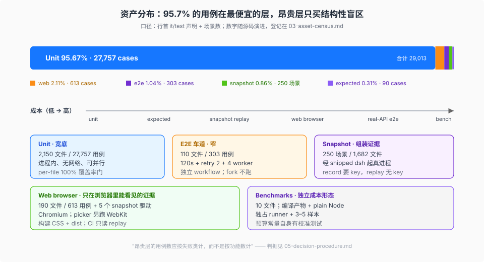

# 03-dsh-testing-asset-census.md: 自动化测试资产的分布与成本

## 概念 (Concept)
DSH 的测试体系不是传统的“测试金字塔”，而是**宽底窄尖**的证据分布模型：约 95% 的用例位于便宜的 Unit 层，而昂贵的 Real-API E2E、Browser Snapshot 等仅承载 5% 的用例，负责捕捉 Unit 层无法感知到的组装级失败。

## 背后思考 (Insight)
*   **成本权衡**：昂贵用例不应按“功能数量”配额，而应按“失败类 (Failure Class)”配额。只有当 Unit 层无法发现的失败类（如真实模型交互、浏览器渲染等）才分配给昂贵层。
*   **自动化门禁**：分布不是“自然长成”的，而是通过 CI 的门禁规则强制分流形成的。

## 工程实践推荐 (Practice)
*   **资产账本**：在每个功能开发前，根据功能涉及的失败类，明确证据资产的分布，并登记在 `catalog.json`。
*   **自动化复测**：确保资产账本可被 CI 自动校验。

## 参考 (Reference)
*   [CI 门禁](./07-dsh-ci-gates-and-reliability.md)
*   [决策流](./05-dsh-testing-decision-procedure.md)

# 资产账本：自动化测试资产的分布与成本

> 本页是本专题唯一登记测试资产数量的地方：成文测试政策 `docs/testing.md`（55 行、9 节），以及各自动化层有多少文件、多少用例、跑起来花什么成本、在 CI 里是不是必需。分层定义见 [02](./02-dsh-testing-tiers-and-selection.md)；"这些资产为什么能防漏"见 [04](./04-dsh-testing-anti-omission-mechanisms.md)；"拿到一个新变更怎么选层"见 [05](./05-dsh-testing-decision-procedure.md)。其他页只引用本页，不复制数字。

## 一句话

DSH 的自动化资产不是经典测试金字塔，而是**宽底 + 窄塔尖**：约 **95.7%** 的用例落在最便宜的 unit 层；真实的模型调用、浏览器、录制回放和性能测量合计只占约 **4%**，而且每一条昂贵用例都能回答"unit 层为什么看不见它"。

## 账本（硬事实，按基线树实测）

| 层 | 选择器 | 规模 | 运行形态 | 边际成本 | PR CI 里的位置 |
|---|---|---|---:|---|---|
| Unit | `*.spec.{ts,tsx}` | **2,150 文件、27,757 条 `it`/`test`** | vitest `forks` worker | 单条毫秒级 | `node 24 / coverage`（必需） |
| Owner-local expected | `*.expected.e2e.ts` | **29 文件、90 条用例** | 起子进程 | 秒级 | `node 24 / snapshots and artifacts`（必需） |
| E2E 车道 | `packages/*/*/tests/**/*.e2e.ts` | **110 文件、303 条用例** | 真进程：真模型与真 bash/PTY/ACP | 120s 超时 | 独立 `e2e.yml` |
| Web browser | `apps/web/tests/**/*.{e2e,snapshot}.ts` | **190 文件、613 条用例** | 构建 CSS + frontend dist，Chromium | 真浏览器 + Host | `node 24 / snapshots and artifacts`（必需） |
| Snapshot | `snapshots/**/*.snapshot.ts` | **250 个场景** | 经 shipped `dsh` profile 起真进程 | replay 可并行 | `node 24 / snapshots and artifacts`（必需） |
| Benchmarks | `benchmarks/**/*.bench.ts` | **10 个文件** | 编译产物 + plain Node | 独占 runner | `node 24 / benchmarks`（必需） |
| 手动诊断 | `*.perf.ts` 等 | **4 个文件** | 本地手动 lane | 不进 CI | 不是门 |

## 比例怎么读（解释）
(以下内容保持与原件一致...)
