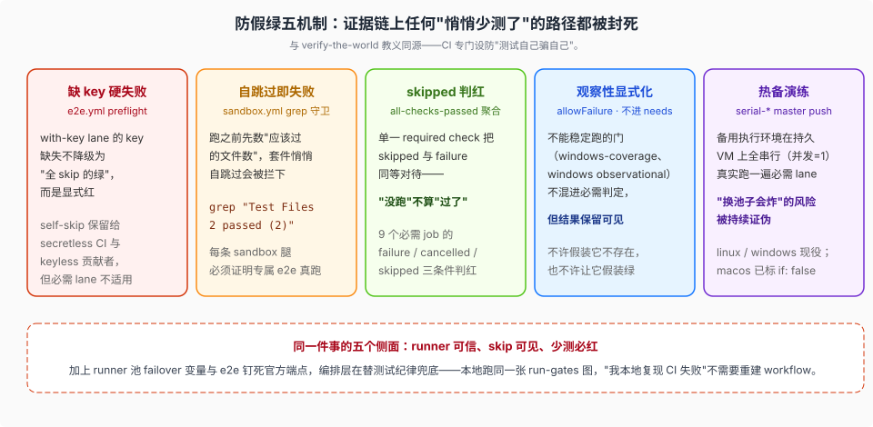

# 04-dsh-testing-anti-omission-mechanisms.md: 六面防漏纪律

## 概念 (Concept)
DSH 的“不漏东西”并非依靠单一机制，而是由六个互不替代的维度（空间、执行、类型、入口、断言、可见性）共同构成的检查面。如果漏测，系统会自动触发红灯、显式豁免或可见跳过。

## 背后思考 (Insight)
*   **空间完备性**：`per-file 100% coverage` 强制所有代码行必须被测试覆盖。
*   **入口可靠性**：所有发布产物（Artifact）必须有冒烟测试。
*   **证据不自欺**：测试必须在被测对象外部进行断言，禁止使用 probe 自身进行自断言。
*   **复盘闭环**：真实的漏测应通过 `postmortem` 复盘，并转化为新的测试规矩，避免同类故障复现。

## 工程实践推荐 (Practice)
*   **显式墓碑**：代码行删除后，必须更新对应的文档/账本，记录移除理由，防止死代码残留。
*   **全自动化**：所有防漏检查均必须融入 CI，任何绕过 CI 的人工确认在 DSH 中都是无效的。

## 参考 (Reference)
*   [测试教义](./../philosophy/01-dsh-testing-philosophy-and-doctrine.md)
*   [决策流](./05-dsh-testing-decision-procedure.md)
