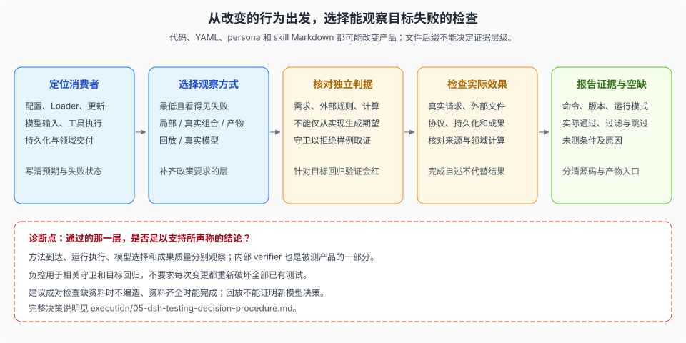

# 05-dsh-testing-decision-procedure.md: 测试决策流

## 概念 (Concept)
DSH 的测试不是全量覆盖，而是**基于变更的风险类评估**。决策程序将测试策略从临场模型判断转变为一套可执行的五个步骤，确保每一条变更都有明确的、对应失败类的证据资产。

## 背后思考 (Insight)
*   **证据链完整性**：测试是为了证明特定的失败类（Failure Class）。如果不具备负控能力（即见过该测试红过），则该测试无效。
*   **分流策略**：绝大多数变更应分流至最便宜的层（Unit/Static），只有跨进程/跨模型等结构性盲区才流向昂贵层。

## 工程实践推荐 (Practice)
1.  **分类决策**：明确变更所属类型（逻辑、插件、配置等）。
2.  **负控优先**：引入目标 bug，确认测试确实会变红。
3.  **证据归账**：将所有证据登记在 PR 的测试账本中。

## 参考 (Reference)
*   [资产账本](./03-dsh-testing-asset-census.md)
*   [CI 门禁与可靠性](./07-dsh-ci-gates-and-reliability.md)

# 决策程序：怎么定测试面、怎么算够

> 本页回答本专题的第三问：把"测试资产做对了没有、做够了没有、分布准不准"从模型临场判断变成一套可执行的程序。输入是一次变更，输出是一份**证据账本**和一组 yes/no 判据。资产分布见 [03](./03-dsh-testing-asset-census.md)，防漏机制见 [04](./04-dsh-testing-anti-omission-mechanisms.md)，插件仓的缩编版见 [15](./15-plugin-testing-contract.md)。

## 决策程序总览（五步）
1. **分类**：这次变更属于哪一类？
2. **选层**：最便宜、但**确实能看见**该失败类的层是哪层？
3. **证明会红**：引入目标回归，确认证据变红，再恢复。
4. **验证世界**：断言外部状态，而不是被测者的自报。
5. **判够 + 记账**：过七问，把证据写进 PR 账本；缺的显式登记。
