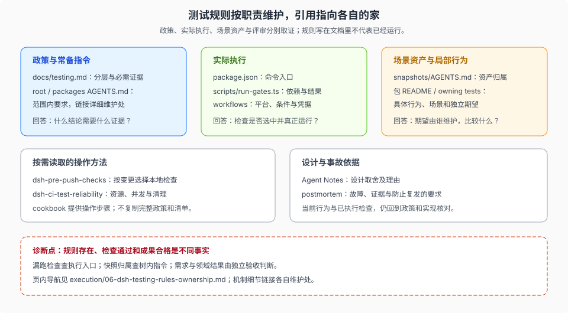

# 06 · 规则所有权：政策、执行与证据各自归属

测试规则按职责维护：政策说明需要什么证据，代码与配置决定实际执行，树内指令约束场景资产，技能帮助选择检查，评审判断需求和结果是否相符。引用同一规则时链接其维护处，避免在不同页面维护两份命令或承诺。

## 查找规则的维护处

| 维护处 | 负责什么 |
|---|---|
| [测试政策](https://github.com/deepseek-ai/deepseek-harness/blob/master/docs/testing.md) | 分层、coverage、真实组合与产物、真实模型、外部断言及必需录制场景 |
| [根指令](https://github.com/deepseek-ai/deepseek-harness/blob/master/AGENTS.md)、[包指令](https://github.com/deepseek-ai/deepseek-harness/blob/master/packages/AGENTS.md) | 常备要求与范围内指令，链接详细政策 |
| [快照树指令](https://github.com/deepseek-ai/deepseek-harness/blob/master/snapshots/AGENTS.md) | Session 场景归属、世代、共享引用、sidecar、独立工作区期望及差异审查 |
| [命令声明](https://github.com/deepseek-ai/deepseek-harness/blob/master/package.json)、[门禁脚本](https://github.com/deepseek-ai/deepseek-harness/blob/master/scripts/run-gates.ts)、[workflows](https://github.com/deepseek-ai/deepseek-harness/tree/master/.github/workflows) | 检查入口、依赖与失败语义、平台及凭据条件 |
| [检查选择技能](https://github.com/deepseek-ai/deepseek-harness/blob/master/.agents/skills/dsh-pre-push-checks/SKILL.md)、[可靠性技能](https://github.com/deepseek-ai/deepseek-harness/blob/master/.agents/skills/dsh-ci-test-reliability/SKILL.md) | 按变更选择本地证据，以及资源、并发与清理的设计和诊断 |
| 包 README、场景与 owning tests | 被测能力的具体行为、夹具和断言；非 Session expected output 留在所属 app／package／script |
| Agent Notes、postmortem | 设计取舍和事故依据；当前要求回到政策与执行维护处核对 |

规则存在不代表检查已经执行。修改规则要同步其真实接受路径和相关测试；修改生成期望要审查差异，不能靠扩大规范化范围隐藏退化。独立验收判据由需求确定，生成目录与实现输出不自动成为正确答案。

## 按症状查页

| 问题或症状 | 阅读入口 |
|---|---|
| 不知道这次改动需要哪些证据 | [测试决策流](./05-dsh-testing-decision-procedure.md) |
| hook 或 CI 绿了，但目标用例没跑 | [防漏检查](./04-dsh-testing-anti-omission-mechanisms.md)、[CI 跳过与聚合](./07-dsh-ci-gates-and-reliability.md) |
| 不知道谁可以改录制、历史世代或工作区期望 | [快照机制](../mechanisms/10-dsh-snapshot-machinery.md) |
| 原生检查或测试只有独立运行才通过 | [可靠性与 flake 归因](./08-dsh-testing-reliability-and-flake-analysis.md) |
| 插件已有单测，仍缺真实入口验收 | [插件测试 playbook](../plugin-testing/14-dsh-plugin-testing-playbook.md) |

## 源码核验入口

上表链接各项规则的原始维护处；[Git hooks](https://github.com/deepseek-ai/deepseek-harness/blob/master/lefthook.yml)可核对本地实际执行范围，[快照实现](https://github.com/deepseek-ai/deepseek-harness/tree/master/packages/test-support/session-snapshot/src)可核对资产处理。完整主仓检查路由见[SDLC 参考](../../../_dsh_plugin_agent_ready_development/03-dsh-sdlc-reference/04-gates-and-local-checks.md)，本页不复制其命令矩阵。
