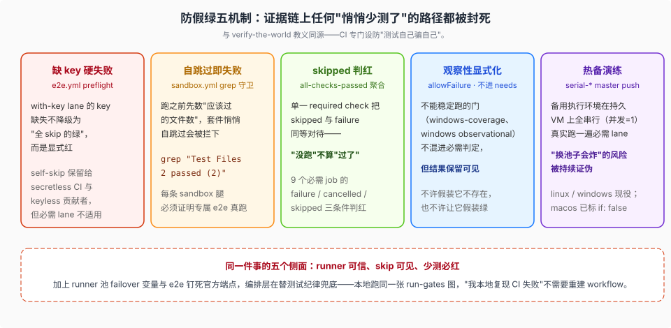

# 07-dsh-ci-gates-and-reliability.md: CI 门禁与平台矩阵

## 概念 (Concept)
DSH 的 CI 不仅仅是“跑测试”的地方，它是自动化门禁图（Programmable Gate Graph）的执行器。该图通过可编程的 DAG 编排，将单元测试、快照、性能基准和发布冒烟测试整合在一起。

## 背后思考 (Insight)
*   **集中化编排**：门禁逻辑（DAG 拓扑、并发度、失败语义）全部集中在 `scripts/run-gates.ts`，而非 Workflow 的 YAML 脚本，确保 CI 和本地执行逻辑一致。
*   **防假绿 (Anti-Fake Green)**：通过“缺 key 硬失败”、“自跳过即红”、“跳过算失败”等机制，封死任何可能导致“假绿”的路径。

## 工程实践推荐 (Practice)
*   **快速反馈**：遵循“先静态后动态，先廉价后昂贵”的执行顺序。
*   **稳定性优先**：对于 Flake，采取强制归因 + 隔离修补 + 制度化入库的闭环策略。

## 参考 (Reference)
*   [测试可靠性与 Flake 归因](./08-dsh-testing-reliability-and-flake-analysis.md)
*   [测试教义](./01-dsh-testing-philosophy-and-doctrine.md)

# CI 门禁与平台矩阵：编排、必需性与防假绿

> 本篇消化 DSH 的 CI 编排层：`scripts/run-gates.ts`（门禁注册表）、`.github/workflows/`（lane 结构）、Wine 与热备演练。分层定义见 [02](./02-dsh-testing-tiers-and-selection.md)，政策见 [01](./01-dsh-testing-philosophy-and-doctrine.md)，可靠性纪律见 [08](./08-dsh-testing-reliability-and-flake-analysis.md)。
> 门禁聚合器与 leaf 家族的机制概述由 [`system-overview/03-门禁与性能基准.md`](../system-overview/03-门禁与性能基准.md) 承载，本篇不重复家族图。

## 现象是什么：一个 1697 行的门禁注册表

DSH 的 CI 不是一堆散装的 workflow 步骤，而是一个**可编程门禁图**：`scripts/run-gates.ts`（基线下 1697 行）注册了 **18 个聚合模式**，每个模式是一张带依赖关系的门禁 DAG。workflow 只是调用入口，门禁的拓扑、并发、失败语义全部由这张注册表统一声明。

(以下内容保持与原件一致...)
