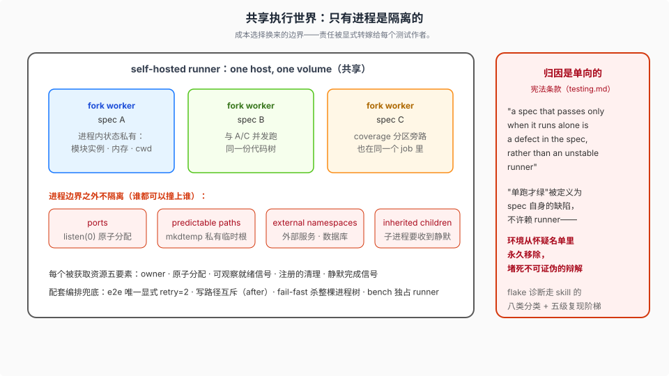

# 08-dsh-testing-reliability-and-flake-analysis.md: 测试可靠性与 Flake 治理

## 概念 (Concept)
DSH 的测试可靠性纪律建立在“共享执行环境”基础上：进程级隔离是环境不变量。flake（偶发失败）不是环境的错，而是 Spec 对“共享环境下的资源 Teardown”责任归属不清导致的缺陷。

## 背后思考 (Insight)
*   **归因单向性**：凡是“单跑才绿”的测试，一律算作 Spec 的缺陷。不允许测试作者将环境不稳定性作为 flake 的理由。
*   **资源归属权**：每个获取的资源（端口、路径、进程）都必须有一个明确的 owner 负责其 teardown，直到完全静默（Quiescence）。

## 工程实践推荐 (Practice)
*   **严格 Teardown**：获取资源后立即注册清理回调，确保在测试失败或超时时仍能被清理。
*   **环境互斥**：对于进程全局状态（Fake Timers、环境变量），必须使用独立作用域或在 `afterEach` 中显式恢复。

## 参考 (Reference)
*   [CI 门禁与可靠性](./07-dsh-ci-gates-and-reliability.md)
*   [测试教义](./01-dsh-testing-philosophy-and-doctrine.md)
