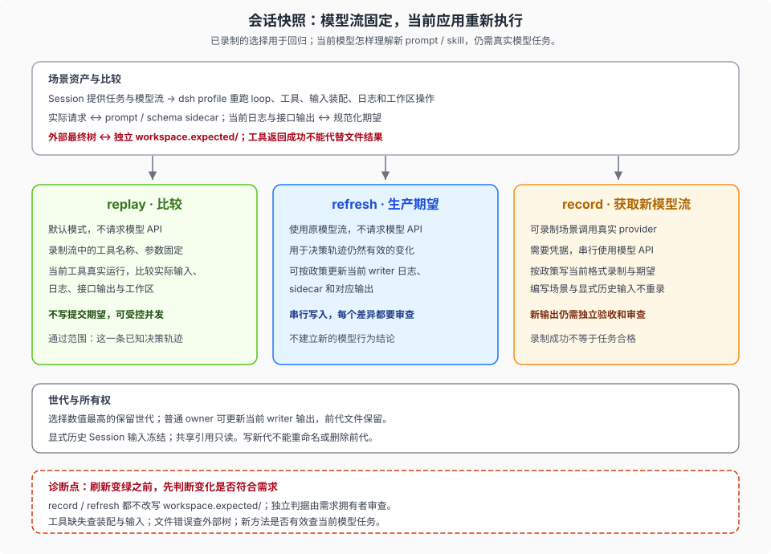

# 10-dsh-snapshot-machinery.md: 快照机制

## 概念 (Concept)
Snapshot 是 DSH 测试体系中最高级的“固化”形式：将一次完整的录制会话（包含输入、模型交互、持久化状态）封装为“无 key 回放”的测试场景。它确保组装后的完整转录没有意外变化，是集成测试最稳固的防线。

## 背后思考 (Insight)
*   **证据不失真**：快照通过固化录制数据，使得对昂贵/真模型交互的验证能以“零 Token、可并行”的成本进入 CI。
*   **世代保留**：通过相邻迁移（Adjacent Migration）策略，永远不重写旧代际场景，从而保留了不同版本的格式回放回归样本。

## 工程实践推荐 (Practice)
*   **人工过目**：对于快照的 `record` 或 `refresh` 操作产生的 `diff`，必须由 owner 人工严格 Review。
*   **场景颗粒度**：尽量将快照场景拆分为独立的最小行为单元，避免通过修改大型快照来验证单一逻辑变更。

## 参考 (Reference)
*   [快照所有权与规则](./06-dsh-testing-rules-ownership.md)
*   [插件测试 playbook](./14-dsh-plugin-testing-playbook.md)
