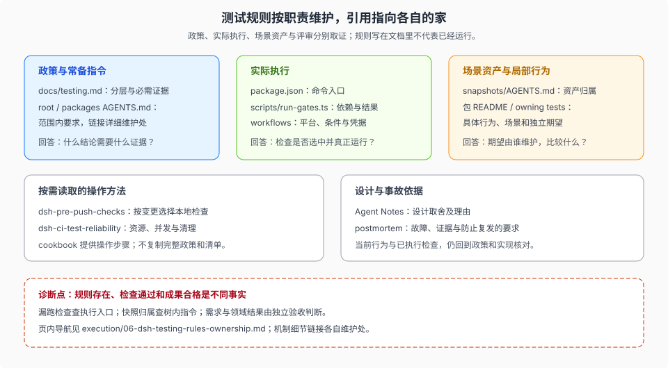

# 01-dsh-testing-philosophy-and-doctrine.md: 测试思想与教义

## 概念 (Concept)
DSH 的测试资产规模巨大，但测试政策却极为简洁。其核心是：“**让绿灯 suite 变得有意义**”。我们不追求“测试覆盖率”这一虚幻指标，而是追求“每个红灯都直指一个真实的业务退化”。

## 背后思考 (Insight)
*   **不仅仅是测试**：测试是 DSH 交付证据链（Evidence Chain）的一部分，是功能修改的“物理属性”。
*   **宽底窄尖**：绝大多数用例在最便宜的 unit 层，昂贵层只测试 unit 结构上看不见的失败。

## 工程实践推荐 (Practice)
1.  **红灯优先**：先证明会红，再证明会绿。
2.  ** evidence-first**：每次 PR，不仅测逻辑，还要补充对应的 evidence（快照、行为对比）。

## 参考 (Reference)
*   [决策流程](./../execution/05-dsh-testing-decision-procedure.md)
*   [测试资产账本](./../execution/03-dsh-testing-asset-census.md)
