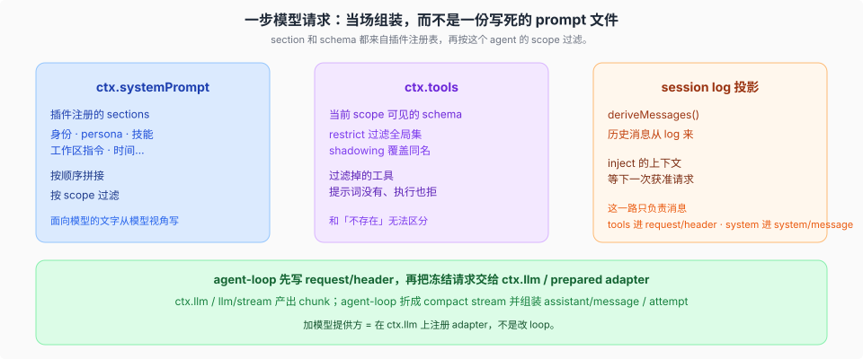
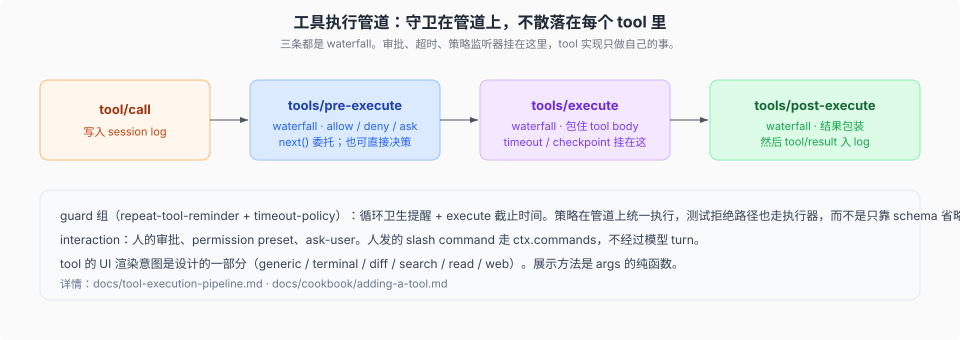

# Tools, prompt, LLM · 模型可见面

## 一句话

模型每一步看见的东西由插件注册表**当场组装**：`ctx.systemPrompt` 的 section，加上 `ctx.tools` 里当前 scope 可见的 schema，历史则从 session log 投影。请求经 `ctx.llm` 的 adapter 流出；工具调用走四条 `tools/*` waterfall（`pre-execute` / `execute` / `post-execute` 在调用管道上，`ptc-dispatch-log` 观察 PTC 子调度；`tools/result` 是同步通知，不是 waterfall），其中前三条构成调用管道。

这一层是「模型可见面」。它依赖 [session log 与 scope](../session-and-loop/00-map.md)。

## 一步请求从哪来



三股汇合（先修概念：[surface](../canon/GLOSSARY.md) 与 [scope chain](../session-and-loop/00-map.md)，归 session 专题）：

1. **Prompt sections** — 插件往 `ctx.systemPrompt` 注册片段，按顺序、按这个 agent 的 scope 过滤后拼起来（顺序为什么重要见 [`01`](./01-section顺序与前缀.md)）。
2. **Tool schemas** — `ctx.tools` 里该 scope chain 仍可见的工具；chain 上的 `restrict` 过滤继承面，当前 agent 自有层最后覆盖或补充——delegation 注册进子代理 own-layer 的 structured-output tool 有一条专门豁免保住它（`packages/core/tools/src/index.ts`）。被过滤的工具在提示词和执行中都表现为不存在。
3. **历史** — `deriveMessages()` 从 surface 投影；`inject` 的材料等下一次获准请求。图像以 durable attachment 引用进 content block，序列化时才解析成 provider 形态并受每请求上限约束（编码与预算的家：[`06`](./06-文件块与内容块投影.md)）。

组装完成后，loop 把生效的模型配置、adapterDefaults 与 tools 写入 `request/header`；渲染后的 system prompt 是 surface 节点 0 的 `system/message`（[`03`](./03-system-prompt作为surface节点.md)）。面向模型的文字从**模型视角**写：提示词、schema、结果、诊断里只有任务相关概念。

加模型提供方：在 `ctx.llm` 上注册 adapter（DeepSeek 官方 adapter 的 thinking effort 与提示词替换分路见 [`04`](./04-in-history提示词替换.md)；pi-ai 的 profile 校验、模型发现与 strict/deferred 配置面在 `packages/llm/llm-pi-ai/src/config.ts` 与 `discovery.ts`）。加面向模型的能力：在 `ctx.tools` 上注册。都不必改 loop。

DeepSeek 官方线协议扩展的逐条权威是 [`docs/deepseek-llm-api-wire-extensions.md`](../../docs/deepseek-llm-api-wire-extensions.md)。

## 工具执行管道



```text
tool/call（入 log）
  → tools/pre-execute     allow / deny / ask；next() 委托下游
  → 单调 guards           守卫在管道上统一执行，不散落在每个 tool 里
  → tools/execute         around-dispatch 包住 tool body；timeout 也挂在这
  → tools/post-execute    包装结果
  → 定义拥有的 projectContent / finalizeContent
tool/result（入 log）
```

参数在进入 `pre-execute` 前已经解析、记录并冻结；这条事件只作 `allow` / `deny` / `ask` 决策，不改写参数。监听器调用 `next()` 表示委托下游，也可以直接返回自己拥有的决定。完整序列以 [`docs/tool-execution-pipeline.md`](../../docs/tool-execution-pipeline.md) 为准（含 monotonic guards 与定义拥有的内容投影两段）；审批、timeout 与动态工具面更新的展开在本专题 [`02`](./02-工具管道审批与timeout.md)，chunk 与 settlement 归 [`05`](./05-chunk到settlement.md)。

和人相关的两条容易混：

- **审批 / permission / ask-user** 挂在 interaction 与这条管道上，仍然是模型 turn 的一部分。
- **人敲的 slash command** 走 `ctx.commands`，**不经过模型 turn**。那是另一个平面，见 [surfaces](../surfaces-entrypoints/00-map.md)。

tool 的 UI 渲染意图是设计的一部分，一开始就要定：call-time 三种 `generic` / `terminal` / `diff`（`packages/core/tools/src/presentation.ts` 的 `ToolCallView`），result-time 另有 `search` / `read` / `web`，共六种（同文件的 `ToolResultView`）。`presentCall` 是 `args` 的纯函数，`presentResult` 是 `(args, result)` 的纯函数。

## 按问题找

| 你的问题 | 去哪 |
|---|---|
| system prompt 顺序为什么重要 / 前缀稳定 | [`01`](./01-section顺序与前缀.md) |
| 审批挂哪、timeout 归谁、会话中途工具面怎么更新 | [`02`](./02-工具管道审批与timeout.md) |
| system prompt 怎么落日志 | [`03`](./03-system-prompt作为surface节点.md) |
| flash 模型的提示词替换 / in-history | [`04`](./04-in-history提示词替换.md) |
| 一次 attempt 怎么结算、chunk 时序与耐久回放 | [`05`](./05-chunk到settlement.md) |
| 图像/文件怎么进消息 | [`06`](./06-文件块与内容块投影.md) |

## 源码入口

| 路径 | `ctx` key | 角色 |
|------|-----------|------|
| `packages/core/system-prompt/` | `ctx.systemPrompt` | section 与 schema 组装 |
| `packages/core/tools/` | `ctx.tools` | 作用域注册表 + 守卫管道 |
| `packages/llm/llm/` | `ctx.llm` | 消息/流词汇 + adapter seam |
| `packages/llm/llm-deepseek/` | | DeepSeek provider |
| `packages/guard/` | | 循环卫生、execute 截止时间 |
| `packages/interaction/` | | 审批、permission、ask-user |
| [`docs/tool-execution-pipeline.md`](../../docs/tool-execution-pipeline.md) | | 管道 |
| [`docs/cookbook/adding-a-tool.md`](../../docs/cookbook/adding-a-tool.md) | | 加 tool |
| [`docs/cookbook/adding-an-llm-adapter.md`](../../docs/cookbook/adding-an-llm-adapter.md) | | 加 adapter |

## 机制级正文

| 文件 | 内容 |
|------|------|
| [`01-section顺序与前缀.md`](./01-section顺序与前缀.md) | `order` 约定、complete section、KV 前缀 |
| [`02-工具管道审批与timeout.md`](./02-工具管道审批与timeout.md) | 调用管道（`pre-execute` / `execute` / `post-execute`）与 `approval/request`；timeout 归属；会话中途的工具面更新；preparing 帧；`ptc-dispatch-log` |
| [`03-system-prompt作为surface节点.md`](./03-system-prompt作为surface节点.md) | `system/message` 事件形状、header 去掉 `system`、三种投影路由、node 0 保护、「稳定前缀」的新载体 |
| [`04-in-history提示词替换.md`](./04-in-history提示词替换.md) | `SystemPromptUpdate = 'in-history'` 能力面、decision rule、清空语义、log 与 token 记账 |
| [`05-chunk到settlement.md`](./05-chunk到settlement.md) | 一次 attempt 一条 settlement、step() 结算序列、紧凑 `AssistantStreamRecord`、实时帧与耐久回放、耐久性代价 |
| [`06-文件块与内容块投影.md`](./06-文件块与内容块投影.md) | `FileBlock` 与 `FileAttachmentRef`、文件无条件投影 vs 图像条件投影、模态与内容块之分 |

入口如何投影同一条流：[`../surfaces-entrypoints/00-map.md`](../surfaces-entrypoints/00-map.md)。

> 承重词按 [`canon/GLOSSARY.md`](../canon/GLOSSARY.md) 的 DSH 原文用；本页自己的分类与指标不是 DSH 的词。
