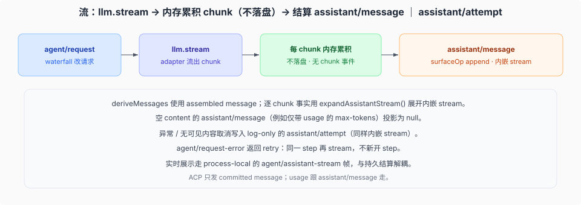

# 工具管道、审批与 timeout

源码核验入口：`packages/core/tools/src/index.ts` 事件、`packages/core/tools/src/ptc.ts`、`packages/llm/llm/src/assembler.ts`、`packages/llm/llm/src/assistant-stream.ts`、`packages/guard/timeout-policy/`、`packages/interaction/user-approval/`、`packages/core/agent-loop/src/agent.ts` `step()`。

本篇说明工具监听器挂哪、审批在哪条 seam、timeout 归谁，以及会话中途的工具面更新怎么入历史；流式 chunk 如何沉淀为 settlement 归 [`05`](./05-chunk到settlement.md)，图像与文件如何进消息归 [`06`](./06-文件块与内容块投影.md)。



## `tools/*` 调用管道的三条，加上一条 `approval/*`

```text
tool/call（log）
  tools/pre-execute     → PreToolDecision：allow | deny | ask
  tools/execute         → 真正 dispatch；timeout 包在这
  tools/post-execute    → 包装 / 替换结果
tool/result（log，surface）
```

三条都是 waterfall：调用 `next()` 委托内层；拥有政策结果的监听器可以直接返回决定、dispatch 结果或 post-decision。只做观察或包装的监听器必须委托。scope 过滤：agent-scoped 监听器只收到该 agent 的调用。

`pre-execute` 默认 inner 是 allow。`ask` 没有审批支持 → 否决。异步门必须看 `exec.signal`；注册表在它们结算后复核取消，但**不丢弃**它们的 promise。

审批本身是另一条 seam：`ctx.approval` + waterfall `approval/request`。审计事件 `approval/asked` / `approval/decided` / `approval/policy` 都是 **log-only**，不进 `deriveMessages`。模型从 runtime-context 快照和 tool result 得知结果，不从审批事件本身。缺 answerer fail-closed。

hooks（Claude Code / Codex 桥）把外部 permission 决策映射成 `pre-execute` 的 allow/deny/ask。人点的 slash command 走 `ctx.commands`，不进这条管道。

## 会话中途的工具面更新

`dsh-llm` 定义路由能力 `ToolUpdate = 'in-history' | 'addition-only'`（`packages/llm/llm/src/types.ts:425`，挂在 `LlmResolvedModelInfo` 上，`:428`）。route 声明了模式时，会话中途的工具面变化按「历史更新」走：loop 在 `request/header` 变更旁边把增删写成一条 `developer/message`（source `tool-registry`，content 是 `tool-addition` / `tool-removal` 块，`packages/core/agent-loop/src/agent.ts:656`-`:665`），随 `headerSeq` 关联触发它的 header。dispatch 边界 `projectToolUpdates`（`packages/llm/llm/src/content.ts:424`）再按目标 route 的模式投影：`in-history` route 收到保留的 `tool-addition` / `tool-removal` 增量，`addition-only` route 的 removal 被滤掉（工具只能增不能撤），未声明模式的 route 收不到 developer 更新、拿完整工具表（`content.ts:430`-`:436`）。DeepSeek wire 侧把保留的 developer 块序列化成 system-role 的 `tool_addition` / `tool_removal` tool 引用，`defer_loading` 声明按 schema 字段透传（`packages/llm/llm-deepseek/src/serialize.ts:47`、`:95`-`:96`、`:165`）。内置唯一声明者 `deepseek-flash` 用 `addition-only`（`packages/llm/llm-deepseek/src/models.ts:15`，catalog zod 校验 `config.ts:81`）。tool 模式同样可被官方 listing 的 `api_capabilities.anthropic_messages.tool_update` 覆盖：`in-history` / `addition-only` 照收，省略保留内建，其他值按 `leading-only` 移除（`packages/llm/llm-deepseek/src/listed-catalog.ts:55`-`:68`）。未声明模式的 route 行为不变：可见 schema 集变化仍然使 `startsSeries` 成立（`packages/core/agent-loop/src/agent.ts:420` 的条件是 `preparedCall?.toolUpdate === undefined && this.toolsChanged(assembly.tools)`）。

## timeout 挂在 `tools/execute`

`dsh-tool-call-timeout-policy`：读 `ctx.tools.get(name, agent)?.timeoutMs`。未声明则 `next()`。有则 `deadline(exec.signal, timeoutMs)`。超时返回模型可见的失败结果，不是抛给 loop 当基础设施错误。同一条 `tools/execute` 上还有 `dsh-session-checkpoint-policy`：先 flush 再进 tool body。`tools/post-execute` 上 `spill-policy` 处理超大文本。

`timeoutMs` 在 `defineTool` 时声明，必须是正有限数。这是 **tool 调用**预算。shell 的 foreground `timeoutMs` 是 **进程**预算。一次 bash 可能两边都有。

`tools/execute` 包装只许改 `exec.signal`，调用身份不可变。注册表在 body 前重新融合原来的 caller signal，替换不能摘掉取消。包装器仍须恢复自己的 signal 并达到 quiescence。

`tools/post-execute`：抛错的 tool 也作为 error 进入这条链。caller 取消在结算后只替换「已接受的成功结果」。

还有 `tools/ptc-dispatch-log`（`packages/core/tools/src/index.ts`）：只改 `run_code` 子调度写入 log 的副本（spill 预览），程序已经拿到完整值，模型也看不见这段。事件名 `tool/ptc-dispatch-start` / `tool/ptc-dispatch`（`packages/core/tools/src/ptc.ts`），sub-call id 为 `<parent>:ptc:<n>`，deferred image 的 plugin 来源为 `tools-ptc`。

**工具卡的 preparing 阶段**：`assistant/live-chunk` 的 `tool-call-delta` 帧在 `tool/call` 落 log 之前就把工具卡的 phase 置为 `preparing`（`packages/client/ui-chat/src/client/conversation-nodes/tool.ts`），Web 过程活动行同样显示准备态（同目录 `process-activity.ts`）；card 拿到的是「工具开始准备」的过程信号，不是执行结果。

## settlement 与内容块归谁

管道之后是模型流侧：一次模型 attempt 只提交**一条 settlement**（`assistant/message` 进 surface，或 log-only 的 `assistant/attempt`），逐 chunk 时序内嵌其中、没有顶层 chunk 事件——完整的结算序列、紧凑编码与实时帧分离见 [`05-chunk到settlement.md`](./05-chunk到settlement.md)。

图像与文件不在这条管道里：图像以 durable attachment 引用进 content block、由序列化器解析成 provider 载荷（预算与卸载见 [`06-文件块与内容块投影.md`](./06-文件块与内容块投影.md)）；文件块从不原生发给任何 provider，一律替换成确定性 handle 文本。

ACP 在已提交 `assistant/message` 上按块投影非空文本**或**图像；chunk 仍不上线。实时展示走 process-local 的 `agent/assistant-stream` frame（start / transient chunk / end）：loop 先追加 settlement，committed end frame 再命名其类型与 seq，被放弃的 end 没有 settlement；Web 的实时 chunk 行是 Client-only 事件 `assistant/live-chunk`，不写进 session log。SDK JSON-RPC 相反：每条耐久事实都 `session.event`。见 [`../surfaces-entrypoints/02-acp与jsonrpc.md`](../surfaces-entrypoints/02-acp与jsonrpc.md)。
