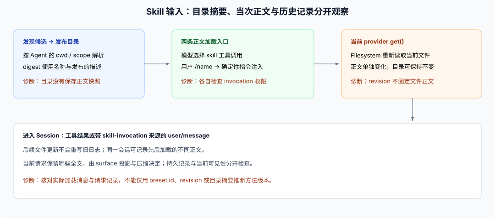

# Skill 正文的发现、加载与会话保留

> Skill 的目录和正文不是同一个快照。目录让模型发现可用名称；模型调用 `skill` 或用户显式写入 `/<name>` 时，运行时再向当前胜出的 provider 读取正文。preset revision 和目录摘要都不固定磁盘正文的版本。
>
> 源码核验入口：`packages/skill/skill/src/index.ts` 的 `snapshot()` / `get()`，`packages/skill/skill-filesystem/src/index.ts` 的 `list()` / `get()`，`packages/skill/tool-skill/src/index.ts` 的 catalog、工具执行和 user-invocable 注入，以及 `packages/core/agent-loop/src/agent.ts` 的会话追加。回归测试见 `packages/skill/tool-skill/tests/tool-skill.spec.ts`。

## 目录是发现提示

每个请求边界，`tool-skill` 按调用 Agent 的 cwd 和 scope 取得可见 skills；只有该 Agent 实际解析到本插件注册的 `skill` 工具时，才发布模型目录。目录项包含名称和截断、规范化后的 description；digest 只由这些发布项计算。目录不是正文副本，也不代表正文已加载。

对 Filesystem provider，发现会读取 Skill 文件的 frontmatter，并保存文件 locator；后续正文读取不使用发现时解析出的内容。内容是否进入模型请求，取决于调用路径，而不是目录出现本身。

## 两条正文加载路径

- **模型调用工具：** 目录说明引导模型在任务匹配时用精确名称调用 `skill`。执行器按调用 Agent 的 cwd/scope 重新解析当前候选，检查 model-invocable 策略，再调用 registry `get()` 并返回完整 `<skill_content>`。模型是否调用仍是模型决策；目录不会自动注入所有 skill 正文。
- **用户显式调用：** 直接用户消息的文本块中，空白边界内的 `/<name>` 会被确定性扫描；识别到的 user-invocable skill 通过 `get()` 读取，并作为带 `skill-invocation` 来源的 instructions 消息附加到本步输入。它可出现在句中，不限于行首。`disable-model-invocation: true` 的 skill 可走此路径但不出现在模型目录；未知名称或禁止 user invocation 的名称不产生注入。

两条路径都在正文加载时读取当下的 Skill definition。Agent 将 `skill-invocation` 注入作为 `user/message` 追加到 Session；模型调用返回的完整正文也作为工具结果进入会话。之后文件更新或目录替换不会重写已经进入日志的正文。同一会话可以记录先后加载的不同正文；当前请求是否仍包含旧全文，则取决于 surface 投影及压缩，日志保留不等于全文始终可见。

## 变化、失败与限制

Filesystem provider 的 `get()` 会重新解析当前文件；只改正文而保持 name/description 不变，不改变目录 digest，也不触发目录替换消息。watcher 或第一方文件写入/编辑可能触发重新发现，但正文会在下一次加载时重新读取。目录 digest 只取决于发布的名称和规范化、截断后的描述；其他 frontmatter 变化只有改变可见项或发布描述时才影响 digest。可见目录被压缩移出 surface 后，相同目录也会重新发布。其他 provider 可采用不同的正文读取策略，不能从 Filesystem 行为推断其版本语义。

加载时文件已消失、不是文本或无法解析时，Filesystem provider 返回无结果；模型工具报告 skill unknown/unavailable，显式用户调用则保留原始文本而不注入正文。无效 frontmatter 或 invocation 值的文件会在发现时跳过。发现不完整时，`tool-skill` 不以不完整结果替换当前目录；候选消失或策略不允许也不会把正文交给调用者。非缺失类的读取错误可能向上传播并使当前调用失败。

**诊断要点：** 目录中有名称，只说明当前发现观察发布了摘要；要确认模型实际收到哪段指令，应检查对应 `skill` 工具结果或 `skill-invocation` 会话消息。preset revision、目录 digest 和当前磁盘正文是不同事实。

## 症状导航

| 症状 | 核对位置 |
|---|---|
| 目录没变，加载结果却变了 | 本页「变化、失败与限制」：目录 digest 不包含正文 |
| 用户未发起 `skill` 工具调用，正文已经进入本步 | 本页「两条正文加载路径」：直接用户 `/<name>` 注入 |
| 日志记录过正文，当前请求却没有全文 | [会话 surface 投影](./03-system-prompts-as-session-surface-nodes.md)及压缩后的可见节点 |

## 源码与测试入口

本地实现与回归测试：

- [Skill registry `snapshot()` / `get()`](../../packages/skill/skill/src/index.ts)
- [Filesystem provider `list()` / `get()`](../../packages/skill/skill-filesystem/src/index.ts)
- [Catalog、模型工具与显式注入](../../packages/skill/tool-skill/src/index.ts)
- [正文更新与调用路径测试](../../packages/skill/tool-skill/tests/tool-skill.spec.ts)

上游源码（跟踪 `master`）：[registry](https://github.com/deepseek-ai/deepseek-harness/blob/master/packages/skill/skill/src/index.ts)、[filesystem provider](https://github.com/deepseek-ai/deepseek-harness/blob/master/packages/skill/skill-filesystem/src/index.ts)、[tool-skill](https://github.com/deepseek-ai/deepseek-harness/blob/master/packages/skill/tool-skill/src/index.ts)、[tool-skill tests](https://github.com/deepseek-ai/deepseek-harness/blob/master/packages/skill/tool-skill/tests/tool-skill.spec.ts)。
