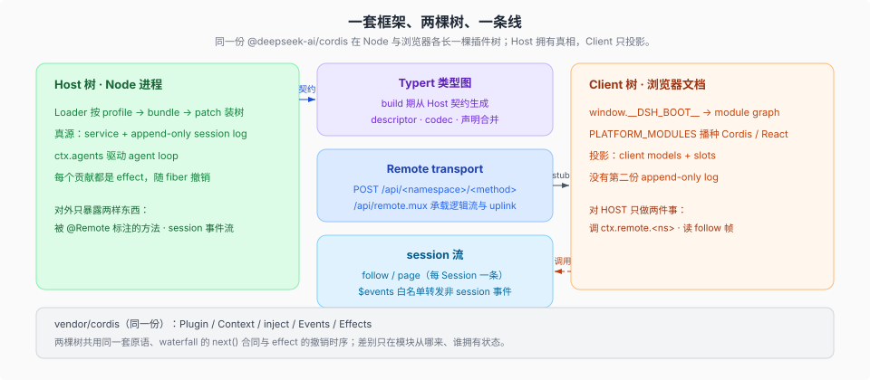

# Two-tree runtime · 一套框架、两棵树、一条线

各页核验值以 [`catalog.json`](../catalog.json) 与 [`_coverage`](../_coverage/00-index.md) 为准；本页只定形状。

## 一句话

Web 与桌面跑的不是「一个运行时加一个前端」，而是**同一套 Cordis 在两端各长一棵插件树**：Node 那棵拥有权威状态，浏览器那棵拥有视图与投影，中间是一条类型化的线（Typert + Remote）。同一个 `ctx`、同一批原语、同一种 `apply(ctx, config)` 写法，区别只在树上的服务与模块从哪来。

## 为什么合成一个专题

因为分开讲会把同一件事讲成两件：`@deepseek-ai/cordis` 在浏览器侧是 `PLATFORM_MODULES` 里的静态模块（[`client/tree/02`](./client/tree/02-模块身份与激活顺序.md)），在两棵树里是同一份 vendor；`ctx.effect()` 的撤销时序、waterfall 的 `next()` 合同、Loader 的 patch 算法，写两边插件时是同一套（[`framework/`](./framework/00-map.md)）。真正属于某一侧的，是「谁拥有状态」和「模块怎么到」。

同一个问题在两边的答案，是这张表的全部意义：

| 问题 | Host 树（Node） | Client 树（浏览器） |
|------|-----------------|---------------------|
| 树从哪来 | Loader 读组合后的行：profile → bundle → patch | Host 写入 `window.__DSH_BOOT__`，壳按 boot graph 建 entry |
| 模块怎么到 | Node 解析 built `lib/`；源码启动时 tsx 把 workspace 包映射到 `src` | 惰性 CJS 表按 `/plugins/??…&rev=` 取 bundle，`PLATFORM_MODULES` 播种平台库 |
| 谁拥有状态 | service + append-only session log | Client model 的投影与 store 里的视图状态；**没有**第二份 log |
| 扩展点 | `ctx.<key>` 服务、`ctx.on` 事件 | `ctx.slots.register`、`ctx.remote.<ns>`、资源 provider |
| 跨边界调用 | 被 `@Remote` 标注的方法 | `ctx.remote.<namespace>.<method>`，`rpcId` 由 Connection 铸 |
| 卸载 | fiber 撤销它拥有的 effect | 同上；再加 module graph 里的贡献随 owner 消失 |

不对称的那一条也要写清楚：**Host 拥有真相，Client 只投影**。`presentation component` 永远拿不到 `ctx`，业务数据住在对象层而不进 store（[`client/state/01`](./client/state/01-谁拥有一份状态.md)）。

## 三格

| 目录 | 回答什么 | 什么时候打开 |
|------|----------|--------------|
| [`framework/`](./framework/00-map.md) | 两棵树共用的框架本体：五原语、waterfall、Loader/Include、24 条 vendor 本地修改 | 写 `apply`、挂监听、改配置行、依赖卸载时序 |
| [`client/`](./client/00-map.md) | 浏览器那棵树：六层与依赖链、模块身份、浏览器启动、谁拥有状态、slot 与 conversation、插件纪律 | 加 UI、加 client 包、查「这条状态该住哪」「包为什么没启动」 |
| [`remote/`](./remote/00-map.md) | 两棵树之间的线：`@Remote` 声明 → build 产物 → Gateway 派发 → Client mount；载体、认证、流 | 加一个跨边界方法、加一种推给浏览器的事实、查认证或重连 |

桌面不是第三棵树：Electron 壳起一个私有 host，host 经 `runProfile` 起完整 web 应用，窗口加载同一份 client 产物——还是 Host 树 + Client 树，只是启动方式不同（[`02-桌面-同一个形状的第三个落脚点.md`](./02-桌面-同一个形状的第三个落脚点.md)、[`../surfaces-entrypoints/03-桌面入口.md`](../surfaces-entrypoints/03-桌面入口.md)）。headless / sdk / sdk-minimal / acp 则只有 Host 树，本专题描述的是「有两个端点时」的形状。

## 先看一条事件怎么走

[`01-一条会话事件穿过两棵树.md`](./01-一条会话事件穿过两棵树.md)：拿 `assistant/message` 从 Host 的 `append` 走到 Chat 卡片，七跳加六个丢事件的位置。查「这条数据为什么没出现在界面上」时先看它，再进对应的格。

## 插件作者视角

这个专题最实用的用法，是按你手上的活直接跳进去：

| 你要做的事 | 从这页开始 | 接着读 |
|---|---|---|
| 写第一个 Host 插件 | [`framework/01`](./framework/01-五条原语对照源码.md) | [`../plugin-system/lifecycle/12-从零到一个能跑的插件.md`](../plugin-system/lifecycle/12-从零到一个能跑的插件.md) |
| 起一个 `packages/client/<name>` 包 | [`client/rules/02`](./client/rules/02-依赖-构建期环境与三处注册面.md) | [`client/rules/01`](./client/rules/01-export-与包内目录.md)（export 与包内目录）、[`client/tree/03`](./client/tree/03-浏览器启动与首屏交接.md)（它怎么被启动） |
| 往界面加一个位置或按钮 | [`client/view/01`](./client/view/01-slot-与-props-纪律.md) | [`client/tree/01`](./client/tree/01-六层与单向依赖链.md)（这个位置属于哪一层） |
| 让 Host 的一个方法对浏览器可调 | [`remote/typert/01`](./remote/typert/01-声明期-装饰器与-namespace.md) | [`remote/gateway/02`](./remote/gateway/02-客户端-mount-与装配.md)（谁把它挂成 `ctx.remote`） |
| 让 Host 的某条事实到达浏览器 | [`remote/streams/01`](./remote/streams/01-一条-emit-两条出站链路.md) | [`remote/gateway/01`](./remote/gateway/01-Host-派发与访问控制.md)（授权与派发）；全程七跳见 [`01`](./01-一条会话事件穿过两棵树.md) |
| 加一种右栏内容 / 一条文件预览 | [`client/view/03`](./client/view/03-右栏-与-document-preview.md) | [`client/state/02`](./client/state/02-资源模型与-holder-生命周期.md)（资源协议与 holder） |

三条反例，比正例更省时间：**不要在入口里再实现一套 loop**；**不要把业务数据放进 entry 的 store**；**不要直接 import 另一个 feature 包的值**（跨包只共享 `import type` 与窄静态 owner，[`client/rules/01`](./client/rules/01-export-与包内目录.md)）。

## 阅读路径

主干：`framework/01` → `client/tree/01` → `client/state/01` → `remote/00-map`。这三跳刚好对应「同一套原语 / 一棵树怎么分层 / 两棵树怎么同步」。

按问题查：写插件看上面的表；查「为什么浏览器拿不到某个值」先看 `client/state/01` 的所有权，再看 `remote/` 的线；查「装了为什么没生效」看 [`../plugin-system/`](../plugin-system/00-map.md)，本专题不重复组合与生命周期。查「桌面为什么和 Web 不一样」看 [`02-桌面`](./02-桌面-同一个形状的第三个落脚点.md)。

## 自检与同步

改完本目录跑 `node _digested/verify.mjs`：它校验相对链接与锚点、SVG 的 XML 结构与实体、严格 UTF-8 与单个结尾换行。图放在各层的 `figures/`，改图后同样要过一遍。

产品源码前进或换基线后，按这个顺序重核——语料的数字必须和仓库对得上，不能只和上一版语料对得上：

1. `node _digested/ref-sweep.mjs _digested/two-tree-runtime --quotes`：报路径不存在、行号越界、引文-锚点漂移。报告是候选不是门禁，按 [`_change_log/0009`](../_change_log/0009-independent-recheck.md) 的三态口径分诊；`require.async("./client.<name>.js")` 这类会被正则截成 `./client.js` 的，属误报。
2. `node _digested/verify.mjs`：链接与锚点、SVG、编码、结尾换行、catalog 与覆盖矩阵一致性、表格列数、宪章副本。
3. 四个会漂的数由 [`claims.json`](../harness-idea/claims.json) 的 `client-package-total`、`remote-import-count`、`forwarded-event-count`、`vendor-local-modification-count` 机械核对；要复测就读这四项的 expected 值，不要在正文抄数字。
4. 换基线时只改 [`catalog.json`](../catalog.json) 的 `baseline`；本页与 `client/`、`remote/` 不再保留核验行，逐页状态由覆盖矩阵渲染。

## 与其它专题的边界

- 入口与启动面（CLI / Web / ACP / SDK / 桌面怎么进来）留在 [`../surfaces-entrypoints/`](../surfaces-entrypoints/00-map.md)。
- profile / bundle / patch / HMR 的层叠与插件从打包到卸载的七段在 [`../plugin-system/`](../plugin-system/00-map.md)。
- session 格式、世代与投影在 [`../session-and-loop/`](../session-and-loop/00-map.md)；本专题只讲它在 wire 上怎么走。

> 承重词按 [`canon/GLOSSARY.md`](../canon/GLOSSARY.md) 的 DSH 原文用；本页自己的分类与指标不是 DSH 的词。
