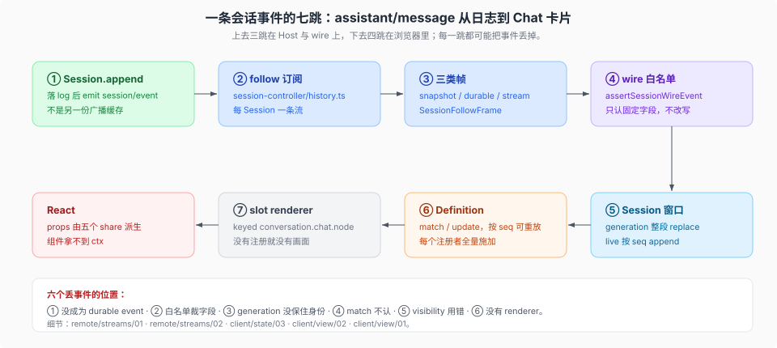

# 一条会话事件穿过两棵树

核验入口：[`packages/api/session-controller/src/history.ts`](../../packages/api/session-controller/src/history.ts)（follow 订阅）、[`packages/api/session-controller/src/types.ts`](../../packages/api/session-controller/src/types.ts)（`SessionFollowFrame`）、[`packages/api/session-controller/src/client/session-wire-event.ts`](../../packages/api/session-controller/src/client/session-wire-event.ts)（wire 白名单）、[`packages/client/ui-conversation/`](../../packages/client/ui-conversation/README.md)（Definition 装配）。

拿一条 `assistant/message` 走完全程：从 Host 的 `append` 到 Chat 卡片上的那一段文本。七跳，每一跳的机制细节在链接的页里，这一页只负责「一眼看到它经过了谁」。

## 七跳

| 跳 | 位置 | 事实 |
|----|------|------|
| 1 append | Host `Session.append` | 之后 `emit('session/event', session, event)`——log 事件经这次 emit 到达监听器（[`remote/streams/01`](./remote/streams/01-一条-emit-两条出站链路.md)） |
| 2 follow 订阅 | `packages/api/session-controller/src/history.ts:146` | 开窗快照 + 按序事件帧；同包 `index.ts:210` 的同名订阅只做 selection 记账与 activity 派生，**不转发事件体** |
| 3 帧 | `SessionFollowFrame`（`types.ts:570`） | 开窗快照 / durable event / `assistant-stream` 三类；帧形状见 [`remote/streams/02`](./remote/streams/02-三类帧与-wire-校验.md) |
| 4 wire 白名单 | `assertSessionWireEvent`（`session-wire-event.ts:14`） | 只保留 `type/seq/time/data/ignorable/surfaceOp/sourceEventSeqs`，不改写字段；三个调用点在 `client/transport.ts:185`、`:217`、`:233` |
| 5 窗口 | `Session`（`client/sessions/session.ts:96`） | 一个 generation 整段 replace，live 事件按 seq append（[`client/state/03`](./client/state/03-会话窗口与-generation.md)） |
| 6 Definition | `ConversationNodeDefinition.match` / `update` | 每个已注册 Definition 全量施加，匹配到才进 State；`update` 必须能按逻辑 seq 确定性重放（[`client/view/02`](./client/view/02-conversation-node-纪律.md)） |
| 7 渲染 | keyed `conversation.chat.node` renderer | 注册者拿到自己 kind 的每个节点；没有 renderer 就没有画面（[`client/view/01`](./client/view/01-slot-与-props-纪律.md)） |

## 六个会丢东西的地方

1. **没成为 durable session event**：刷新与重放都看不到它——「model-visible ⟺ logged」的反面。
2. **进了 follow 却被 wire 白名单裁字段**：客户端拿到的是残缺事件，且不报错。
3. **generation 替换时身份没保住**：React 整段重挂、输入态与滚动位置一起丢。
4. **Definition 的 `match` 不认它**：事件在窗口里，但不进任何节点，界面上什么都没有。
5. **`visibility` 用错**：该消失的节点留在可见流里，或该保留的被抹掉。
6. **slot 没有 renderer 注册**：节点算出来了，但没有位置画它。

## 插件作者视角

要新增一种「Chat 里看得见」的东西，顺着七跳**反着**查：先确认 Host 侧真的有这条 session event，再确认客户端白名单允许它的字段，再写 Definition，最后才写 renderer。只写 renderer 不产生事件，等于没有数据源；只产生事件不注册 Definition，等于数据到了没人渲染；两者都有了但白名单裁掉字段，等于渲染了一个残缺对象。
