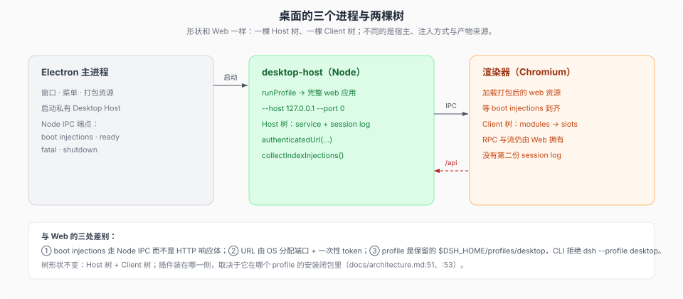

# 桌面：同一个形状的第三个落脚点

核验入口：[`docs/architecture.md`](../../docs/architecture.md) 的「Desktop application」（`:51`、`:53`）、[`apps/desktop/README.md`](../../apps/desktop/README.md)、[`apps/desktop-host/src/index.ts`](../../apps/desktop-host/src/index.ts)。

桌面**不是第三棵树**：Electron 主进程 + 一个 Node 子进程（desktop-host）+ 渲染器，跑的还是 Host 树 + Client 树，只是宿主、注入方式和产物来源不同。这一页只讲「形状哪里一样、哪里不一样」；启动细节在 [`../surfaces-entrypoints/03-桌面入口.md`](../surfaces-entrypoints/03-桌面入口.md)。

## 三个进程各管什么

| 进程 | 角色 | 事实 |
|------|------|------|
| Electron 主进程 | 应用外壳 | 启动私有 Desktop Host（Electron Node 模式），拥有窗口与 Node IPC 端点；随包发布的是这份 dsh 生产运行时（`docs/architecture.md:51`、`:53`） |
| `apps/desktop-host` | Host 树所在进程 | 经 `runProfile` 起完整 web 应用（`--host 127.0.0.1 --port 0`，端口由 OS 分配），然后把认证 URL 与 `collectIndexInjections()` 经 IPC 交给窗口（`apps/desktop-host/src/index.ts:100-104`） |
| 渲染器 | Client 树所在文档 | 加载打包后的 web 资源，等 boot injections 到齐后激活 client plugins；RPC 与流仍由 Web 拥有（`docs/architecture.md:53`） |

## 与 Web 的三处差别

1. **注入走 Node IPC，不走 HTTP 响应体**——boot injections、readiness、fatal error、shutdown 都在同一条 IPC 上（`docs/architecture.md:53`）。
2. **URL 带一次性的认证 token**，由 host 用 `ctx.connection.authenticatedUrl(...)` 拼好交给窗口；之后仍是同一条 cookie 认证链（[`../two-tree-runtime/remote/connection/02-认证与浏览器宿主.md`](./remote/connection/02-认证与浏览器宿主.md)）。
3. **profile 是保留的 `$DSH_HOME/profiles/desktop`**，由桌面应用自己初始化；CLI 仍拒绝 `dsh --profile desktop`（`apps/cli/src/args.ts:83` 的 `rejectElectronProfile`）。桌面与 npm CLI 共享产品数据，但 packages、激活与 lockfile 分开（`docs/architecture.md:51`）。

## 插件作者视角

- **桌面专属行是合法的**：例如 `browser` tab 是多实例 `builtin`（`docs/subsystems/sidebar-right.md:146`），其 web-app 行用 `disabled: !!js "ctx.get('profileContext')?.name !== 'desktop'"` 只在 desktop 挂载（`packages/bundle/web-app/cordis.patch.yml:296-298`）。写这类行时要在键里说明「桌面才有」。
- **不要在插件里假设端口**：桌面默认由 OS 分配，profile 配置可覆盖；拿 `ctx.connection.authenticatedUrl` 而不是拼 `127.0.0.1:19387`。
- **失败呈现可能被 carrier 接管**：桌面提供 `onFailure` 时不画失败页、保留 boot/loading 页，错误交给 carrier 呈现（`packages/client/web/src/boot.ts:46`、`packages/client/web/README.md:30`）；去桌面进程的日志里找。
- **插件装在哪**：桌面用自己 profile 下的安装闭包；npm CLI 管 CLI 侧，Desktop bundled CLI 以 `manageDesktopProfile` 管理 desktop profile，两边的包与激活仍分开（`docs/architecture.md:51`、`apps/cli/src/args.ts:199`）。
