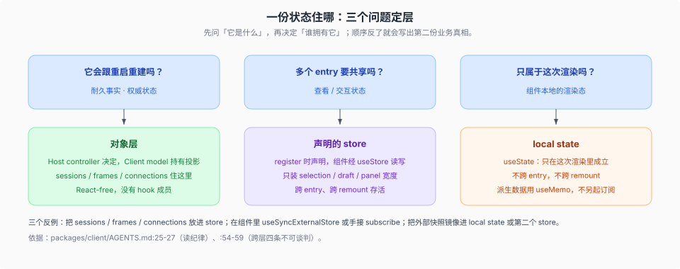

# 谁拥有一份状态

核验入口：[`docs/subsystems/web-client.md`](../../../../docs/subsystems/web-client.md) 的「Client models」、[`packages/client/AGENTS.md`](../../../../packages/client/AGENTS.md) 的 layering red line 与跨层四条不可谈判。

这一页只回答一个问题：一份状态该住哪一层。这四条红线和三条 layering red line 是后面所有 UI 规则的前提。

## 三条 layering red line 与跨层四条

三条 layering red line 先定层：数据对象层 React-free —— `client/connection` 拥有 transport generation，`api/session-controller/client` 拥有 `ClientSessions` → `SessionManager` → `Session`，`api/workspace-controller/client` 拥有 Workspace 状态，`client/store` 拥有 snapshot-store 引擎（`defineStore`、`createSnapshotStore`、`shallowEqual`），store 产物是没有 hook 成员的裸 observable source（`packages/client/AGENTS.md:50`）；渲染机械（`ui-renderer`，动态插件）承担全部 ctx-to-React 集成 —— slot renderer/outlet、`SessionProvider`、uSES adapter，每个 hook 在 binding site 由裸 source 合成，生产业务代码不带 ui-renderer 值依赖（`packages/client/AGENTS.md:51`）；presentation component（各插件包 `src/client/`，pure props）是可整批重写的耗材，业务逻辑不得渗进去（`packages/client/AGENTS.md:52`）。

跨层的四条不可谈判（`packages/client/AGENTS.md:54-59`）：**业务数据住在对象层，永远不住 store** —— entry 声明的 store 只装共享的查看/交互状态（selection、draft、panel 宽度），sessions、frames、connections 留在对象层；**`rpcId` 严格双向** —— initiator mint、responder echo，mint 只发生在 Connection；**notifier 发布纪律** —— `notifyNow` 只是用户手势的直接回显，结构性更新用 microtask 批处理的 `markDirty`，可见的流式 chunk 用累积的 `markFrameDirty`；**web 层是纯展示** —— 只是「怎么画」的东西不进 session log，tool card 在 Client 从原始 call/result 事件与持久化结果元数据派生，进程内控制状态用各自的 snapshot 与 frame，未知或畸形 tool 数据回落到通用形态，而任何新的 **model-visible** 输入仍按仓库级规则需要一条 session event。

## 插件作者视角

加一个值之前先问三句，答案唯一：**它会跟着重启重建吗**（耐久 → 对象层，不进 store）；**多个 entry 要共享它吗**（是 → 声明 store 或走 framework hook）；**它只属于某个组件的一次渲染吗**（是 → local state）。

三个已经付过代价的反例：把 sessions/frames/connections 放进 entry 的 store；在组件里 `useSyncExternalStore` 或手接 `subscribe`；把外部快照镜像进 local state 或第二个 store（`packages/client/AGENTS.md:25-27`、`:54-59`）。
