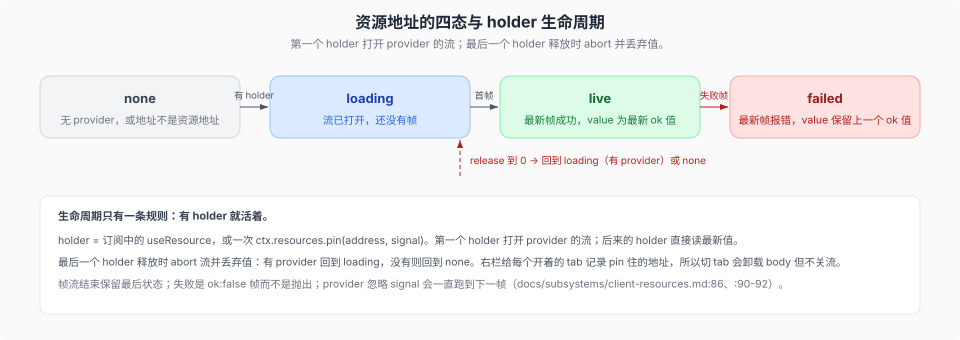

# 资源模型与 holder 生命周期

核验入口：[`docs/subsystems/client-resources.md`](../../../../docs/subsystems/client-resources.md)、[`docs/subsystems/sidebar-right.md`](../../../../docs/subsystems/sidebar-right.md)、[`packages/client/resources/README.md`](../../../../packages/client/resources/README.md)。决策记录：`.agents/notes/implemented/architecture/2026-09-05-client-resource-model.md`、`.agents/notes/archived/architecture/2026-09-05-sidebar-tab-types-and-navigation.md`（已归档，只作历史）、`.agents/notes/archived/architecture/2026-09-07-workspace-files-dual-face-package.md`（已归档，只作历史）。

`a66e470204`（`dsh-v0.1.2-rc.1`）→ `183f08e9c6`（`dsh-v0.1.5-rc.1`）是 client 侧最大的一次结构性变化：给 Web UI 加内容不再只等于「找一个 slot 注册组件」，而是「声明一条资源协议 → 注册该协议的 provider → 用地址读」。右栏是这套模型的第一个消费者。旧写法（每个消费者自己拉数据、自己管取消）在这条路径上被替换成：一个地址只有一条流，谁持有谁负责释放。

## 资源地址

一个资源地址是 `dsh-resource://<type>/…` 形式的 URL（`packages/client/resources/src/client/resources.ts:46` 的 `RESOURCE_SCHEME = 'dsh-resource'`）。host 段是协议键，必须是 `ResourceProtocolMap` 的成员（该 map 由 `packages/client/ui-slots/src/index.ts:47` 声明，各 provider 包用声明合并扩充）；host 之后是协议自己的 path，由协议所有者逐段百分号编码。

模型只读 scheme 与 host：`protocolOf(address)` 返回 `dsh-resource://` URL 的小写 host，其它一律 `undefined`。所以 `sidebar://guide` 这类**导航地址**不指向任何资源，读作 `none`；拼错的协议与畸形地址同样静默读作 `none`（`docs/subsystems/client-resources.md:90-92`）。

`file` 协议的 path 带自己的作用域：`dsh-resource://file/session/<sessionId>/<path>` 是「某个 Session 下的路径」——相对该 Session 工作区根**或绝对路径**都行，Host 用自己持有的 root 解析；`dsh-resource://file/absolute/<path>` 是 session-less 的绝对路径形式（Windows 盘符的 `:` 保持字面）。构造/解析函数在 [`dsh-util-workspace-path`](../../../../packages/util/workspace-path/README.md)：`fileAddressFor(sessionId, cwd, path)` 恒产出 session 地址（绝对路径也归到 session 作用域），`sessionFileAddress(id, path)` 与 `absoluteFileAddress(path)` 是两个底层构造（`packages/util/workspace-path/src/file-address.ts:65`、`:76`），`parseFileAddress(address)` 读回或返回 `undefined`（`:89`）。地址按字符串比较，`openResource` 只接受 `fileAddressFor` 产出的规范拼写；裸 `absolute` 形式产品运行时不产出，也没有右栏类型认领。

## provider 契约

协议所有者在自己的 `ctx.effect` 里用 `ctx.resources.register(provider)` 注册，注册返回 disposer；同一协议第二次注册抛错。`register`、`pin`、`source` 三个操作在 `packages/client/resources/src/client/contract.ts:100`、`:106`、`:114` 声明。

provider 是 `{ protocol, open(address, { signal }) }`（同文件 `:71-85`）：`open` 返回 `AsyncIterable<RemoteResult<Value>>`，第一帧是当前状态，之后每帧一次变化；`signal` abort 时流必须结束。**失败是 `ok: false` 帧，不是抛出**：`open` 内部 throw 属于编程错误，模型不接。帧流结束则保留最后状态。

## `useResource` 与四态

`useResource` 是**每个 slot component 都有的全局标准 prop**，不论 scope（`packages/client/resources/src/client/contract.ts:21-26` 的声明合并）。`useResource
(address)` 以类型参数指定协议，返回 `{ status, value, failure }`（`ResourceSnapshot`，`:47-53`），`status` 就是四态（`ResourceStatus`，`:44`）：

| `status` | 含义 | `value` | `failure` |
|---|---|---|---|
| `none` | 该协议没有 provider，或地址不是资源地址 | `undefined` | `undefined` |
| `loading` | 流已打开但还没有帧 | `undefined` | `undefined` |
| `live` | 最新帧成功 | 最新 `ok` 值 | `undefined` |
| `failed` | 最新帧报错 | 保留上一个 `ok` 值 | 该帧的 `RemoteFailure` |

**生命周期是「有 holder 就活着」**：holder 是订阅中的 `useResource`，或一次 `ctx.resources.pin(address, signal)`；第一个 holder 打开 provider 的流，后来的 holder 直接读最新值，最后一个释放时 abort 流并丢弃值（有 provider 则回到 `loading`，没有则回到 `none`）。右栏给每个开着的 tab 记录 pin 住它的地址，所以**切 tab 会卸载 body 但不关流**（`docs/subsystems/client-resources.md:86`）。`ctx.resources.source(address)` 是 hook 背后的裸 observable，按地址保持引用稳定，供 React 之外调用。

限定（原文即写明，`docs/subsystems/client-resources.md:90-92`）：地址记录活到页面生命周期，最后一个 holder 离开后记录仍在内存里（不持流、不持值）；provider 若忽略 `signal` 会一直跑到下一帧；`failed` 的失败类型是 Remote 面的 `RemoteFailure`，所以源不是 Remote 调用的 provider 得自己造一个。

明确**不建**（`docs/subsystems/sidebar-right.md:148-159`）：布局持久化、只读布局快照或订阅、capability 发现数组（`features`）、tab 类型的 `option` 优先级带、用户可见 undo、记录标题不可重设（`title(address)` 开 tab 时捕获，活标题只能走 title slot）、按实现名开 tab、服务上的地址查找、`sidebar://<kind>` 之外的导航地址。

## workspaceFiles 服务

Host 提供 `ctx.workspaceFiles`，生成的 `workspaceFiles` Remote namespace 让客户端读同一个服务。每个方法都在 wire 上带 Session 身份，客户端从不自己命名 root；Host 读活的 Session header，冷 Session 走 persistence 的 `stat`，不激活 Agent、不读事件体、也不借用父 Session 的 root。五个 `@Remote` 方法（`packages/api/workspace-files/src/index.ts:233` 的 `read`、`:257` 的 `readBytes`、`:290` 的 `stat`、`:303` 的 `list`、`:340` 的 `changes`；旧语料记的「七个方法」里的 `readAll` / `readRelated` 不是 Host 方法——完整读与关联文件读是 Client 侧用 `readBytes` 的无 `range` / `baseFile` 形态组合出来的）：

| 方法 | 返回 |
|------|------|
| `stat(path)` | `{ absolutePath, version, bytes? }`，只给身份、版本与大小，不给内容 |
| `read(path, { offset?, limit? })` | 一页文本行（`offset` 1 起，`limit` 受配置页大小封顶），带 `lines` 与 `eof` |
| `readBytes(path, { range?, baseFile? })` | 一窗原始字节（`range.offset` 0 起，缺省读到 `maxFileBytes` 封顶；超限失败不截断），native `Uint8Array`，不做文本解码（经 Connection 的 binary RPC transport）；`baseFile` 给出时从该文件所在目录解析相对目标 |
| `list(path)` | 工作区根内某目录的直接子项，按配置上限截断并置 `truncated` |
| `changes(path)` | stream：先 `ready` 一次，之后是该目标的观察帧（`{ absolutePath, version }` 或 `{ absolutePath, absent: true }`）；Host 决定目标是文件还是目录，目录必须留在工作区根内 |
