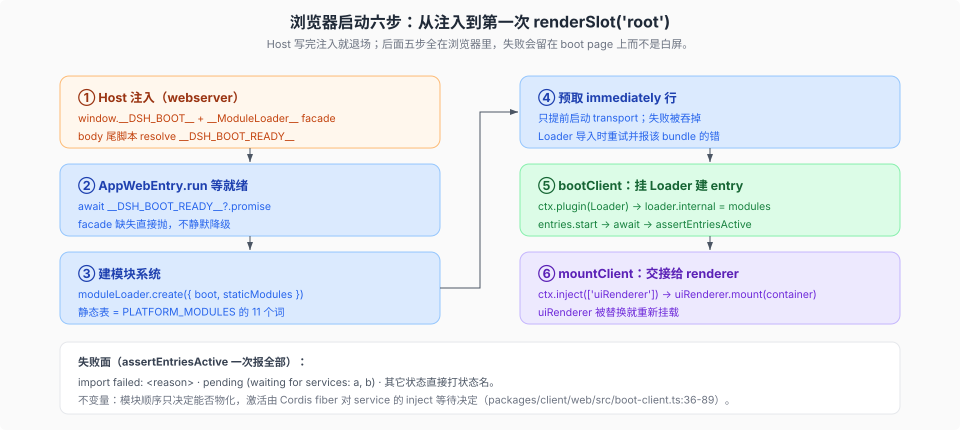

# 浏览器启动与首屏交接

核验入口：[`docs/subsystems/web-client.md`](../../../../docs/subsystems/web-client.md) 的「Browser boot」、[`docs/subsystems/client-modules.md`](../../../../docs/subsystems/client-modules.md)、[`packages/client/web/src/`](../../../../packages/client/web/src/)（`boot.ts`、`boot-client.ts`、`mount.ts`、`seed.ts`）。

这一页跟「Host 把页面交给浏览器」到「第一次 `renderSlot('root')`」之间的六步；Host 侧那段（六段流水线、首屏五步、token→cookie→注入）在 [`../../../plugin-system/composition/05-启动窗口与首屏交接.md`](../../../plugin-system/composition/05-启动窗口与首屏交接.md)，本页不重复。

## 六步

| 步 | 谁做 | 事实 |
|----|------|------|
| ① 注入 | Host webserver | 写 `window.__DSH_BOOT__`（组合出的 `WebBootGraph`）、装 `__ModuleLoader__` facade，并在 body 末尾放一条把 `__DSH_BOOT_READY__` resolve 掉的脚本（`packages/host/webserver/src/injections.ts:86`、`:104`）；注入发生在 parser-preloaded script 执行之前（`docs/subsystems/web-client.md:24`） |
| ② 等就绪 | `AppWebEntry.run` | `await __DSH_BOOT_READY__?.promise`；没有 facade 直接抛 `web boot: window.__ModuleLoader__ bootstrap facade is missing`（`packages/client/web/src/boot.ts:57`、`:59-61`） |
| ③ 建模块系统 | boot kernel | `moduleLoader.create({ boot: win.__DSH_BOOT__, staticModules: getStaticModules(), loadBundle? })`；静态表恰好覆盖 `PLATFORM_MODULES` 的 11 个词（`boot.ts:72-79`、`packages/client/web/src/seed.ts:24-42`） |
| ④ 预取 | boot kernel | 只预取 `immediately` 行；预取失败被吞掉，因为「预取只是提前启动 transport，Loader 的导入会重试并报这个 bundle 的错」（`boot.ts:79`、`:116-122`） |
| ⑤ 挂 Loader、建 entry | `bootClient` | `ctx.plugin(Loader)` → `loader.internal = modules` → 每行 `entries.start` → `loader.await()` → `assertEntriesActive`（`packages/client/web/src/boot-client.ts:36-56`） |
| ⑥ 交接 | `mountClient` | 在 `ctx.inject(['uiRenderer'], ...)` 里调 `uiRenderer.mount(container)`；`uiRenderer` 被替换会重新挂载（`packages/client/web/src/mount.ts:19-24`） |

## 失败面：画面为什么停在 boot page

`assertEntriesActive` 把每个没 active 的 entry 分成三类，一次报全部（`boot-client.ts:66-89`）：

- `import failed: <reason>`：模块系统记下的导入错误；
- `pending (waiting for services: a, b)`：它 inject 的服务当前无人提供；
- 其它状态直接打状态名（`loading` / `failed` / …）。

启动失败由 `AppWebEntry.run` 的 catch 收口：`console.error` 原始错误，然后交给 `onFailure`（桌面、worker 这类 carrier 自己的致命呈现）或 boot page 的 `fail()` 留屏（`boot.ts:49`、`:101-107`）。

## 两个不变量

**模块顺序 ≠ Cordis 激活。** `entries.start` 只保证每个 entry 的模块能被同步 `require` 物化；谁先 active 由 Cordis fiber 对 service 的 inject 等待决定（[`02-模块身份与激活顺序.md`](./02-模块身份与激活顺序.md)）。所以「entry 都在，但画面不对」通常不是启动顺序问题。

**静态表是唯一的跨 bundle 共享面。** `getStaticModules()` 的 `satisfies Record<PlatformModule, unknown>` 让「往 `PLATFORM_MODULES` 加了词、却没加静态 import」在编译期失败，而不是运行时 require miss（`seed.ts:24-42`）。

## 插件作者视角

| 症状 | 先查 |
|---|---|
| 你的包完全没出现在启动列表 | manifest 里没有这一行：`dsh.client` 声明、bundle 的 patch 行、以及 `immediately` 是否写对（[`../rules/02-依赖-构建期环境与三处注册面.md`](../rules/02-依赖-构建期环境与三处注册面.md)） |
| `pending (waiting for services: …)` | inject 写了一个当前树里没人提供的服务；确认提供者在同一 profile，且没有被 gate 成 detached |
| `import failed: …` | bundle 路由、`rev`、裸 specifier 解析；机制见 [`02-模块身份与激活顺序.md`](./02-模块身份与激活顺序.md) 与 `docs/subsystems/client-modules.md` |
| 画面停在 boot page | 先看 entry 名和失败原因；若 carrier 提供了 `onFailure`，boot page 不会显示，去 carrier 的日志找 |
| 想在自己的 entry 里等别人 | 用 `inject`；不要在 `apply` 里轮询 `ctx.get(...)`——`ctx.get` 读全局服务表，绕过 fiber 的等待语义（[`../../framework/01-五条原语对照源码.md`](../../framework/01-五条原语对照源码.md)） |
