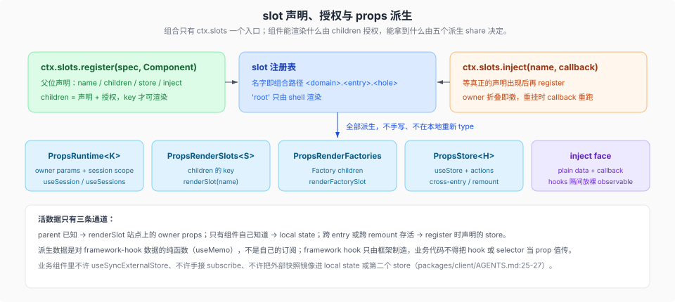

# slot 与 props 纪律

核验入口：[`docs/subsystems/slots.md`](../../../../docs/subsystems/slots.md)、[`packages/client/AGENTS.md`](../../../../packages/client/AGENTS.md) 的 slot/props 段。

这一页讲组合的唯一两个入口（`register` 与 `registerFactory`）和组件能拿到的派生 share；加 UI 之前先确认你要加的是 slot 还是 factory。

组合只有 `ctx.slots` 一个入口：`register`（父位声明）与 `registerFactory`（独立复用渲染）两种声明形式，没有独立的 slot 定义调用、没有 whitelist face 对象、没有 face-minting helper；`'root'` 只由 shell 渲染（`packages/client/AGENTS.md:11`、`docs/subsystems/slots.md:21`）。

`children` = 声明 + 授权：组件能渲染的 slot 恰好是 register 调用 `children` 对象的 key（spec 值为 `kind`/`scope`），渲染未声明的 slot 或声明别人已声明的 slot 在 load 时失败；slot 名镜像组合路径 `<domain>.<entry>.<hole>`，例如 `'tool.call.toolview'`（`packages/client/AGENTS.md:12`）。声明 `root` 以外的子 slot 只在拥有并渲染该位置的组件里做，其他包用 `ctx.slots.inject(key, callback)` 等待声明后 `ctx.slots.register()` 贡献；owner 折叠时贡献递归移除，owner 重新挂载时 callback 重跑（`docs/subsystems/slots.md:15`、`docs/subsystems/slots.md:21`）。注册进别人的 slot 时 apply 顺序不受约束，用 `ctx.slots.inject(name, () => ctx.slots.register(...))`，多个贡献要原子安装与回滚时返回 generator（`packages/client/AGENTS.md:149`）。

组件 props 是**五个 share，全部派生**（0009 起 Factory 组件加入第五个）：`PropsRuntime<K>`（SlotMap：owner params + session scope 的 `useSession`/`sessionId` + 全局 `useSessions`/`useWorkspaces`）、`PropsRenderSlots<S>`（children key）、`PropsRenderFactories`（`renderFactorySlot`，Factory children）、`PropsStore<H>`（store factory）、以及 inject face；已由 share 派生的成员不得手写，share 不得在本地重新 `type`（`packages/client/AGENTS.md:13`）。`docs/subsystems/slots.md:64-75` 是这几项加 `PropsLocale<N>` 与 chain `matched` 的来源表。

framework hook 只由框架制造：`useSession`、`useSessions`、`useWorkspaces`、`useStore`、`renderSlot`、`renderFactorySlot` 是 standing seat（Factory 定义另收 `useFactorySlot`），加上 renderer 从 provide 贡献与 inject `hooks` 隔间绑定的 `use<Name>`；业务代码不得把 hook 或 selector 当 prop 值传，只传 plain data 与 callback（`packages/client/AGENTS.md:14`）。`docs/subsystems/slots.md:81-97` 列全了按 scope 发放的标准 props（`usePanelInfo`、`useProjection`、`useConversation`、`useInput`、`useChat`、`useTrajectory` 等），`:97` 说明 `useStore` 与本地化 `t` 是 registration 派生而非全局标准 props，`:99` 规定标准集只能由 framework 与 domain adapter 经 `provideRoot()`/`uiSession.provide()` 扩充，feature 组件不得自己造 hook prop 或为 entry 私有数据加全局标准 prop。

活数据只有三条通道：parent 已知 → renderSlot 站点上的 owner props；只有组件自己知道 → local state；跨 entry 共享或跨 remount 存活 → register 时声明的 store；派生数据是对 framework-hook 数据的纯函数（`useMemo`），不是自己的订阅（`packages/client/AGENTS.md:15`）。读共享状态用 `props.useStore`，写用 `props.actions.*`，声明的 actions 就是完整 mutation API；store 写成导出的 `createXXXStore()` factory，模块级 handle 是被禁止的 de-facto singleton，同一个 handle 在 `apply` 内传给多个 register 共享；生产代码不得在 `apply` 之外调 factory 或 `.create()`，测试可以（这是指定的零机械路径）（`packages/client/AGENTS.md:16`）。

inject 从 apply 闭包自己的 ctx 返回 **plain data 与 callback**：不得手造 hook、不得产 ReactNode、不得给整个 service 对象；registrant 私有的响应式事实走保留的 `hooks` 隔间（renderer 把 `hooks: { status }` 转成 `useStatus(selector)` prop，组件拿不到 source 本身），插件只能用 `inject` 声明命名的依赖，没有更宽的 ctx 可伸手（`packages/client/AGENTS.md:17`、`docs/subsystems/slots.md:103-107`）。owner props、registration `inject`、slot-level `inject`、声明 store 各有适用面：一次渲染已知道的值走 owner props，一个 entry 的回调与私有 observable 走 registration inject，slot owner 控制的 capability 走 slot-level inject，跨 entry 或跨 remount 的可变视图状态走 store，React node 一律走子 slot（`docs/subsystems/slots.md:109`）。

配套的读纪律：render 读到的一切可能脱离 React 变化的值都必须经 framework hook 进来，render code 订阅、event-handler code 可读 live snapshot（`packages/client/AGENTS.md:25`）；业务组件里没有任何订阅机械 —— 不许 `useSyncExternalStore`、不许手接 subscribe、不许把外部快照镜像进 local state 或第二个 store（`packages/client/AGENTS.md:26`）；需求按「framework hook → 声明 store（`useStore`/`actions`）→ inject 回调 → 其他一律算新框架扩展点并需主线程裁决」这条 data-access ladder 解决（`packages/client/AGENTS.md:27`）。UI 域之间只共享 JSON-compatible 数据与回调，例外只有瞬态文件读与 document preview 的 `Uint8Array`（发布出去即只读借用，Worker 传输前复制，绝不进 layout 或 Session JSON），`hooks` 隔间是放裸 observable 的唯一位置，ReactNode 走 slot（`packages/client/AGENTS.md:28`）。observable source 保持两层身份稳定 —— source 对象本身（hook binding 按 source 缓存）与两次变化之间的 snapshot（`getSnapshot` 在事实未动前返回同一引用）（`packages/client/AGENTS.md:29`）；重建了已发布值的人必须在同一步经同一 source 重新发布，可能在消费者存在之后才跑的注册路径也要在注册时通知活消费者（`packages/client/AGENTS.md:30`）。完整层级树见 `docs/subsystems/slots.md:111-194`。

owner props 的发放面按 slot 逐个声明，因此「换一个渲染者要不要改 props」是契约变更而非实现细节。`conversation.chat.reasoning.body` 的 owner props 是 `{ rawText, text, running }`：`text` 是 Chat 备好的展示文本，`rawText` 承载未处理输出（`packages/client/ui-chat/src/client/contract/slots.ts:79`）；同一 slot 的 doc 要求渲染者保留**未翻译的展示文本**（`:435`、`packages/extensions/cordis-client-runner/src/client/slot-catalog.ts` 的 `conversation.chat.reasoning.body` 条目同步）。准备动作住在 `reasoningText()`（`packages/client/ui-chat/src/client/reasoning-text.ts`）：首字符不是 `<` 原样返回；以 `<signature>` 开头时剥到闭合标签之后并吞掉其后的换行；标签未闭合（流式途中）返回空串。它是**纯展示层**处理，不存在于 Session 日志里——原始块文本仍是记录的真源，`rawText` 就是它。`ReasoningRow.tsx` 在算完展示文本后取 `hidden: text !== rawText && text.trim() === ''`，为真时**整个 disclosure 行直接 `return null`**（`packages/client/ui-chat/src/client/chat/ReasoningRow.tsx:81`），所以“只剩 signature 的思考块”在四种 display mode 下都不占位，而不是渲染一个空壳。它同时被 `process-activity.ts:103` 的 live detail 复用，所以「折叠态摘要」和「展开态正文」对 signature 的处理不会分叉。Content Factory（`ReasoningContentInput`，`slots.ts:89`）不再继承 owner props，只收 `text`、`running` 与可选 `labels`——渲染者不该重跑 Chat 的展示处理。

owner props 是**对外契约**：改字段名或字段语义会静默改变第三方渲染者的行为，因此变更必须进 [`upgrade guide`](../../../../docs/upgrade-guide/v0.2.1-rc.4/reasoning-body-props/guide.md)，而不是只进 README。当前下游：`experimental/client-ui-cot-translation` 的 `TranslationBody.tsx` 读 `text`；`extensions/cordis-client-runner` 的 slot catalog 有对应条目；`ui-chat` README 记录 `rawText` / `text` 的分工（`packages/client/ui-chat/README.md:120`）；回归在 `apps/web/tests/reasoning-preview.e2e.ts` 与 `ui-chat` 的三个 spec（`reasoning-text`、`reasoning-content`、`reasoning-row`）。
