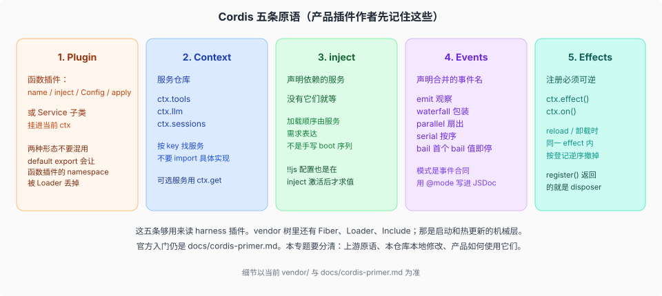
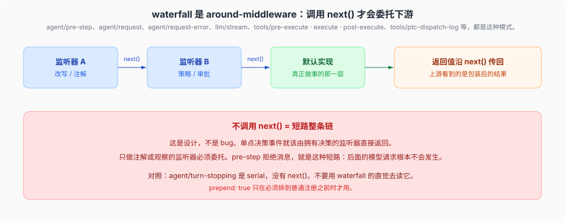
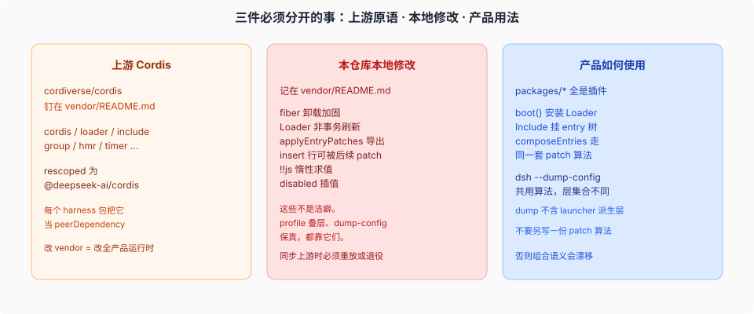

# Framework · 两棵树共用的框架本体

## 一句话

Harness 把 Cordis 源码放进 `vendor/`，rescoped 成 `@deepseek-ai/cordis`，再在上面长产品。读 dsh 之前先分清三件事：**上游原语**、**本仓库记在 `vendor/README.md` 的本地修改**、**产品插件怎么用它们**。包名映射（上游包名 ↔ `@deepseek-ai/*` 产品名）的权威是 [`docs/rescope.md`](../../../docs/rescope.md)，`vendor/README.md` 只记版本与本地修改。

官方教程是 [`docs/cordis-primer.md`](../../../docs/cordis-primer.md)；本页只定位 Harness 依赖的运行时原语。

## 这一层管什么

Host 的 Node 树和浏览器的 Client 树**用的是同一份 `@deepseek-ai/cordis`**：Client 侧的 `PLATFORM_MODULES` 把它作为静态平台模块发给每个动态 bundle（见 [`../client/tree/02-模块身份与激活顺序.md`](../client/tree/02-模块身份与激活顺序.md)）。所以原语、事件合同、Loader 与 Include 的解析规则，写两边的插件时是同一套。

这里只讲「两棵树共用的部分」。树各自怎么长见 [`../client/00-map.md`](../client/00-map.md)，两棵树之间怎么说话见 [`../remote/00-map.md`](../remote/00-map.md)，整体形状见 [`../00-map.md`](../00-map.md)。

## 五条原语

对读 harness 插件最有用的对照：

| 原语 | 在 dsh 里长什么样 |
|------|-------------------|
| Plugin | `packages/*` 中的能力以插件装入树，并由 fiber 管理生命周期。 |
| Context | 服务按 `ctx.tools`、`ctx.llm`、`ctx.sessions` 等 key 查找；Consumer 依赖 Definition，不导入具体 Provider。 |
| inject | 插件声明服务依赖；缺少依赖时等待，满足后激活。 |
| Events | 事件通过 TypeScript 声明合并扩展，`emit` / `waterfall` / `parallel` / `serial` / `bail` 是调用合同的一部分。 |
| Effects | 注册、监听和子插件都由 effect 拥有；fiber 卸载时贡献一并撤销。 |

## waterfall：`next()` 委托下游

dsh 里最容易踩的事件合同就是 waterfall。它是 around-middleware，不是「通知一下」。

`agent/pre-step` 可以短路模型请求。`agent/turn-stopping` 不是 waterfall，而是关闭 turn 前的 serial 续跑检查：监听器没有 `next()`，需要继续时调用 `agent.steer()`。

## 上游 · 本地修改 · 产品用法

[`vendor/README.md`](../../../vendor/README.md) 是本地修改的权威清单。Harness 直接依赖其中的 effect 卸载时序、Include 的解析保护与持久化写、共享 patch 算法和延迟配置插值；profile 组合、dump 与 HMR 都建立在这些行为上。产品依赖和对应源码见 [`04-vendor-本地修改.md`](./04-vendor-本地修改.md)。

> **vendor 4.0.5**（0011 复核更新）：本地修改清单现为 **24** 条——0008 跨度新增 #16（cordis 发布 src）/ #20（entry fiber identity）/ #21（logger exporter disposal）/ #22（volatile config 四件套），第 8/9/12 条随 0.1.7 线事务重载退役而重写；0011 跨度再新增 #23（loader 保留 entry 的模块命名空间身份）与 #24（timer 的中英文显示文案），并首次写下拟升级计划 [`vendor/cordis-rc11-upgrade-plan.md`](../../../vendor/cordis-rc11-upgrade-plan.md)（目标 cordis `4.0.0-rc.11`，分 PR 落地、逐条决定退役或保留）。发布版本 cordis 4.0.5 / loader 1.0.6 / include 1.0.10 / schemastery 3.18.5 / cosmokit 1.8.6 / group 1.0.5 / timer 1.1.7 / hmr 1.0.20 / logger-console 1.0.5。0006 时「vendor 零改动」的结论已被 0008 跨度推翻，下一次同步须逐条重放。具体修改内容见 [`04-vendor-本地修改.md`](./04-vendor-本地修改.md)。

## 源码入口

| 路径 | 角色 |
|------|------|
| `vendor/cordis/` | Context / Fiber / Service / Events |
| `vendor/loader/` | Loader |
| `vendor/include/` | `cordis:include`，patch 算法 |
| `vendor/group/` | `cordis:group`，`isolate` realm |
| `vendor/hmr/` | 配置与模块热更新 |
| [`vendor/README.md`](../../../vendor/README.md) | 固定的 SHA、本地修改清单、同步步骤 |
| [`docs/cordis-primer.md`](../../../docs/cordis-primer.md) | 作者向的五条思想 |
| [`docs/cordis-tutorial/`](../../../docs/cordis-tutorial/index.md) | 同一套思想的动手教程 |

## 机制级正文

| 文件 | 内容 |
|------|------|
| [`01-五条原语对照源码.md`](./01-五条原语对照源码.md) | Plugin / Context / inject / Events / Effects 对到 `vendor/cordis/src/` |
| [`02-waterfall-与事件合同.md`](./02-waterfall-与事件合同.md) | `waterfall` 源码算法；`agent/pre-step` vs `agent/turn-stopping` |
| [`03-loader-include-与js插值.md`](./03-loader-include-与js插值.md) | `!!js` 两处求值；`applyEntryPatches` 为何能叠 bundle |
| [`04-vendor-本地修改.md`](./04-vendor-本地修改.md) | 产品依赖的 vendor 修改及其后果 |
| [`05-group与isolate-realm.md`](./05-group与isolate-realm.md) | group 与 isolate：组合单元 vs 服务作用域 |

Profile / boot 时序见 [`../plugin-system/composition/01-boot-时序.md`](../../plugin-system/composition/01-boot-时序.md)。

## 插件作者视角

写插件时这一层是**工具**，不是背景知识。四个文件对应四类会实际咬人的问题：

| 你正在做的事 | 打开 | 会踩的坑 |
|---|---|---|
| 写 `apply(ctx, config)`、决定能力挂在哪 | [`01`](./01-五条原语对照源码.md) | 注册不放进 `ctx.effect()`，卸载后贡献还在；Consumer 直接 import 具体 Provider 而不是拿 `ctx.<key>` |
| 监听或拦截一条事件 | [`02`](./02-waterfall-与事件合同.md) | waterfall 里不调 `next()`，下游全被短路；把 serial 的 `agent/turn-stopping` 当 waterfall 写 |
| 在自己的 `cordis.patch.yml` 里加行、改 bundle | [`03`](./03-loader-include-与js插值.md) | 以为 `!!js` 在任意字段都求值（只有两处）；patch 目标 id 写错导致整行被替换 |
| 依赖帧卸载时序、配置热更、持久化写 | [`04`](./04-vendor-本地修改.md) | 上游 Cordis 没这个行为——同步 vendor 时会被改回去 |

最短路径：先读 [`01`](./01-五条原语对照源码.md) 的五原语表，再照 [`../plugin-system/lifecycle/12-从零到一个能跑的插件.md`](../../plugin-system/lifecycle/12-从零到一个能跑的插件.md) 走一遍最小插件；本层只解释「为什么这样写才成立」。

> 承重词按 [`canon/GLOSSARY.md`](../../canon/GLOSSARY.md) 的 DSH 原文用；本页自己的分类与指标不是 DSH 的词。
