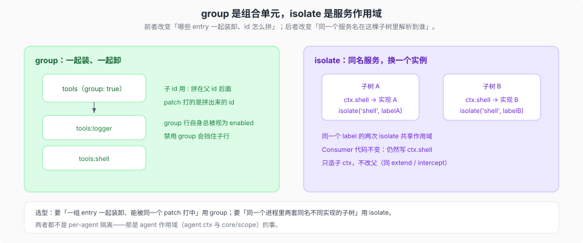

# group 与 isolate realm

核验入口：[`vendor/group/README.md`](../../../vendor/group/README.md)、[`vendor/group/src/index.ts`](../../../vendor/group/src/index.ts)、[`vendor/cordis/src/context.ts`](../../../vendor/cordis/src/context.ts)（`isolate`，`:115-121`）、[`docs/cordis-tutorial/06-composition-and-hmr.md`](../../../docs/cordis-tutorial/06-composition-and-hmr.md)（`:21`）。

这两个词经常被混着用，其实管的是两件事：**group** 把一串 entry 当一个单元装卸，**isolate** 让同一个服务名在子树里解析到另一个实例。



## group：把一串 entry 当一个单元

`group: true` 的行，`config` 是一份子 entry 列表：

```yaml
- id: tools
  name: '@cordisjs/plugin-group'
  group: true
  config:
    - id: logger
      name: '@cordisjs/plugin-logger-console'
```

- 子 entry 的 id 用 `:` 拼在父 id 后面（`tools:logger`）——patch 打的就是这个拼出来的 id。
- group 行**自身总被视为 enabled**（它只是容器），但禁用它会让子行不再运行（`vendor/group/README.md`）。
- 产品里 `cordis:group` 不自动造 realm；`isolate` 是 entry 的配置项，实现在 `vendor/loader/src/config/isolate.ts:71`，和 group 是两个维度。

## isolate：同一个服务名，换一个实例

`ctx.isolate(name, label?)` 造一个子 ctx：名为 `name` 的服务在这棵子树里按 `label` 解析。**同一个 label 的两次 `isolate()` 共享作用域**，不同的 label 各自解析（`vendor/cordis/src/context.ts:115-121`）；和 `extend`、`intercept` 一样，它只造子 ctx，不改父（[`01-五条原语对照源码.md`](./01-五条原语对照源码.md) 的 Context 一节）。

教程里的口径最直观：两个 group 可以各自看到一个配置不同的 `shell` provider，互不影响（`docs/cordis-tutorial/06-composition-and-hmr.md:21`）。

## 什么时候你需要它

- **要同一进程里跑两套「同名不同实现」的子树**：例如一个子系统想用自己的 `shell` / `logger` 提供方，而不动全局的那一个——这是 isolate。
- **要一组 entry 一起装卸、一起被 patch**：这是 group。它不改变服务解析，只改变组合单元。
- **不要用它做 per-agent 隔离**：agent 的作用域是 `agent.ctx` 与 `core/scope` 的事（见 [`../../capability-seams/`](../../capability-seams/00-map.md) 的 scope 一节），isolate 是配置期的子树划分，不是运行期的 per-agent 上下文。

## 插件作者视角

- 用 group 时先想清楚 id 前缀：`a:b` 会成为 patch 的稳定目标，改名前后的 patch 全部失效。
- 用 isolate 时 Consumer 代码不变——仍然 `ctx.<service>`；变的是它解析到哪个 Provider。所以「为什么我这个插件拿到的 shell 和别处不一样」的答案，通常在它被装进了哪个 isolate 子树。
- 写插件不要自己在 `apply` 里 isolate 一个全局服务：isolate 只作用于新造的子 ctx，父树看不到，你以为改了全局其实没有。
