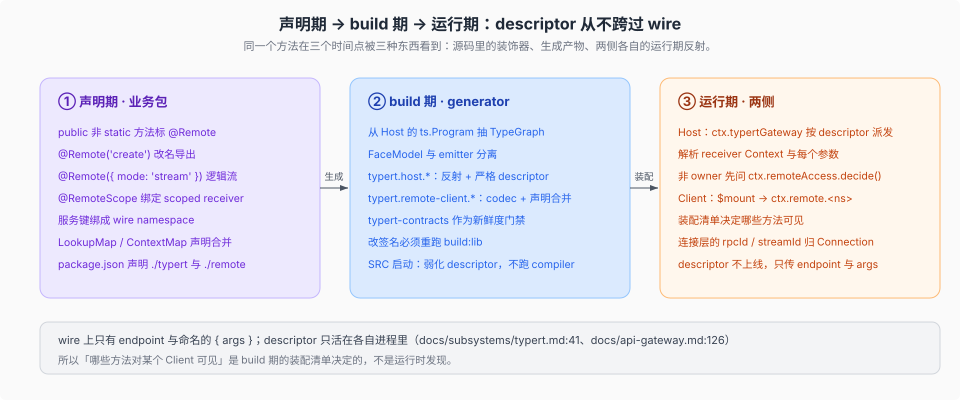

# Remote · 两棵树之间的线

核验入口：[`docs/subsystems/typert.md`](../../../docs/subsystems/typert.md)、[`docs/api-gateway.md`](../../../docs/api-gateway.md)、[`packages/typert/README.md`](../../../packages/typert/README.md)、[`packages/client/connection/README.md`](../../../packages/client/connection/README.md)。决策记录：`.agents/notes/implemented/architecture/2026-08-02-typert-remote-method-calls.md`、`.agents/notes/implemented/architecture/2026-07-27-compiler-independent-typert-model.md`。

## 一句话

`Typert` 把「Host 上一个 Cordis Service 的方法」变成「Client 上一个具体函数」，全程只过三段：业务包在**声明期**用 `@Remote` / `@RemoteScope` 标注方法、把 Cordis 服务键绑成 wire `namespace`；**build 期** generator 从 Host 的 `ts.Program` 抽出 `TypeGraph`，为同一份契约发出 Host 反射与 Host-for-Client 投影；**运行期** Host 的 `ctx.typertGateway` 按 descriptor 解析活的 Service 并派发，Client 的 `ctx.remote.$mount()` 把同一份 descriptor 装成 `remote.<namespace>` 子服务上的具体方法。descriptor 是两侧本地反射、从不上线，wire 只传 endpoint 与 `{ args }`（`docs/subsystems/typert.md:41`、`docs/api-gateway.md:126`）。

## 一条线的四块

前三块来自同一件事（Typert 的三段）；`connection/` 与 `streams/` 是这条线上另外两件正交的事——载体与会话流。

| 目录 | 段 | 内容 |
|------|----|------|
| [`typert/`](./typert/) | 声明期 + build 期 | [`01`](./typert/01-声明期-装饰器与-namespace.md) 装饰器、namespace 键、声明合并、四个包与三个 `core` 服务（`ctx.typert`、`ctx.typertGateway`、`ctx.remoteAccess`）；[`02`](./typert/02-类型图与两族产物.md) `TypeGraph`、`typert.host.*` / `typert.remote-client.*`、`typert-contracts` 门禁、SRC 弱化路径 |
| [`gateway/`](./gateway/) | 运行期（Host 侧 + Client 侧） | [`01`](./gateway/01-Host-派发与访问控制.md) 注册、registry、派发顺序与 `ctx.remoteAccess`；[`02`](./gateway/02-客户端-mount-与装配.md) `$mount` 与 `api/remotes` 的装配清单 |
| [`connection/`](./connection/) | 载体 | [`01`](./connection/01-载体-rpcId-与逻辑流.md) 信封、`rpcId`、`POST /api/<ns>/<method>`、mux 与 uplink；[`02`](./connection/02-认证与浏览器宿主.md) process-token URL、`dsh-auth-` cookie、桌面宿主 |
| [`streams/`](./streams/) | 会话流 | [`01`](./streams/01-一条-emit-两条出站链路.md) `session/event` 与 `$events` 白名单两条出站链路；[`02`](./streams/02-三类帧与-wire-校验.md) follow 的三类帧与客户端 wire 校验 |

## 谁定义、谁提供、谁消费

| 面 | owner | 事实 |
|----|-------|------|
| 声明（装饰器、绑定、协议 map、descriptor 类型） | `packages/typert/protocol` | 只声明类型与装饰器标记，不做 TypeScript 分析、不注册 Cordis 服务（`docs/api-gateway.md:88`、`packages/typert/protocol/README.md:12`） |
| 生成 | `packages/typert/generator` | build 期严格分析 Remote 签名、类型图、lookup、Context 与源位置，再发 Host 与 Host-for-Client 产物（`docs/api-gateway.md:89`） |
| `ctx.typert` 实现（core） | `packages/typert/registry` | 存 Host descriptor、schema 与包注册，并持有 lookup / Context provider（`docs/api-gateway.md:90`、`docs/capability-seams.md:647`） |
| 自动注册 | `packages/typert/loader` | 消费 `ctx.loader` 与 `ctx.typert`，只发现、不实现 registry（`packages/typert/README.md:28`、`packages/typert/loader/README.md:28`） |
| `ctx.typertGateway` 实现（core） | `packages/api/gateway` | 认领 endpoint、解析对象或 Context、调用活 Service、校验请求与返回值（`docs/api-gateway.md:92`、`docs/capability-seams.md:648`） |
| 非 owner Peer 的访问控制（core） | `packages/api/remote-access` | 按资源 kind 的 role 策略判定一次调用，过滤 list 结果，并给每个 Peer 一条访问快照（`docs/api-gateway.md:93`、`docs/subsystems/typert.md:287-357`） |
| Client `ctx.remote` 与 namespace 子服务 | `packages/api/gateway/src/client` | mount 生成 descriptor、发起/校验/取消调用（`docs/api-gateway.md:94`） |
| 选择与 mount 哪些 namespace | `packages/api/remotes/src/client` | 显式选择应用允许的 `/remote` 贡献，并带入对应声明合并（`docs/api-gateway.md:95`） |
| 业务方法契约与 namespace 键 | 各业务包（如 `api-session-controller` 的 `session`、`goal`） | 拥有 `@Remote` 方法与自己的 `/typert`、`/remote` 导出（`packages/api/session-controller/src/index.ts:158`、`packages/goal/goal/package.json:33-40`） |
| RPC carrier | `packages/client/connection` | 提供 RPC、request correlation、信任边界、取消、响应信封与 `/api` HTTP 桥（`docs/api-gateway.md:96`） |

## 插件作者视角

**加一个能被浏览器调用的方法**，按顺序做五件事：

1. 在 Host Service 的 public 非 static 方法上标 `@Remote`（导出名不同就写 `@Remote('create')`，逻辑流写 `@Remote({ mode: 'stream' })`）——未被标记的方法不会进入生成的 Client 类型，也不能经 `ctx.remote` 调用（[`typert/01`](./typert/01-声明期-装饰器与-namespace.md)）。
2. 让包在 `package.json` 里声明 `./typert` 与 `./remote`，两者都指向 `lib/` 下的生成文件；只依赖 `@deepseek-ai/dsh-typert-protocol` 这个轻量协议包。
3. 重跑 `pnpm run build:lib`——改了签名就必须重跑，只改方法体不用（[`typert/02`](./typert/02-类型图与两族产物.md)）。
4. 在 `packages/api/remotes` 的 Client 端装配清单里加一行，否则这个方法对整个应用不可见——「哪些 Host 方法对某个 Client 可见」是 build 期选定的，不是运行时发现。
5. 真正读该 namespace 的业务包，在自己的 `inject` 里同时声明 `remote` 与 `remote.<namespace>`（[`gateway/02`](./gateway/02-客户端-mount-与装配.md)）。

**让一条 Host 事实到达浏览器**，先判断它属于哪条链路：session 事件走 `follow` 流，非 session 事件要进 `API_REMOTE_FORWARDED_EVENTS` 白名单——白名单里没有 `session/event`，也不该加（[`streams/01`](./streams/01-一条-emit-两条出站链路.md)）。

三个最常见的坑：把 descriptor 当成上线数据（它只在本进程）；以为加 `@Remote` 就够（还要 export 声明、重建、装配三处）；在 Client 端手写 fetch 绕开 `ctx.remote`（取消、`rpcId` 与信任都在 carrier 里，绕开就全丢了）。

## 边界

- ACP 与 JSON-RPC SDK 是另外两条协议线，不是这条 Remote：[`../../surfaces-entrypoints/02-acp与jsonrpc.md`](../../surfaces-entrypoints/02-acp与jsonrpc.md)。
- `ctx.remote` 的客户端用法（谁拥有状态、怎么投影）在 [`../client/state/01`](../client/state/01-谁拥有一份状态.md)；本目录只讲线本身。
- 类型系统的生成前置（`tsconfig` face 聚合、`build:artifacts` 顺序）在 [`../../docs/development.md`](../../../docs/development.md) 与 gate 脚本；本目录只列与 Remote 契约直接相关的三个门禁。

## 上游阅读顺序

1. [`docs/subsystems/typert.md`](../../../docs/subsystems/typert.md)：`TypertLookupMap` / `TypertContextMap` / `InvocationDescriptor` / `TypertRegistryContract` / `TypertClientRemote` 的字面契约，以及 `ctx.typert`、`ctx.typertGateway` 的生成 API 区。
2. [`docs/api-gateway.md`](../../../docs/api-gateway.md)：声明、生成、SRC 兜底与运行期调用的端到端参考，含组件职责表与产物表。
3. [`packages/typert/README.md`](../../../packages/typert/README.md)：四包分工与各自 README 入口。
4. [`packages/typert/protocol/README.md`](../../../packages/typert/protocol/README.md)：装饰器、协议 map、失败词汇与事件转发声明。
5. [`packages/api/gateway/src/index.ts`](../../../packages/api/gateway/src/index.ts) 与 [`packages/api/gateway/src/client/index.ts`](../../../packages/api/gateway/src/client/index.ts)：Host 派发与 Client mount 两侧的实现。

> 承重词按 [`canon/GLOSSARY.md`](../../canon/GLOSSARY.md) 的 DSH 原文用；本页自己的分类与指标不是 DSH 的词。
