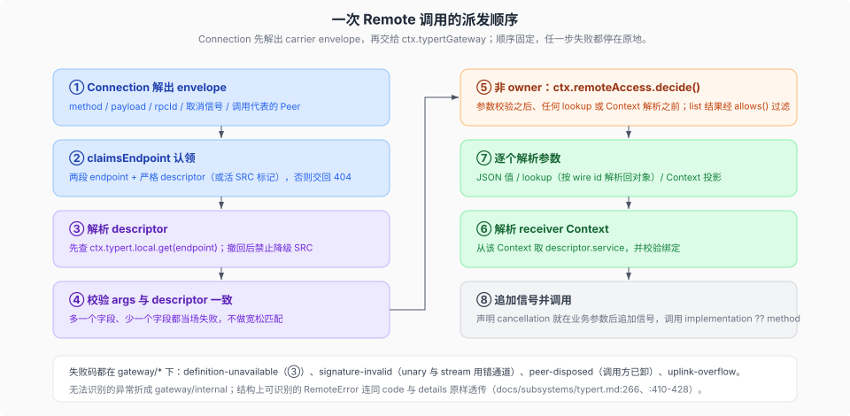

# Host 派发与访问控制

核验入口：[`docs/api-gateway.md`](../../../../docs/api-gateway.md)、[`packages/typert/registry/README.md`](../../../../packages/typert/registry/README.md)、[`packages/typert/loader/README.md`](../../../../packages/typert/loader/README.md)、[`packages/api/remote-access/README.md`](../../../../packages/api/remote-access/README.md)。

这一页跟一次调用的 Host 半边：注册 → registry → 派发 → 访问控制；Client 半边见 [`02`](./02-客户端-mount-与装配.md)。

**注册。** Loader 插件让每个在此组合中挂载的、带生成 export 的包自动把 Host 面反射与 schema 贡献给 registry，并在包或插件卸载时撤回；没有该 export 的包被静默跳过，所以把它加进任意组合都是安全的（`packages/typert/loader/README.md:12`、`:51`）。`validateTypertManifest()` 是「build 产物 → 类型化 registry」的模块边界：manifest 必须指名导出它的包、face 为 `host`、持有 zod v4 schema 工厂（`create()`，首次读取时才 materialize），invocation descriptor 必须用严格 codec，任一失败都点名包与缺陷（`packages/typert/loader/README.md:71`）。注册按 entry 名记账、经 `ctx.typert.register()` 返回的精确 disposer 撤回，在途 import 晚于 owner 消失就丢弃（`packages/typert/loader/README.md:75`、`packages/typert/loader/src/index.ts:445-449`）。它只发现 Host 面：Client 运行时要等另一个组合 owner 才能有等价发现（`packages/typert/loader/README.md:115`）。

**registry。** 一次 contribution 是一次原子且 fiber 拥有的提交：`register()` 先校验包面身份、schema 与 invocation descriptor，再用一个 Cordis effect 提交全部内容，重复身份在任何状态变更前于 owning operation 边界失败（`packages/typert/registry/README.md:68`、`packages/typert/registry/src/service.ts:549-577`）。`ctx.typert` 把当前环境 descriptor、显式选中的 Remote 贡献、lookup provider、scoped Context provider 与资源 kind 分开存放（`docs/subsystems/typert.md:592`），对应 `local` / `remotes` / `lookups` / `contexts` / `resources` 五个子 registry（`packages/typert/registry/README.md:70-76`）。消费侧读 schema 用 `get(key)` / `resolve(key)` / `list(filter?)`，读包反射用 `getPackage(name, face?)` / `listPackages(filter?)`，`toJSONSchema(key)` 不缓存地把活 Zod schema 投成 JSON Schema（`packages/typert/registry/README.md:40`）。

**Host 派发。** Connection 先解出自己的 carrier envelope，再调用 `ctx.typertGateway`；request 带精确命名的 wire 字段，carrier 的取消信号与调用代表的 Peer 单独传递，disposed Peer 被拒为 `gateway/peer-disposed`；非 owner 调用在参数校验之后、任何 lookup 或 Context 解析之前问 `ctx.remoteAccess.decide()`（`docs/subsystems/typert.md:383`）。访问控制面本身见 `docs/subsystems/typert.md:287-357` 的「Remote access resources」与 `packages/api/remote-access/README.md`：业务包按资源 kind 定义 role（action 集合），为非 owner principal kind 注册策略，Gateway 解析一次调用触及的全部资源后逐个判定，list 方法经 `allows()` 过滤，每个 Peer 跟随自己的访问快照。Gateway 只认领两段 endpoint 且有严格 descriptor 或活 SRC 标记的请求，其余交回 404 / 其它 Fetch 路由（`docs/api-gateway.md:126`、`packages/api/gateway/src/index.ts:235` 的 `claimsEndpoint`、`:313`）。解析 descriptor 时先查 `ctx.typert.local.get(endpoint)`；严格定义已被撤回（`hasSeen`）就抛 `gateway/definition-unavailable` 并禁止降级到 SRC，否则才走 SRC 推断（`packages/api/gateway/src/index.ts:748`、`docs/api-gateway.md:134`）。一次调用的准备顺序固定为：解析 descriptor → 校验 `args` 字段与 descriptor 完全一致 → 解析 receiver Context → 从该 Context 取 `descriptor.service` 并校验绑定 → 按 `descriptor.parameters` 逐个解析（JSON、lookup、Context 投影）→ 若声明了 `cancellation` 就在业务参数之后追加信号 → 取 `implementation ?? method` 作为真正调用的成员（`packages/api/gateway/src/index.ts:349` 起的 invokePrepared）。`invoke()` 拒绝 stream descriptor（`:345`），`stream()` 拒绝 unary descriptor（`:374`），两者都抛 `gateway/signature-invalid`（`:352/:387/:794`，末者是 stream 的 SRC-signal 约束）。派发与边界失败一律走 `TypertGatewayError`（类定义 `:162`），其 `gateway/*` 码是普通 `RemoteError` 码，RPC adapter 把结构上可识别的 `RemoteError` 连同 code 与 details 原样透传，只把无法识别的异常折成 `gateway/internal`（`docs/subsystems/typert.md:266`）。权威的码全集见 `docs/subsystems/typert.md:410-428`。

## 插件作者视角

四个最常见的症状，都在这条链上：

- **调用回 404。** Gateway 只认领两段 endpoint 且有严格 descriptor（或活 SRC 标记）的请求，其余交回 404 或别的 Fetch 路由（`docs/api-gateway.md:126`、`packages/api/gateway/src/index.ts:235` 的 `claimsEndpoint`）。先查 endpoint 拼写与 descriptor 是否真的挂上，不要先怀疑网络。
- **`gateway/definition-unavailable`。** 严格定义已被撤回（`hasSeen`）时，Gateway 拒绝降级到 SRC 推断（`packages/api/gateway/src/index.ts:748`、`docs/api-gateway.md:134`）——重新构建并重挂，而不是在调用侧加重试。
- **`gateway/signature-invalid`。** `invoke()` 拒绝 stream descriptor、`stream()` 拒绝 unary descriptor（`:345`、`:374`、`:352`）：声明 `mode: 'stream'` 就要用流式调用，两边的「怎么调」必须一致。
- **list 少了几行。** 非 owner 调用在参数校验之后、任何 lookup 或 Context 解析之前先问 `ctx.remoteAccess.decide()`，list 结果经 `allows()` 过滤（`docs/subsystems/typert.md:383`、`packages/api/remote-access/README.md`）——资源 kind 或 role 没登记，就会安静地少行。
