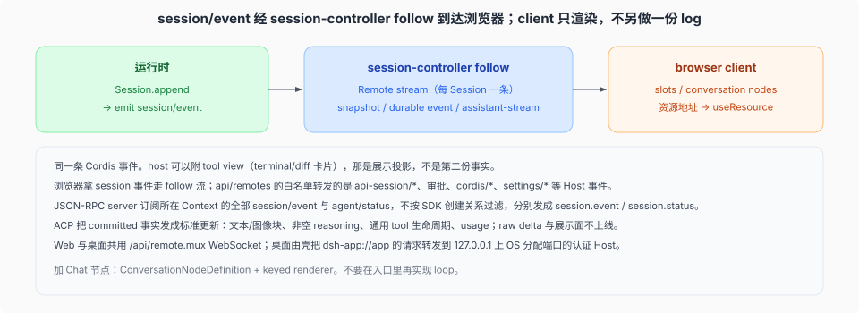

# 一条 emit，两条出站链路

核验入口：[`packages/api/session-controller/`](../../../../packages/api/session-controller/README.md)、[`packages/api/remotes/src/remote-events.ts`](../../../../packages/api/remotes/src/remote-events.ts)（Host 事件转发白名单）。

这一页把一次 `emit('session/event')` 拆成两条互不相同的出站链路：session 事件走 follow 流，非 session 事件走白名单转发。

## host / client 共享 `session/event`

运行时：`Session.append` 之后 Cordis `emit('session/event', session, event)`。这不是 log 事件本身——catalog 写明 log 事件经这一次 emit 到达监听器。

同一条 emit 有两条互不相同的出站链路。旧页把它们并成了一条，NEW 下必须分开写：

- **session 事件 → 浏览器**：`packages/api/session-controller/` 的 `follow` Remote stream 在 `packages/api/session-controller/src/history.ts:146` 订阅 `session/event`，把开窗快照与按序事件帧交给客户端。同一包 `packages/api/session-controller/src/index.ts:210` 的同名订阅只做 selection 记账与 `api-session/activity` 派生（`:221`），**不转发事件体**。
- **Host 侧非 session 事件 → 浏览器**：`packages/api/remotes/` 的转发循环按白名单 `API_REMOTE_FORWARDED_EVENTS` 转发 `api-session/*`、`approval/request`、`user-questions/request`、`cordis/*`、`settings/document-updated` 等。

白名单里**没有** `session/event`，NEW 与 OLD 皆然——浏览器拿 session 事件从来不靠它。

浏览器半边（`packages/client/`）订阅读这些帧，slots / `ConversationNodeDefinition` 渲染。client **没有**另一份 append-only log。刷新 / 重连从持久化再 hydrate，仍然是同一条 session 的事件。

Host 把每一个已登记的 settings namespace 交给 Web；插件自己登记 Host schema 与浏览器卡片。事件转发白名单集中在 `packages/api/remotes/src/remote-events.ts:26-55`，本基线是 **28 条**（0008 跨度内新增：`agent-preset/selected`、`commands/change`、`credentials/reference-updated`、`cordis/inspect-query(-resolved)`、`permission-presets/catalog-changed`、`plugin-manager/changed|install-log|install-state`；0009 跨度内新增：`deepseek-account/session-expired`、`deepseek-account/model-sign-in-required`、`credentials/record-updated`、`schedule/changed`；0011 跨度内新增：`cordis/request-run(-resolved)`、`cordis/dynamic-package`、`cordis/dynamic-retract`、`llm/adapters-updated`、`plugin-market/changed`；`goal/activation-changed` 在 `:39`，`mode: 'emit'`）；`packages/api/session-controller/src/remote-events.ts` 的同名文件只是 5 个 `api-session/*` 事件的 `TypertRemoteEventSelection` 模块扩充声明，不是白名单。含图的 Web prompt 不再由 session-controller 直接批量准入：它经 `ctx.attachments.admitPromptContent(...)`（`packages/api/session-controller/src/commands.ts:340`）走到 attachment capability 内部（`packages/attachment/attachment/src/index.ts:114` 的 `admitPromptContent`，图像批交给 `packages/attachment/attachment/src/admission.ts` 的 `admitEncodedImages`），session-controller 保留图像模态检查与 `session/attachment-invalid` 映射。历史分页仍按 `sourceEventSeqs` 取分组起点，避免大 transcript 上的调用栈溢出。
