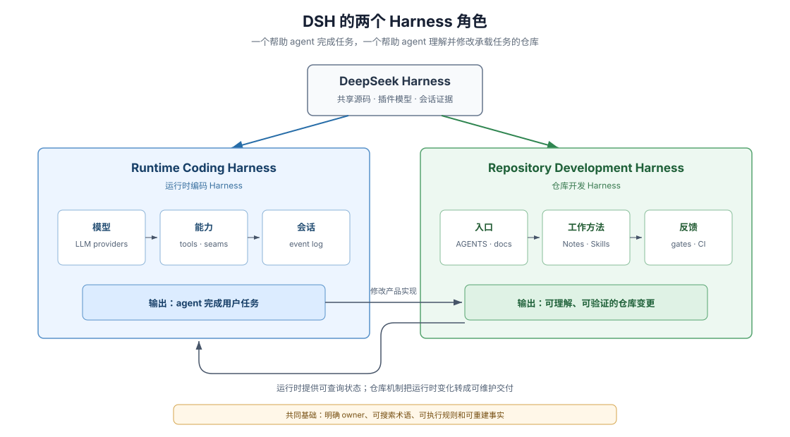

# 通用 Agent-Friendly Repo 工程学：把仓库建成 Coding Agent 的开发 Harness

## 为什么传统代码库一遇上 Agent 就会迅速退化

大多数传统代码库是为“长期在职的人类工程师”设计的：架构边界靠老员工口头传授，目录里塞满历史遗留的 `utils/` 与过期设计文档，评审靠资深同事人肉盯风格与隐性副作用。一旦把主力编码工作交给每次从零上下文启动的 coding agent，这类仓库会在几周内出现典型的结构性退化——agent 在错误位置硬插分支、重复提出半年前已被否决的方案、用宽泛类型强转糊弄编译器、造出一堆只测 mock 的假绿单测，并在注释里留下满地推理残渣。

DeepSeek Harness（DSH）提供了另一种经过大规模自举检验的范式：它不仅是一个运行编码代理的产品框架（runtime coding harness），更把自己的代码库打造成了一座严密的 **Repository Development Harness（仓库开发 Harness）**——把原本锁在资深工程师脑子里的导航地图、职责边界、情境化工作流、确定性门禁和历史负知识全部外置为机器可检索、可校验的仓库结构。

> This codebase is developed primarily by coding agents. Agents follow enforced gates far more reliably than prose conventions [...].
>
> — DSH [`Mechanical quality gates over prose guidelines` Agent Note](https://github.com/deepseek-ai/deepseek-harness/blob/master/.agents/notes/archived/process/2026-06-11-quality-gates.md)。这句判断道破了 Agent-Friendly Repo 的第一定律：不要指望 agent 靠“自觉”遵守冗长文档，而要用清晰的信息拓扑降低它找对路的阻力，用非零退出的确定性门禁封死它走歪路的通道。

本卷把这套仓库级工程学从 DSH 具体业务中完整抽离出来。无论你维护的是后端微服务、基础设施、前端应用还是 AI 系统，都可以直接复用本卷的架构模型与起步模板；如果你正在开发独立的 DSH 插件仓库，读完本卷核心思想后可直接切入 [卷二：DSH 插件仓库开发与专属 Harness](../02-dsh-plugin-harness/00-index.md) 获取全套插件拓扑与专属门禁代码。

## 一座合格的仓库开发 Harness 必须回答哪六个问题

当一个没有任何历史对话记忆的 fresh coding agent 接手任务时，仓库结构本身必须以最低的上下文开销回答以下六个正交问题：

| Agent 面临的生存问题 | 传统仓库的常见失效形态 | Agent-Friendly Repo 的结构化设施 | 本卷对应专章 |
|---|---|---|---|
| **1. 我该先读什么、新代码挂哪？** | 根目录只有一份营销向 README，agent 全仓乱搜、把新逻辑硬塞进核心主循环 | 受词数预算保护的分层 `AGENTS.md` + `architecture.md` 行为路由表 + 四级改动爆炸半径阶梯 | [`01`](./01-follow-a-fresh-agent.md)、[`04`](./04-paved-road-and-participation.md) |
| **2. 当前事实与历史取舍去哪查？** | 设计文档与现行 API 混写，或靠手工维护总目录导致多分支频繁冲突 | “一个事实一个家”：源码/README 只写现在 + 源码生成索引 + 路径树即清单的决策记录（含强制备选方案） | [`02`](./02-legibility-and-ownership.md)、[`08`](./08-repository-taxonomy.md) |
| **3. 复杂非布尔型任务怎么操作？** | 把所有发版、选测、评审细节全塞进根提示词挤爆窗口，或完全靠人肉经验 | 按任务描述匹配才加载正文的程序化工作记忆（`.agents/skills/*/SKILL.md`） | [`03`](./03-skills-as-procedural-memory.md) |
| **4. 写歪了谁在第一时间拦住我？** | 本地零门禁，等人类 code review 才指出跨层私引、类型强转和死文档 | 五层左移反馈 + 专治 Agent 八大恶习的确定性门禁 + 新增守卫“造回归看红再撤” | [`05`](./05-executable-feedback.md) |
| **5. 静态源码看不出活状态怎么办？** | 多层配置叠加和动态注册全靠盲猜，出了问题改错层 | 动态可观测四面镜：合成配置导出、生成目录、只读活状态自省、仅追加事件日志 | [`06`](./06-runtime-inspection.md) |
| **6. 半年后文档和代码怎么不腐烂，存量老仓怎么不停工改造？** | 旧方案原地涂改、过时设计堆积如山，或因老债太多迟迟不敢上门禁 | 清理推理残渣 + 决定强制取代检查 + 人类四方向盘 + **存量老仓指纹级单调棘轮（只减不增）渐进改造** | [`07`](./07-boundaries-and-costs.md)、[`10`](./10-agent-ready-repo-blueprint.md)、[`11`](./11-spec-drift-and-decision-metabolism.md)、[`12`](./12-brownfield-repo-migration.md) |

## 全卷 12 章阅读地图

| 章节 | 核心主题与可带走的工程产物 |
|---|---|
| [`01-follow-a-fresh-agent.md`](./01-follow-a-fresh-agent.md) | **零历史 Agent 六步回路**：解剖单次任务如何走完“入口地图 → 事实/理由分离 → 加载 Skill → 垂直切片 → 左移反馈 → 记忆留存” |
| [`02-legibility-and-ownership.md`](./02-legibility-and-ownership.md) | **可读性与知识归属**：五问五归属、当前状态与负知识物理分家，以及“源码生成目录 vs 路径树即清单”的双轨索引设计 |
| [`03-skills-as-procedural-memory.md`](./03-skills-as-procedural-memory.md) | **Skills 程序化工作记忆**：`AGENTS.md` / `SKILL.md` / `Gate` 三层职责矩阵，以及高信噪比 Skill 的触发词与边界写法 |
| [`04-paved-road-and-participation.md`](./04-paved-road-and-participation.md) | **正确路径与爆炸半径阶梯**：L0 配置 → L1 叶子扩展点 → L2 可替换能力接缝（Seam）→ L3 核心主干的四级架构减震器与单一撤销协议 |
| [`05-executable-feedback.md`](./05-executable-feedback.md) | **可执行反馈与八类反劣化门禁**：棘轮基线锁、拓扑锁、文档类型同构锁、词数预算锁等八大通用门禁模式与 Prove-Red 负例验证 |
| [`06-runtime-inspection.md`](./06-runtime-inspection.md) | **动态可检查性四面镜**：跨技术栈对照（Python/Go/Web/AI），配备合成配置导出、生成目录、只读活状态自省与可重建事件账本 |
| [`07-boundaries-and-costs.md`](./07-boundaries-and-costs.md) | **Harness 经济学与机器六大盲区**：三类参与门槛、四组致命等价误区，以及自动化门禁在原理上绝对查不到的六类语义空白 |
| [`08-repository-taxonomy.md`](./08-repository-taxonomy.md) | **仓库分类学与防腐化代码契约**：六类通用顶层分区、五种内容维护形态，以及 16 类精确角色后缀、边界显式 `resolve` 与上下文成本记账 |
| [`09-platform-and-multi-repo-legibility.md`](./09-platform-and-multi-repo-legibility.md) | **跨仓库与可扩展平台生态可读性**：平台/SDK 底座仓如何通过同构原语、零密钥教程阶梯与契约/治理分离赋能下游独立仓库 |
| [`10-agent-ready-repo-blueprint.md`](./10-agent-ready-repo-blueprint.md) | **新建仓库总蓝图与四件套模板**：人类不可下放的四个方向控制面、Tier 1–3 规模裁剪阶梯，以及 `AGENTS.md` / ADR / `SKILL.md` / `verify.mjs` 起步骨架 |
| [`11-spec-drift-and-decision-metabolism.md`](./11-spec-drift-and-decision-metabolism.md) | **长周期防规格漂移与决策新陈代谢**：四种仓库老化病理、清理推理残渣（CoT Leakage）、强制取代检查与 DSH 归档 453 组决策记录的工业实证 |
| [`12-brownfield-repo-migration.md`](./12-brownfield-repo-migration.md) | **存量业务老仓库不停工改造实战**：10 项 Agent 友好度自检打分表、Day-1/Week-1/Month-1 三阶段演进，以及零 `--add` 后门的精确指纹单调棘轮脚本 |

## 核心术语对照

| English | 中文概念 | 在通用仓库 Harness 中的精确含义 |
|---|---|---|
| development harness | 仓库开发 Harness | 帮助 coding agent 与人类低摩擦理解、修改、验证并沉淀记忆的仓库级结构与工具总和 |
| legibility | 仓库可读性 | 零历史参与者在有限上下文窗口内建立正确局部模型并定位唯一事实 owner 的难易度 |
| progressive disclosure | 渐进披露 | 常驻上下文只付短指令与目录的代价，详细规则、API 与任务 SOP 按需逐层加载 |
| procedural memory | 程序化工作记忆 | 封装在 `SKILL.md` 中、带明确触发条件、调查步骤与停止边界的可复用任务工作流 |
| paved road | 铺装正确路径 | 仓库为高频改动预先铺设的标准扩展接缝、参考范本与配套验证车道 |
| negative control (prove-red) | 负例控制（先看红） | 新增门禁或防回归守卫时，亲手注入目标缺陷确认检查变红报错后再撤回的必经证明 |

## 证据呈现约定

本卷每章均遵循“先讲清通用工程原理与迁移方法，再以 Markdown blockquote 逐字摘录 DSH 一手英文原文佐证，并在章末列出可回溯源码路径”的结构。外链统一指向 DSH `master` 分支；核验基线版本统一登记在[语料维护页](../_coverage/00-corpus-maintenance.md)。

## 证据入口

- DSH [`AGENTS.md`](https://github.com/deepseek-ai/deepseek-harness/blob/master/AGENTS.md) 与 [`docs/AGENTS.md`](https://github.com/deepseek-ai/deepseek-harness/blob/master/docs/AGENTS.md)：根级常驻指令、单一事实归属层级表与词数预算治理。
- DSH [`docs/architecture.md`](https://github.com/deepseek-ai/deepseek-harness/blob/master/docs/architecture.md)：系统分层地图与“新行为挂在哪里”的路由入口。
- DSH [`Mechanical quality gates over prose guidelines` Agent Note](https://github.com/deepseek-ai/deepseek-harness/blob/master/.agents/notes/archived/process/2026-06-11-quality-gates.md)：面向 coding agent 优先建设确定性机械门禁的决策原点。
