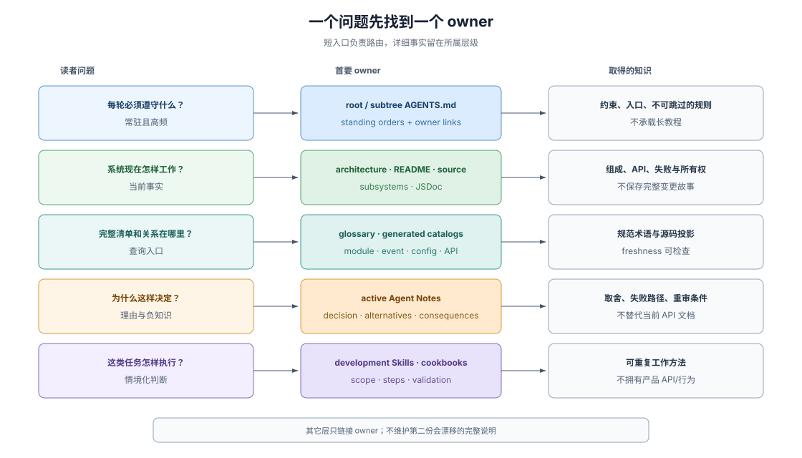

# 02 · 可读性与知识归属：一个事实一个家与双轨索引

## 对 Agent 而言，可读性等于“确定性的寻址路径”

很多团队误以为“让仓库对 Agent 友好”就是写一份几千行的超级总览文档。结果恰恰相反：过长的总览一进上下文就挤占工作记忆，而且只要代码改了两次，总览里的细节就开始与真实源码打架。

对受限于上下文窗口且没有历史记忆的 coding agent 而言，**Legibility（仓库可读性）** 的工程定义非常朴素：**遇到任何一类具体问题时，它能否在两跳之内定位到该事实唯一的权威文件（owner），明确区分“现在怎么运行”与“当初为什么这样选”，并且绝不会在仓库里撞见两份说法不一的副本。**

> Each fact has one home: the tier whose job it is; elsewhere, link there.
>
> — DSH [`docs/AGENTS.md` 的文档层级规则](https://github.com/deepseek-ai/deepseek-harness/blob/master/docs/AGENTS.md#the-tier-taxonomy-one-home-per-fact)。“一个事实一个家，别处只准放链接”不是排版洁癖，而是根除多 Agent 并发修改下文档局部漂移的唯一结构解。

## 1. 五类问题路由到五类互斥 Owner

一座信息架构清晰的仓库，会按“读者此刻带着什么问题来查”把知识切分到五个职责严格互斥的层级：

| 参与者此刻的问题 | 唯一权威归属（Primary Owner） | 严禁往这一层塞入什么（防越界红线） |
|---|---|---|
| **每轮干活必须死守哪些红线？** | 根级与关键子树 `AGENTS.md` | 长篇背景故事、分步入门教程、某个模块的局部参数表 |
| **系统现在怎样组成、接口是什么？** | `architecture.md`、子系统文档、模块 `README`、源码与类型 | 设计拉锯过程、“以前版本长什么样”的变更史 |
| **全局有哪些注册项、术语与依赖关系？** | `glossary.md` 与**源码自动生成的各类 Catalog / Graph** | 人工手抄的第二份包清单、事件表或配置表 |
| **为什么选这条路、哪些方案输了？** | 活跃的决策记录（`Agent Notes` / ADR） | 冒充当前 API 的唯一文档，或保留未落地的旧实施计划 |
| **面对某类复杂任务按什么步骤做？** | `.agents/skills/` 任务工作流与 `docs/cookbook/` 操作手册 | 定义底层运行时行为或充当协议契约真源 |

这张表的威力在于**双向排他**：架构文档可以链接决策记录解释背景，决策记录也可以链接当前源码指明落点，但任何一方都绝不把对方拥有的事实抄一遍。一旦某条接口参数变了，维护者只需改源码与所属 README，并重跑生成器，全仓不会留下任何半死不活的文字副本。

## 2. “当前状态”与“负知识”必须物理分家

软件工程里最昂贵的隐性损耗之一是**反复重提旧案（re-litigation）**：前人花了三天验证某条看似优雅的技术路线会引发严重竞态并将其否决，但因为代码里只留下了最终采用的笨办法而没记下“为什么不走那条捷径”，三个月后新进场的 coding agent 一眼看中那条捷径，兴冲冲地把坑重新挖开。

反过来，如果把大段“我们为什么放弃方案 B”的历史讨论直接堆在源码注释或模块 README 里，又会严重污染日常读取当前接口的信噪比，甚至让 agent 把被否决的方案名当成现行可调用项。DSH 的解法是给 **Negative Knowledge（负知识：不做什么、为什么不做、当前有哪些已知边界）** 指定专门的法定住处：

> A decision recorded without what it beat invites re-litigation — the failure Agent Notes exist to prevent.
>
> — DSH [`.agents/notes/README.md` 的 “Alternatives considered — mandatory”](https://github.com/deepseek-ai/deepseek-harness/blob/master/.agents/notes/README.md#alternatives-considered--mandatory)。没有写明“击败了哪个真实备选方案”的决策记录在格式门禁前直接不合格。

具体而言，三类不同的负知识分住三处：
1. **被击败的备选架构与被否决的提案**：住在活跃决策记录的强制 `## Alternatives considered` 节，或专门的 `rejected/` 决策目录（且规定一旦某篇否决记录在演进后不再能阻止任何可信误判，就果断整组删除，绝不留无用坟场）；
2. **模块当前的已知能力边界与暂缓项**：住在各模块 README 固定的 `Known Limitations and Deferred Work` 节，防止调用方或 agent 把刻意不做的边界当成漏实现的 bug 去乱补；
3. **已失去未来指导价值的历史决策**：迁入 SHA-256 封印冻结的 `archived/` 目录备查，明确剥夺其现行规范地位（完整状态机与归档判据见 [卷三：Agent Note 生命周期](../03-dsh-sdlc-reference/01-agent-note-lifecycle.md)）。

## 3. 双轨索引架构：为什么必须禁掉手工集中式 `INDEX.md`

当模块数和决策文档涨到几十上百篇时，团队几乎都会本能地想建一份手工维护（或每次新增文档都要追加一行）的集中式 `INDEX.md`。在多 Agent 并行提 PR 的仓库里，这是一个经典的架构陷阱：
- **手工索引必然漏登或过期**：Agent 改了模块却忘了改总表，总表迅速退化为误导源；
- **集中式追加文件制造无谓合并冲突**：五个互不相干的功能分支同时往同一个 `INDEX.md` 末尾加一行，每次合并主干都全线冲突。

DSH 彻底摒弃手工总表，针对“现行代码接口”与“设计决策记忆”两类性质截然不同的资产，采用了**双轨无冲突索引设计**：

| 资产类型 | 索引实现机制 | 为什么这样选（工程权衡） |
|---|---|---|
| **现行接口与拓扑关系**（工具、配置项、持久化事件、模块依赖图、CLI 帮助） | **源码驱动的穷举生成目录 + 新鲜度门禁**（如 `tool-catalog.md`、`config-catalog.md`、`module-graph.md`） | 源码本身已经包含全量结构化声明；由脚本扫描源码自动生成完整 Markdown 索引，并在 CI 中对比逐字节新鲜度——查询零遗漏、人工零手抄 |
| **架构决策记录**（`.agents/notes/`） | **固定三层路径树即清单（`{lifecycle}/{class}/yyyy-mm-dd-topic.md`）+ 相对链接互引**（明文禁止建集中式 `INDEX.md`） | 决策是自然语言推理，把状态与六个封闭分类直接编码进三层目录结构，日常靠目录浏览与全文检索定位，跨篇引用一律用可机械校验的相对链接——不同分支新增各自文件，**零中心文件锁竞争** |

同时要清醒认识生成目录的边界：**生成新鲜度只证明“索引与当前源码一致”，不证明接口设计合理或 JSDoc 描述诚实**；后者仍由模块 owner 文档、行为测试与语义评审把关。

## 4. 渐进上下文披露（Progressive Context Disclosure）

有了清晰的归属与索引，最后一步是控制**每次读取的上下文带宽**：
- **第 0 层（常驻必读，百词至千词级）**：根 `AGENTS.md` 只放全局不变量、验证入口与分区导航，并由词数预算门禁死死压住体积；
- **第 1 层（按目录/意图跳转）**：进入具体子树才触发子树 `AGENTS.md`，查改动落点读 `architecture.md`，做特定工序才加载匹配的 `SKILL.md`；
- **第 2 层（精准叶子定位）**：通过生成目录或路径树直接打开目标模块的 `README`、源码与关联决策记录。

这种金字塔式的渐进披露，让 coding agent 把 90% 的上下文窗口留给当前真正要改的代码与测试证据，而不是在开场阶段就被全仓背景噪音淹没。代码内部如何延续这套可读性纪律（角色后缀命名、边界显式解析与模型上下文记账），见 [08 · 仓库分类学](./08-repository-taxonomy.md#7-代码与模块契约防-agent-写腐化的三道防线)；长周期迭代中如何防止这些文档逐渐老化打架，见 [11 · 防规格漂移与决策新陈代谢](./11-spec-drift-and-decision-metabolism.md)。

## 证据入口

- DSH [`docs/AGENTS.md`](https://github.com/deepseek-ai/deepseek-harness/blob/master/docs/AGENTS.md)：文档层级分类表（一个事实一个家）、反劣化清单（slop checklist）与常驻文档词数预算规则。
- DSH [`docs/glossary.md`](https://github.com/deepseek-ai/deepseek-harness/blob/master/docs/glossary.md)：单一概念绑定唯一规范术语（canonical term）的全局词典。
- DSH [`.agents/notes/README.md`](https://github.com/deepseek-ai/deepseek-harness/blob/master/.agents/notes/README.md)：强制备选方案、三层路径树即清单、禁用集中式 `INDEX.md` 以及归档/删除规则。
- DSH [`docs/module-graph.md`](https://github.com/deepseek-ai/deepseek-harness/blob/master/docs/module-graph.md)、[`docs/event-producer-consumer.md`](https://github.com/deepseek-ai/deepseek-harness/blob/master/docs/event-producer-consumer.md)、[`docs/capability-seams.md`](https://github.com/deepseek-ai/deepseek-harness/blob/master/docs/capability-seams.md) 与 [`docs/persistence-catalog.md`](https://github.com/deepseek-ai/deepseek-harness/blob/master/docs/persistence-catalog.md)：从源码自动生成并受新鲜度门禁保护的穷举关系索引实例。
