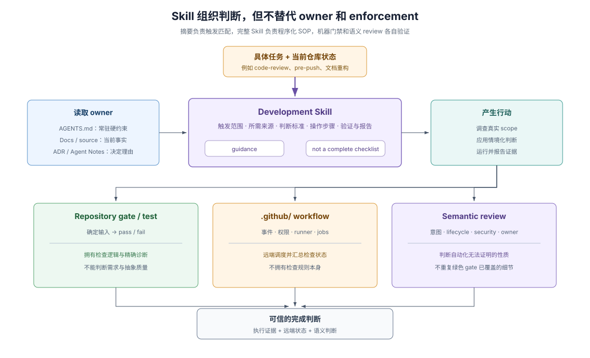

# 03 · Skills：把复杂判断封装成按需加载的程序化工作记忆

## 常驻规则与布尔门禁之间缺失的中间层

在建设 Agent-Friendly Repo 时，团队最容易陷入两极分化：要么把所有操作细节全塞进根 `AGENTS.md`，导致每次新会话还没开始干活就被迫吞下几千词与当前任务无关的流程噪音；要么只靠 `lint` 和单测给布尔红绿灯，把“推送前该挑哪组最小测试”“怎样排查异步生命周期竞态”“旧设计文档该留还是该封存”这类无法写成单条正则的工程判断继续留在老员工脑子里。

这类任务的共同特征是：**触发具有情境性、过程包含多步调查与权衡、产出需要诚实交代验证边界**。DSH 在常驻规则（`AGENTS.md`）与机械门禁（repository gates）之间，专门设立了 `.agents/skills/` 层来承载这种 **procedural memory（程序化工作记忆）**。

> Skills (`.agents/skills/`) | Reusable workflows and specialized decision standards
>
> — DSH [`docs/AGENTS.md` 的层级表](https://github.com/deepseek-ai/deepseek-harness/blob/master/docs/AGENTS.md#the-tier-taxonomy-one-home-per-fact)。这一定义把 Skill 精确锚定为“可复用工作流与专门判断标准”的权威归属，既不挤占每轮必读的常驻预算，也不冒充产品运行时 API 文档。

## 六类仓库知识载体的严格分工

在任何引入 Skill 机制的仓库里，第一步都是划清它与其余五类载体的边界——好的 Skill 只链接上游事实与下游脚本，绝不把别的载体复制一遍：

| 知识载体 | 核心回答的问题 | 上下文加载时机 | 绝不能越界替代什么 |
|---|---|---|---|
| **`AGENTS.md`** | 每轮改动都必须无条件遵守哪些硬红线与路由入口？ | 会话启动或进入对应目录子树时常驻加载 | 特定低频任务的多步排查手册 |
| **`SKILL.md`** | 遇到某类专门任务时，按什么顺序调查、权衡、验证并汇报？ | 任务语义命中 frontmatter `description` 时才按需加载 | 可写成非零退出码的确定性 pass/fail 检查 |
| **Repository Gate / Script** | 某条可机械判定的不变量此刻是否成立？ | 本地提交前、聚焦自检或 CI 跑批时执行 | 代码意图合理性与架构取舍优劣 |
| **`.github/` Workflow** | 在什么事件、权限隔离、操作系统矩阵下调度哪些检查？ | 远端推送、PR 触发或人工派发时执行 | 检查逻辑本身（逻辑应留在仓库脚本以便本地复现） |
| **架构文档 / 模块 README** | 系统此刻对外提供什么接口、遵循什么不变式？ | 修改或调用对应模块时按需读取 | 历史方案比较或临时评审清单 |
| **决策记录（ADR / Agent Note）** | 当年为什么选 A 拒 B、什么前提变了才重议？ | 触碰反直觉约束或准备推翻既有设计时读取 | 当前 API 用法或分步执行操作流 |

> This skill is guidance, not a complete checklist. [...] The report identifies paths and dirty layers but does not replace semantic review.
>
> — DSH [`dsh-code-review`](https://github.com/deepseek-ai/deepseek-harness/blob/master/.agents/skills/dsh-code-review/SKILL.md)。这段自我设限点明了 Skill 的本质：它帮 coding agent 收敛注意力、排定调查次序，但绝不把需要理解业务意图的语义评审降格成机械打勾。

## 一个高信噪比开发 Skill 的五步执行闭环与四条写法准则

当 coding agent 在仓库中遇到匹配任务时，标准调用闭环分为五步：**Match（按描述匹配）→ Load（动手前先读完整 `SKILL.md`）→ Resolve owners（顺着链接读取当前规则与源码权威文件）→ Apply judgment（结合实际 diff 与风险施用判断标准）→ Verify & Report（执行匹配的门禁与测试，如实报告已跑命令与未覆盖边界）**。为了让任意 agent host 都能稳定走通这五步，编写仓库级 `SKILL.md` 时可直接复用四条工程准则：

1. **`description` 只写触发时机与问题症状，不写空泛宣传语。** Agent 决定要不要加载一份 Skill，全看 YAML frontmatter 里的两行 `description`。应直接点名触发动作与典型坏味道（例如“在推送、强推或宣称检查通过前用于按改动面选择最小测试集”“在审查异步卸载、单例状态与清理顺序时使用”），让匹配零歧义。
2. **严禁凭目录摘要脑补步骤，未加载正文前不得声称已遵循。** 目录只负责路由发现，完整正文与同目录 `references/`、`scripts/` 才拥有操作约束——正如 DSH 在工具侧对模型立下的同一条渐进披露铁律：

> This catalog contains summaries only; do not infer or follow a skill's instructions until it has been loaded.
>
> — DSH [`@deepseek-ai/dsh-tool-skill` README](https://github.com/deepseek-ai/deepseek-harness/blob/master/packages/skill/tool-skill/README.md)。无论在产品运行时还是仓库开发侧，“摘要管发现、全文管执行”都是控制上下文窗口膨胀而不丢精度的核心机制。

3. **显式写清禁区（Exclusions）与过矫陷阱（Overcorrection Traps）。** 告诉 agent 什么能做只完成了一半；真正老练的 Skill 还会明确标出绝对不能误伤的边界（例如清理注释残渣时严禁触碰 `vendor/` 与已封存归档树、严禁把真实的静态检查豁免理由当成废话删掉）。
4. **要求结构化、可核验的交付报告。** 在 Skill 末尾规定汇报格式——例如必须列出实际跑过的命令、每个发现项的文件行号与所有权证据，以及因缺少凭据或跨平台环境而留给远端 CI 验证的边界，从源头掐断 agent“没跑硬说全绿”的幻觉。

## DSH 实证：开发侧 Skills 全景与同名概念辨析

在阅读 DSH 源码时，要先区分两套同样采用“渐进披露”思想但服务对象完全不同的设施：**仓库开发 Skills**（位于 `.agents/skills/`，服务于修改代码库的 coding agent）与 **产品运行时 Skill 能力**（位于 `packages/skill/`，由 Service Definition、本地文件系统 Provider 与模型侧 `skill` 工具组成，服务于终端用户的会话代理）。两者互不共享注册表。

DSH 主仓 `.agents/skills/` 将高频复杂判断收敛为五组专门工作流（其中 `agent-experience/SKILL.md` 通过符号链接指向 `packages/preset/agent-preset/skills/agent-experience/SKILL.md`，让仓库开发代理与产品内置预设复用同一套工具定义精简准则；通用新建仓库起步只需挑最痛的 2–3 个场景编写，模板见 [第 10 章](./10-agent-ready-repo-blueprint.md)）：

| 任务领域 | DSH 仓库开发 Skills 样本 | 封装的核心判断逻辑 |
|---|---|---|
| **决策新陈代谢与简化** | `dsh-archive-agent-notes`、`dsh-find-simplifications`、`agent-experience` | 按“未来决策指导价值”而非字数或年龄裁决去留；识别死代码与过度抽象；压缩工具上下文开销 |
| **文档、表达与破坏性变更** | `dsh-doc`、`dsh-prose-standard`、`dsh-trim-cot-leakage`、`dsh-translate-docs`、`dsh-create-upgrade-guide` | 维护单事实归属与双语行对齐；剥离会话推理残渣；在破坏外部可感知表面时同步产出升级指南 |
| **界面体验与视觉资产** | `dsh-client-ui-ux`、`dsh-responsive-ui`、`dsh-official-plugin-artwork` | 约束视觉 token 复用、窄屏防截断与键盘可达性、官方图标比例与设计师准入 |
| **故障与恢复契约** | `dsh-error-handling` | 区分可自愈业务错误与配置期致命错误，明确错误归属、隔离半径与用户可行动提示 |
| **交付选测、评审与性能** | `dsh-pre-push-checks`、`dsh-code-review`、`dsh-merging-stacked-prs`、`dsh-ci-test-reliability`、`dsh-speed-up-perf`、`cordis-styling-nitpicking`、`record-browser-gif` | 按 diff 选最小可信本地检查、堆叠 PR 同步校验、排查并发/时钟/端口抖动、审计插件生命周期竞态、录制真实界面演示 |

## 证据入口

- DSH [`.agents/skills/`](https://github.com/deepseek-ai/deepseek-harness/tree/master/.agents/skills)：仓库开发 Skills 全集与 frontmatter 触发描述实例。
- DSH [`dsh-code-review`](https://github.com/deepseek-ai/deepseek-harness/blob/master/.agents/skills/dsh-code-review/SKILL.md) 与 [`dsh-pre-push-checks`](https://github.com/deepseek-ai/deepseek-harness/blob/master/.agents/skills/dsh-pre-push-checks/SKILL.md)：将语义审查聚焦与按改动范围选测写成可复用判断流程的代表样本。
- DSH [`dsh-trim-cot-leakage`](https://github.com/deepseek-ai/deepseek-harness/blob/master/.agents/skills/dsh-trim-cot-leakage/SKILL.md) 与 [`dsh-archive-agent-notes`](https://github.com/deepseek-ai/deepseek-harness/blob/master/.agents/skills/dsh-archive-agent-notes/SKILL.md)：显式声明禁区、过矫陷阱与语义归档判据的高阶 Skill 范本。
- DSH [`@deepseek-ai/dsh-skill` README](https://github.com/deepseek-ai/deepseek-harness/blob/master/packages/skill/skill/README.md)、[`@deepseek-ai/dsh-skill-filesystem` README](https://github.com/deepseek-ai/deepseek-harness/blob/master/packages/skill/skill-filesystem/README.md) 与 [`@deepseek-ai/dsh-tool-skill` README](https://github.com/deepseek-ai/deepseek-harness/blob/master/packages/skill/tool-skill/README.md)：产品运行时侧渐进披露目录与按需加载能力的对照实现。
